# LeonidApp — Documentación completa del proyecto

> **Estado del documento:** documento de consulta derivado (cuarto documento maestro de consulta). **La sección §0 es el estado objetivo vigente (FASE 1) y prevalece sobre cualquier cifra o descripción histórica del resto del texto** (instantánea del 2026-11-18, conservada solo como contexto). Se generó el 2026-11-18 contrastando los documentos del proyecto con el **código real, la base de datos y la aplicación en ejecución**. Si este documento y los tres documentos maestros de `docs/` (`LeonidApp-Arquitectura-Datos-MongoDB.md`, `LeonidApp-Rutas-SEO-Monetizacion.md`, `LeonidApp-UI-NUI-DesignSpec.md`) difieren, **mandan los maestros**, salvo que aquí se marque expresamente una brecha entre lo documentado y lo implementado.

## Cómo leer este documento

**Para qué sirve.** Describe de forma explícita todo lo que hay en LeonidApp (antes ATLAS VICE): requisitos, arquitectura, datos, API, seguridad, navegación, interfaz y estado de producción. Está pensado para conocer el producto a detalle y para **compararlo con un sitio de referencia consolidado** (§33).

**Qué es verificado y qué no.** (Las referencias a «inventarios» y «auditoría de conformidad» son revisiones de código hechas para este documento; sus resultados están incorporados aquí.) Cada afirmación técnica sale de uno de estos orígenes: el código fuente (con referencia `archivo:línea`), la base de datos local consultada en modo lectura, capturas de la app en ejecución o los documentos del proyecto. Lo que no se pudo comprobar está marcado como ❓.

| Marca | Significado |
| --- | --- |
| ✅ | Implementado y verificado |
| 🟡 | Parcial: existe pero le falta algo |
| ⚠️ | Divergente: el código hace algo distinto de lo documentado |
| ❌ | No implementado |
| ❓ | No verificado |
| `> ⚠️ **Brecha:**` | Bloque que señala una diferencia o un riesgo |

**Lectura rápida.** Si solo tienes unos minutos: §1 (estado actual), §32 (brechas y hoja de ruta) y §33 (matriz de comparación).

**Límites del documento.** No contiene costos ni fechas de lanzamiento, porque con los datos disponibles no se pueden estimar; §23 y §32 indican qué información haría falta. No contiene valores de claves, tokens ni variables de entorno (solo sus nombres). Los conteos de páginas del sitio de referencia son medidas externas del 2026-11-18 que no se verificaron contra el sitio.

## 0. Estado objetivo consolidado (vigente)

Esta sección recoge la arquitectura consolidada y las decisiones aprobadas por el propietario. Si un apartado posterior (instantánea histórica del 2026-11-18: «138 fichas», «0 marcadores», «lienzo SVG genérico», «datos de ejemplo», «AdSlot sin script», etc.) la contradice, **manda esta sección** y el apartado debe leerse como historia.

### 0.1 Stack

| Capa | Tecnología |
|---|---|
| Cliente | Vite + React + TypeScript (strict) + Tailwind CSS + Zustand + TanStack Query + idb-keyval (offline-first). Sin librería de router, de UI ni de mapas: el enrutado usa History API propia y el mapa es un canvas propio. **No se usa Leaflet.** |
| Servidor | Node.js + **Fastify** + Mongoose + Zod. **No se usa Express.** MongoDB es el único motor de persistencia. |
| Nativo | Capacitor (`com.leonidapp.companion`, `leonidapp://`). |

### 0.2 Datos (MongoDB)

Cifras vigentes (verificadas contando `server/data/*-editorial.json`):

| Colección | Documentos | Detalle |
|---|---|---|
| `entities` | **243** | armas **13**, vehículos **200**, guías **20**, mapa **10**, coleccionables 0 |
| `mapmarkers` | **10** | uno por ficha de mapa (bloque `marker` del lote editorial) |
| `officialnews` | **1** | `take-two-ir` (únicamente fuentes oficiales Rockstar / Take-Two) |

El catálogo se alimenta de lotes editoriales 100 % originales en `server/data/*-editorial.json`, importados con `pnpm --dir server import:catalog <archivo.json> --apply --source editorial`. Las 12 colecciones (las 10 originales más `MediaAsset`, aprobada el 2026-11-21 para las imágenes del carrusel del Hero, y `PipelineRun`, para el registro del pipeline de datos) y sus campos siguen cerrados según `docs/LeonidApp-Arquitectura-Datos-MongoDB.md`.

### 0.3 Mapa (`/mapa`)

- Base cartográfica HD en `public/map-tiles/`: pirámide de teselas WebP, manifiesto vigente `v: 7`, **5 niveles (z = 0..4)**, `tileSize` 512, nivel z4 nativo **6600 x 9300** px, cargada bajo demanda (fuera del bundle JS).
- Render: **canvas** para las teselas (decodificadas como `ImageBitmap`) más una **capa SVG de marcadores** superpuesta. Sin rótulos SVG de lugares sobre la base y sin Leaflet.
- **Sin atribución visible** sobre el mapa, por decisión del propietario.
- Deep link `/mapa?pin=<slug>`. El Modo Editor de pines pertenece al panel oculto (§0.5), no a la UI pública.

### 0.4 Catálogo, guías, foro y noticias

- Catálogo: `/catalogo/:categoria` y `/catalogo/:categoria/:itemSlug` con SSR-lite y JSON-LD (`CollectionPage`, `CreativeWork`, `BreadcrumbList`); la navegación se sincroniza con la URL. En móvil, **Bottom Sheet master-detail** que reutiliza `EntityDetailPanel`.
- `/catalogo/mapa` y `/catalogo/mapa/:slug` responden **301** a `/mapa` y `/mapa?pin=<slug>`. `/catalogo/ARMAS` (mayúsculas) se normaliza con **301** a minúsculas.
- Categorías vacías (hoy `coleccionables`): `noindex`, estado vacío limpio y fuera del `sitemap.xml`.
- Guías: `/guias` y `/guias/:slug` (`HowTo` cuando `metadata_json.steps` existe, si no `Article`), máximo 2 `AdSlot`.
- Foro: público en lectura; la API pública expone de cada autor **solo `id`, `username` y `avatar_url`** (nunca el rol).
- Noticias oficiales: `/noticias` y `/noticias/:slug`; ingesta por worker solo de hosts oficiales en lista blanca.

### 0.5 Política de invisibilidad de Gestión de Identidades y Panel Oculto

Cero exposición pública: ni UI pública, ni dock, ni footer, ni Hub, ni `robots.txt`, ni `sitemap.xml`.

1. **Ruta oculta `/_staff`** (cliente y SSR). No se enlaza desde ninguna página pública.
2. **Chunks aislados:** el código del panel sale del build en `/_staff/assets/`. El servidor **solo** sirve esos archivos a una sesión de staff autorizada: MODERATOR+ para moderación; ADMIN+ para contenido público y editorial; SUPER_ADMIN para Control Total, roles, identidades y auditoría. En cualquier otro caso responde un **404 uniforme**, idéntico al de una ruta inexistente.
3. **API administrativa:** `/api/admin/*` y los POST/PATCH/DELETE administrativos de catálogo, mapa, roles, configuración y auditoría devuelven ese mismo **404 genérico** a quien no tenga sesión de staff autorizada. El RBAC real se evalúa **antes** que la validación Zod (no se distingue 401/403/400 hacia fuera).
4. **Cliente:** trata como «sin acceso» solo el 404 uniforme (cuerpo exacto `{"error":"No encontrado"}`, sin `code`); un 404 de recurso a staff autorizado lleva `code:"RESOURCE_NOT_FOUND"` y no expulsa. Con trabajo abierto, el panel muestra el modal «Sesión caducada» en lugar de desmontarse.
5. **Verificación de build:** ningún chunk público contiene las cadenas `SUPER_ADMIN`, `Control Total` ni `/api/admin/`.
6. **Limitación documentada y aceptada:** el panel requiere red y el mismo origen web; no funciona offline ni en Capacitor.

#### 0.5.1 Arquitectura funcional del panel `/_staff` (mapa de la app pública)

El panel se organiza por **módulo público que gobierna**, no por tecnología. Cada bloque muestra «Qué controla en la app pública» y un enlace a esa vista pública (`target="_blank" rel="noopener"`). Las cuatro secciones aparecen según el rol; el servidor decide siempre (404 uniforme a quien no corresponda).

| Sección (rol mínimo) | Bloque | Qué controla en la app pública | Vista pública | Endpoints `/api` que consume (rol) |
| --- | --- | --- | --- | --- |
| **Resumen operativo** (MODERATOR+, pantalla de entrada) | Resumen | Tarjetas accionables que enlazan a su sección: aportes pendientes por tipo y antigüedad del más viejo; estado real del worker de noticias y último error por fuente (o «sin errores registrados»); cobertura del catálogo por módulo; pines sin ficha y fichas del módulo `mapa` sin pin; últimas 10 acciones de auditoría (SUPER_ADMIN todas, el resto solo las propias). Contenido filtrado por rol: MODERATOR solo ve aportes de moderación (sin contact/newsletter) y sus propias acciones; ADMIN+ añade worker, cobertura y pines | — (interno) | `GET /api/admin/overview` (MODERATOR, `Cache-Control: private, no-store`); `GET /api/admin/submissions/pending-count` (MODERATOR; insignia dinámica de la pestaña «Comunidad y moderación», refetch cada 60 s con la pestaña visible) |
| **Contenido público** (ADMIN+) | Catálogo | Las 243 fichas de `armas`, `vehiculos`, `coleccionables`, `guias` y `mapa`: filtro por módulo, buscador por nombre/slug (`?q=`), paginación del servidor, alta/edición/borrado | `/catalogo`, `/catalogo/:categoria/:itemSlug` | `GET /api/entities?module&q&page&limit&envelope=1` (público); `POST/PATCH/DELETE /api/entities` (ADMIN). Columna «Pin» por ficha (estado del pin vinculado) y acceso a `/mapa?editor=1&entity=<slug>`; borrar una ficha con pines devuelve `409 HAS_DEPENDENTS` con recuento y títulos |
| | Mapa interactivo | Los 10 marcadores de `/mapa` (coordenadas, región, entidad vinculada con selector de búsqueda remota y enlace «Abrir ficha»). Un marcador existente está publicado (no hay borradores: `MapMarker` no tiene estado). Acceso directo al Modo Editor (`/mapa?editor=1`) | `/mapa` | `GET /api/markers` (público); `POST/PATCH/DELETE /api/markers` (ADMIN) |
| | Portada (Hero) | Diapositivas del carrusel del Hero de `/` (máx. 6): miniatura, título, estado Activa/Pausada, orden, edición y borrado con confirmación; kicker, título, descripción, botón (texto y enlace), botón secundario opcional para invitados, imagen (subida 1600×900 o enlace https) y texto alternativo; vista previa. Sin diapositivas activas se muestra la diapositiva por defecto | `/` | `GET /api/hero` (público); `GET/PUT /api/admin/hero` y `POST /api/admin/media` (ADMIN); `GET /media/:id` (público) |
| | Módulos del catálogo | Los 7 módulos: activación (oculta/muestra navegación y rutas), orden y metadatos (nombre, icono, slug). No se borra un módulo con fichas | Dock y `/catalogo` | `GET /api/modules?all=1` (ADMIN, `no-store`); `POST/PATCH/DELETE /api/modules` (ADMIN) |
| **Comunidad y moderación** (MODERATOR+) | Aportes | Bandeja de `/aportar`: revisar, aprobar (crea/actualiza la entidad o el marcador con auditoría) o rechazar. Contacto y suscripciones solo para ADMIN+ | `/aportar` | `GET /api/admin/submissions?status&limit&origin&runId&reason` (MODERATOR), `PATCH /api/admin/submissions/:id`, lote `POST /api/admin/submissions/bulk` y miniatura `GET /api/admin/submissions/:id/tarjeta.webp` (MODERATOR) |
| | Foro | Hilos y respuestas: fijar, cerrar (`is_locked`), editar título/contenido/categoría/spoiler, eliminar (con sus votos) | `/foro` | `GET /api/admin/forum/threads?q&categoria&page`, `GET /api/admin/forum/threads/:id`, `PATCH /api/admin/forum/threads/:id`, `PATCH /api/admin/forum/posts/:id`, `DELETE /api/forum/threads/:id`, `DELETE /api/forum/posts/:id` (todos MODERATOR). Los aportes muestran el payload formateado, tabla Actual vs Propuesto en correcciones, errores 422 desglosados, rechazo con motivo (`Submission.reviewNote`), selección múltiple con cola de 3 peticiones concurrentes y enlace «Ver ficha»/«Ver pin» (`promotedTo`). Aprobar un aporte `entity` con `payload.marker` crea en la misma transacción el `MapMarker` vinculado |
| **Editorial y automatización** (ADMIN+) | Worker de noticias | Estado del worker de noticias oficiales (fuentes en lista blanca, último ciclo, resultado por fuente, próximo ciclo, noticias por fuente) y ejecución manual (una a la vez, 409 si ya corre, limitada por cuota) | `/noticias` | `GET /api/admin/news/status`, `POST /api/admin/news/sync` (ADMIN) |
| | Pipeline de datos y catálogo (ETL) | Tarjeta bajo «Noticias oficiales»: estado activo/en espera, métricas del último lote (creados, actualizados, sin cambios, conflictos, rechazados con motivos por `slug`), enlace a Auditoría filtrada por `system:pipeline` y botón «Sincronizar ahora» (desactivado con aviso si falta `PIPELINE_WEBHOOK_URL`) | `/catalogo` | `GET /api/admin/pipeline/runs`, `POST /api/admin/pipeline/trigger` (ADMIN) |
| | Guías | Guías publicadas (módulo `guias`): lista, edición y enlace a su página pública con `HowTo`/`Article` | `/guias`, `/guias/:slug` | los de Catálogo con `module=guias` |
| **Control Total** (SUPER_ADMIN) | Configuración | `announcement` (Hub), `maintenance_mode` (aviso en acceso), proveedores de acceso (1 a 4, sin duplicados), `feature_flags`, redes sociales (footer) | `/`, `/hub`, footer | `GET /api/config`; `PATCH /api/admin/config` |
| | Monetización | `AppConfig.monetization`: interruptor global, proveedor, `publisher_id`, hasta 20 slots; el servidor valida ruta/posición permitidas (Rutas §6.1), máximo 2 slots activos por ruta, ids únicos y `publisher_id` si AdSense está activo. Verificación de cada ruta contra una página real (`HEAD`) | `/guias`, `/noticias`, `/catalogo/:categoria/:itemSlug`, `/foro` | `PATCH /api/admin/config` |
| | Identidades y roles | Listado paginado con búsqueda y filtro por rol; cambio de rol `USER/MODERATOR/ADMIN/SUPER_ADMIN` (no degrada al último SUPER_ADMIN); revocación de sesiones (`User.sessions_revoked_at`) | — (interno) | `GET /api/admin/users?q&rol&page`, `PATCH /api/admin/users/:id/role`, `POST /api/admin/users/:id/revoke-sessions` |
| | Auditoría y salud | Bitácora filtrable (acción, tipo de objetivo, actor, fechas, paginada) y salud: ping y conteos de MongoDB, proceso, worker, caché SSR/ETag; vaciado de caché SSR | — (interno) | `GET /api/admin/audit-logs`, `GET /api/admin/health`, `POST /api/admin/cache/clear`, `POST /api/admin/audit-logs/:id/restore` (restaura lo borrado; SUPER_ADMIN). Historial «de este objeto» en `GET /api/admin/history?target_type&target_id` (MODERATOR+; ADMIN y MODERATOR solo ven sus propias entradas, SUPER_ADMIN todas) |

Reglas transversales del panel: toda mutación escribe `AuditLog` (actualizaciones con `before`/`after` de los campos cambiados; borrados con `snapshot` completo, incluidos los hijos de un hilo; convención y política de tamaño en Arquitectura §2.10); el 404 uniforme lleva el cuerpo exacto `{"error":"No encontrado"}` y un 404 de recurso solo visible a staff autorizado añade `code:"RESOURCE_NOT_FOUND"` (el cliente expulsa únicamente ante el 404 sin `code`; nunca se emite un código distinto de 404 a quien no es staff); **prevención de errores humanos:** borrar ficha, pin, módulo o hilo exige escribir el `slug` exacto (o id/título corto si no hay slug) y muestra los dependientes (`GET /api/admin/dependents/:type/:id`), la auditoría ofrece «Restaurar» solo a SUPER_ADMIN (`*.restore`, mismo `_id`, 409 si el `_id` o el `slug` ya existen), los modales del panel no se cierran con el clic en el fondo, avisan de cambios sin guardar y conservan un borrador en memoria (Zustand, clave tipo+id; nunca `localStorage`), y un 401 o un 404 uniforme con trabajo abierto muestra el modal «Sesión caducada» sin desmontar el panel ni el formulario; la URL del panel (`/_staff?s=&b=&q=&m=&p=`) refleja sección, bloque y filtros (History API, solo dentro de `/_staff`); atajos `/` (enfoca el buscador del bloque, si el foco no está en un campo) y `Esc` (cierra detalle/modal); los datos de las pestañas se leen sin caché pública (`no-cache`/`no-store`) para reflejar al instante los cambios; márgenes inferiores `pb-28` + `env(safe-area-inset-bottom)` para que el dock no tape acciones; toasts de éxito/error en cada acción. Sin campos nuevos salvo `User.sessions_revoked_at`, `ForumThread.is_locked` y `Submission.reviewNote` (ver Arquitectura §2.1, §2.8 y §2.9) más el índice `MapMarker { entity_id }` (§2.5); no hay estado «borrador» en `Entity` ni `MapMarker` (limitación documentada). Los chunks `staff-*` sirven a MODERATOR+ y `staff-ctl-*` solo a SUPER_ADMIN.

Componentes (carpeta `src/components/ui/`): chunk `staff-panel` = `StaffKit`, `StaffContent`, `StaffCommunity`, `StaffModeration`, `StaffEditorial` y `pages/StaffPage.tsx`; chunk `staff-ctl-panel` = `StaffControl`, `StaffIdentity`, `StaffAudit`. `StaffContent.tsx` sustituye a `CatalogAdminPanel.tsx` (retirado). Sesiones: `lv_session` se invalida si su emisión es anterior a `User.sessions_revoked_at`. Las respuestas a un hilo cerrado devuelven 409 y la UI pública lo muestra con el hilo en solo lectura.

### 0.6 Alcance de `/aportar`

Buzón comunitario 100 % público para enviar sugerencias (marcadores, fichas, correcciones). No menciona moderación, roles, administración ni endpoints internos. El dock mantiene 5 ítems (Hub, Mapa, Catálogo, Foro, Aportar) y el footer dice «Aportar» (no «Aportes y moderación»). La revisión y promoción de aportes ocurre solo en el panel oculto (§0.5).

### 0.7 SEO, API y seguridad

- `robots.txt`: únicamente `Disallow: /api/` (más `Allow: /` y `Sitemap:`). Las páginas privadas se protegen con `noindex` por meta, no listándolas en robots (así no se revelan rutas ocultas).
- `GET /api/entities`: paginación (`?limit=&page=`) y filtro `?module=`, compresión y `Cache-Control`/`ETag`.
- **Carrusel del Hero (2026-11-21):** `AppConfig.hero_slides` (máx. 6, campos y límites en Arquitectura §2.2), editable por ADMIN+ en `/_staff` → Contenido público → «Portada (Hero)» con `GET/PUT /api/admin/hero`; lectura pública `GET /api/hero`; subida de imágenes `POST /api/admin/media` (cuerpo binario WebP/JPEG, validado por firma real y dimensiones exactas **1600 × 900 px, ≤ 400 KB**, guardado en `MediaAsset`) y lectura pública `GET /media/:id` (caché inmutable, sin listado). El Hero actual es la diapositiva por defecto cuando no hay ninguna activa. La CSP abre `img-src` a `https:` (decisión del propietario: enlaces a imágenes de cualquier dominio https; riesgo: fuga de IP/Referer al host de la imagen y contenido externo mutable).
- Cabeceras: CSP y HSTS (HSTS solo en producción), además de `nosniff`, `X-Frame-Options: DENY`, `Referrer-Policy` y `Permissions-Policy`; cookies `Secure` bajo https.
- Si la API falla, el cliente muestra un **fallback honesto con reintento**: no se inventan datos de ejemplo.
- `/entrar`: máximo 4 botones; los proveedores con `configured:false` se ocultan o se marcan «Próximamente».
- Hub: «Rutas sugeridas» permanece oculta mientras no existan rutas reales.
- Monetización: `AdSlot` condicionado a `leonidapp_consent` (Marketing), carga diferida con `IntersectionObserver`, CLS = 0, nunca en `/mapa`, `/hub`, `/progreso`, `/aportar`, `/entrar` ni en Capacitor.

## Índice

**Parte I — Producto, requisitos y procesos**

- [§0. Estado objetivo consolidado (vigente)](#0-estado-objetivo-consolidado-vigente)
- [§1. Resumen ejecutivo y estado actual](#1-resumen-ejecutivo-y-estado-actual)
- [§2. Especificación técnica y arquitectura del sistema](#2-especificación-técnica-y-arquitectura-del-sistema)
- [§3. Requisitos funcionales y no funcionales](#3-requisitos-funcionales-y-no-funcionales)
- [§4. Historias de usuario (backlog priorizado)](#4-historias-de-usuario-backlog-priorizado)
- [§5. Mapa de procesos (flujo operativo y de retención)](#5-mapa-de-procesos-flujo-operativo-y-de-retención)
- [§6. Diagramas de casos de uso](#6-diagramas-de-casos-de-uso)

**Parte II — Datos, roles y acceso**

- [§7. Propósito y estrategia de escalabilidad de datos](#7-propósito-y-estrategia-de-escalabilidad-de-datos)
- [§8. Modelo de datos escalable](#8-modelo-de-datos-escalable)
- [§9. Diagrama Entidad-Relación (DER)](#9-diagrama-entidad-relación-der)
- [§10. Diccionario de entidades y relaciones](#10-diccionario-de-entidades-y-relaciones)
- [§11. RBAC (roles y permisos)](#11-rbac-roles-y-permisos)
- [§12. Autenticación y sesión](#12-autenticación-y-sesión)
- [§13. Regla de aprobación automática de aportes](#13-regla-de-aprobación-automática-de-aportes)
- [§14. Pipeline y estado del catálogo de datos](#14-pipeline-y-estado-del-catálogo-de-datos)

**Parte III — Backend, SEO, seguridad e infraestructura**

- [§15. API REST completa](#15-api-rest-completa)
- [§16. Servicios y worker de noticias oficiales](#16-servicios-y-worker-de-noticias-oficiales)
- [§17. SEO técnico (SSR-lite, sitemap, robots)](#17-seo-técnico-ssr-lite-sitemap-robots)
- [§18. Monetización (AdSlot)](#18-monetización-adslot)
- [§19. Seguridad](#19-seguridad)
- [§20. Estructura de carpetas (real vs permitida)](#20-estructura-de-carpetas-real-vs-permitida)
- [§21. Configuración, ejecución y scripts](#21-configuración-ejecución-y-scripts)
- [§22. Calidad, pruebas e infraestructura](#22-calidad-pruebas-e-infraestructura)
- [§23. Camino a producción](#23-camino-a-producción)

**Parte IV — Navegación, interfaz y móvil**

- [§24. Arquitectura de navegación (modelo jerárquico compuesto)](#24-arquitectura-de-navegación-modelo-jerárquico-compuesto)
- [§25. Mapa de navegación visual](#25-mapa-de-navegación-visual)
- [§26. Adaptabilidad web vs móvil (iOS y Android)](#26-adaptabilidad-web-vs-móvil-ios-y-android)
- [§27. Wireframes estructurales (escritorio NUI vs móvil)](#27-wireframes-estructurales-escritorio-nui-vs-móvil)
- [§28. Sistema de diseño Vice Sunset NUI](#28-sistema-de-diseño-vice-sunset-nui)
- [§29. Catálogo de pantallas (una por una)](#29-catálogo-de-pantallas-una-por-una)
- [§30. App nativa (Capacitor)](#30-app-nativa-capacitor)

**Parte V — Conformidad, brechas y comparación**

- [§31. Conformidad con los documentos maestros (matriz resumida)](#31-conformidad-con-los-documentos-maestros-matriz-resumida)
- [§32. Brechas priorizadas y hoja de ruta](#32-brechas-priorizadas-y-hoja-de-ruta)
- [§33. Matriz de comparación con un sitio de referencia (GTABase)](#33-matriz-de-comparación-con-un-sitio-de-referencia-gtabase)
- [§34. Glosario](#34-glosario)

---

## 1. Resumen ejecutivo y estado actual

### 1.1 Qué es el producto

**LeonidApp** es un compañero web y móvil para GTA VI (ambientado en Leonida / Vice City). Agrupa en una sola aplicación: un **mapa** interactivo, un **catálogo** tipo Inspector (armas, vehículos, coleccionables), **guías** paso a paso con checklist, **noticias oficiales** de Rockstar Games / Take-Two, un **foro** comunitario con hilos ligados a fichas y puntos del mapa, y un **tracker de progreso** (% global y por categoría). Se usa sin cuenta (modo Invitado, progreso en el dispositivo) o con cuenta (progreso sincronizado en la nube). Identificador de la app nativa previsto: `com.leonidapp.companion`; esquema de deep links previsto: `leonidapp://` (ver brecha en §1.3 y §2.1).

### 1.2 Propuesta de valor

| Para quién | Valor que el sistema ya ofrece (verificado) | Valor que el diseño promete y aún no existe |
|---|---|---|
| Jugador sin cuenta | Entrar y usar mapa, catálogo, guías y progreso sin registro; el progreso queda en IndexedDB (`src/store/useProgressStore.ts`) | Mapa con pines reales (resuelto: 10 marcadores, §0.3) |
| Jugador con cuenta | Progreso fusionado y sincronizado entre dispositivos (`PUT /api/progress`, last-write-wins); foro completo; aportes | Notificaciones/racha de regreso diario; login nativo por deep link |
| Comunidad | Buzón público `/aportar` (marcador, ficha, corrección); la revisión ocurre solo en el panel oculto | Subida de imágenes propias (solo URL), "reportar mensajes" |
| Equipo editorial | Panel oculto de staff en `/_staff` (CRUD catálogo/mapa/módulos, moderación, roles, configuración, auditoría; §0.5) e importador de catálogo desde grabaciones | Gestión de fuentes de noticias desde el panel |
| Negocio / SEO | Páginas con metadatos, JSON-LD, `sitemap.xml` y `robots.txt` generados por el servidor; hueco publicitario (`AdSlot`) | Ingresos: el `AdSlot` no carga ningún script de anuncios (ver §3, RF-12) |

### 1.3 Estado real (instantánea histórica 2026-11-18; superada por §0)

> **Vigencia:** las cifras y brechas de §1.3 a §1.5 (227 entidades, 138 fichas de mapa, 0 marcadores, lienzo SVG genérico, avisos de «datos de ejemplo») son históricas. El estado vigente es §0: 243 entidades (armas 13, vehículos 200, guías 20, mapa 10), 10 `MapMarker`, 1 noticia oficial y mapa HD por teselas.

**Qué funciona (verificado en código y/o ejecución):** `pnpm typecheck` y `pnpm build` del cliente y del servidor pasan sin errores (el inventario de infraestructura); API Fastify activa en el puerto 3000 con MongoDB local; 13 rutas de cliente con History API; Invitado y progreso local; sincronización de progreso; foro con muro de registro para invitados; aportes y promoción automática; panel de administración por rol; SSR-lite (meta, canonical, Open Graph, JSON-LD), `sitemap.xml` y `robots.txt` dinámicos; Footer legal con Contact/Subscribe persistidos y modal de cookies; worker de noticias cada 15 min.

**Qué no funciona o no está completo:**

- **Mapa (histórico, resuelto):** entonces la base tenía 0 marcadores y el lienzo era un SVG vectorial propio (1000x700). Hoy hay 10 `MapMarker` sobre la pirámide de teselas HD (§0.3).
- **Monetización inoperante:** `AdSlot` solo reserva un hueco; no inyecta AdSense ni lee el consentimiento; `ads_enabled=false` y 0 slots configurados.
- **App nativa no lista:** proyectos Android/iOS generados pero con `appId` `com.atlasvice.app` y nombre "ATLAS VICE"; sin esquema `leonidapp://`, sin plugin `@capacitor/app`; el retorno por deep link no está cableado; la web embebida en `android/` es una compilación antigua.
- **Login real sin verificar de extremo a extremo:** los 4 botones dependen de credenciales de proveedores (Google, Discord, Apple) y SMTP, que son opcionales en `server/src/config/env.ts` (sin ellas el servidor responde 503). Sus valores no se verificaron (❓). OAuth pierde el parámetro `?next` tras el login (`server/src/routes/auth.ts:46`).
- **Error en el Magic Link de `/entrar`:** la validación de correo de `src/pages/LandingAuthPage.tsx:52` usa `/^S+@S+.S+$/` (faltan barras invertidas, confirmado en el código), de modo que un correo normal no pasa. El formulario del Footer sí valida bien.
- **Sin SUPER_ADMIN persistido:** la base tiene 4 USER y 1 ADMIN; ningún SUPER_ADMIN. El Panel Control Total solo se alcanza con `SUPER_ADMIN_EMAIL` o con el acceso demo de desarrollo (`server/src/scripts/demoAccess.ts`, se niega con `NODE_ENV=production`).
- **Noticias:** solo se ingiere Take-Two IR (1 noticia hoy). Rockstar Newswire (sin RSS/API) y YouTube (prohibido por su robots.txt) no se ingieren, aunque el modelo todavía los lista (`server/src/workers/sources.ts:22-27`).
- **Sin pruebas automatizadas, CI, linter, Dockerfile ni despliegue**; sin service worker ni manifest (no es PWA).
- **Derechos de imagen:** resuelto en el Sprint 4: `public/assets/` solo conserva `hero-gas-station.jpg`; las capturas con prefijos de terceros se eliminaron y la UI usa degradados Vice Sunset propios.

> ⚠️ **Brecha:** la auditoría de conformidad e el inventario del cliente hablan de "23 entidades y 20 marcadores de ejemplo". Eso **ya no está en la base** (se borró). Sigue existiendo en `server/src/scripts/seedData.json` y `src/data/seed.ts` como *fallback* cuando la API devuelve 0 entidades y 0 marcadores (`src/data/seed.ts:464-473`). Con 227 entidades en la API, el cliente usa datos de la API, no la semilla.

### 1.4 Contenido de ejemplo frente a contenido real

| Conjunto | Origen | Naturaleza |
|---|---|---|
| (Histórico) 225 fichas importadas de grabación (armas 12, vehículos 20, mapa 138, guías 55); sustituidas por el lote editorial vigente (§0.2) | `catalogo_grabaciones.json` (166 KB, versionado en `server/data/`): análisis por fotogramas de grabaciones de stream, con evidencia `fecha_sesión: t_NNNN@cuadrante ~ hh:mm:ss` y confianza (alta 154, media 63, baja 8) | Dato **derivado de grabaciones**, no oficial. El proceso de extracción no está en el repositorio (❓ no verificado). Estadísticas 0-10 del juego guardadas exactas en `metadata_json.stats_juego` y escaladas a 0-100 en `stats_json` |
| 2 guías "Basicos" | Semilla del servidor | Ejemplo |
| 6 hilos de foro y 9 posts | Semilla | Ejemplo |
| 5 usuarios (4 USER, 1 ADMIN) | Semilla/pruebas | Ejemplo |
| 1 noticia (Take-Two IR) | Worker | **Real y oficial** |
| 7 módulos, 1 AppConfig, 3 registros de auditoría | Configuración / uso | Real |
| 0 coleccionables, 0 marcadores, 0 aportes, 0 votos, 0 progresos | — | Vacío |

El catálogo aún muestra el aviso "Datos de ejemplo..." en ficha y guías (`CatalogPage.tsx:951`, `GuidesPage.tsx:316`). Con el contenido ya importado ese aviso puede ser engañoso (❓ no verificado visualmente).

### 1.5 Cifras de datos actuales

| Colección | Documentos | Detalle |
|---|---|---|
| `entities` | **227** (histórico; vigente: 243, ver §0.2) | mapa 138 (Negocios 43, Ciudades y Barrios 25, Puntos de Interés 22, Islas y Cayos 18, Aguas 16, Condados 14), guías 57 (55 de grabación + 2 semilla; Sistemas 15, Personajes 14, Misión Principal 11, Teléfono y Apps 8, Actividades 3, Tiendas 2, Talleres 2), vehículos 20, armas 12, coleccionables 0 |
| `mapmarkers` | 0 (histórico; vigente: 10) | — |
| `forumthreads` / `forumposts` / `forumvotes` | 6 / 9 / 0 | Hilos: General 2, Guías/Ayuda 2, Secretos 1, Crews 1 |
| `users` | 5 | USER 4, ADMIN 1, SUPER_ADMIN 0 |
| `modules` | 7 | mapa, armas, vehiculos, coleccionables, guias, foro activos; radio inactivo |
| `officialnews` | 1 | `take-two-ir` |
| `auditlogs` | 3 | — |
| `appconfigs` | 1 | auth: google/discord/apple/magic-link; mantenimiento off; monetización off, proveedor `none`, sin slots |
| `submissions` / `userprogresses` | 0 / 0 | — |

Tamaño del cliente: `src/` 7 868 líneas; compilación de producción: JS 495,51 kB (146,23 kB gzip), CSS 52,86 kB (10,56 kB gzip), 90 módulos.

### 1.6 Semáforo por módulo

Leyenda: 🟢 operativo para uso real · 🟡 funciona con limitaciones · 🔴 no operativo / bloqueante.

| Módulo | Semáforo | Estado real | Principal brecha |
|---|---|---|---|
| Mapa | 🔴 | Lienzo SVG con zoom, capas, búsqueda y ficha; **0 pines**: no hay nada que marcar | Cargar marcadores con coordenadas; decidir si el lienzo vectorial basta frente a un mapa real |
| Catálogo | 🟡 | Inspector, filtros, comparador 2-3 ítems, fichas con URL propia; 32 fichas de armas/vehículos | Coleccionables en 0; datos derivados de grabaciones, no oficiales; imágenes con derechos dudosos |
| Guías | 🟡 | 57 guías con pasos y progreso; checklist local | Calidad editorial de las 55 guías importadas sin revisar (❓); `AdSlot` puede mostrar 3 anuncios en una guía |
| Noticias | 🟡 | Worker cada 15 min, lista y detalle, solo oficiales | 1 sola fuente y 1 noticia; sin gestión de fuentes |
| Foro | 🟡 | Hilos, respuestas, votos, spoiler, fijar/borrar, muro para invitados | Contenido semilla; sin "reportar" ni "ocultar"; enlace Discord es un marcador de posición |
| Progreso | 🟡 | % global y por categoría, tip, sync nube | Sin marcadores casi no hay nada que completar; rutas sugeridas probablemente vacías (inferido de `DashboardPage.tsx:95-101`); sin racha ni notificaciones |
| Aportes / Moderación | 🟡 | Flujo completo con promoción automática (0 aportes reales) | Sin subida de imagen; sin pruebas con usuarios reales |
| Panel Control Total | 🟡 | Config, módulos, monetización, roles, auditoría | Ningún SUPER_ADMIN persistido; sin gestión de fuentes de noticias; auditoría legible por ADMIN (el diseño dice SUPER_ADMIN) |
| Auth | 🟡 | PKCE con 4 proveedores implementado; sesión por cookie HttpOnly | Credenciales y SMTP sin verificar; `?next` perdido; JWT sin revocación (7 días); bug de validación de correo en `/entrar` |
| SEO | 🟡 | SSR-lite, sitemap, robots, JSON-LD | Sin hreflang; `SearchAction` apunta a `/catalogo?q=` no implementado; sin registro de 301 por cambio de slug; solo opera con el servidor sirviendo `dist/` |
| Monetización | 🔴 | Solo huecos y panel de configuración | Sin carga de AdSense, sin consentimiento enlazado, ingresos = 0 |
| App nativa | 🔴 | Proyectos Android/iOS creados | Identidad incorrecta, sin deep link, web embebida antigua, sin plugins |

Ningún módulo está en 🟢: el producto es una **pre-alfa funcional** (primer commit el 2026-11-17, 32 commits, un solo autor).

---

## 2. Especificación técnica y arquitectura del sistema

### 2.1 Ficha técnica

| Atributo | Especificación |
|---|---|
| Nombre de producto | LeonidApp (wordmark heredado "ATLAS VICE" ya no visible); paquete cliente `atlas-vice` v0.1.0; servidor `leonidapp-server` v0.1.0 |
| Tipo | SPA + API REST, repositorio único (cliente en raíz, servidor en `server/`); ambos `"type": "module"` |
| Gestor de paquetes | pnpm (scripts `pnpm --dir server ...`) |
| Persistencia | MongoDB (único motor), 12 colecciones lógicas (14 archivos de modelo con `MediaAsset` y `PipelineRun`); local en `127.0.0.1:27017`, base `leonidapp` |
| Tiempo de ejecución servidor | Node.js (usa `--env-file-if-exists` y `--watch`); ES2023, `module: NodeNext` |
| TypeScript | `^7.0.2` en cliente y servidor; `strict`, `noUncheckedIndexedAccess`, `noUnusedLocals/Parameters` |
| Enrutado del cliente | Propio, sobre History API + Zustand (`src/store/useRouteStore.ts`); sin react-router |
| Librerías de UI externas | Ninguna (Zero Bloat); iconos como SVG inline (el diseño decía Lucide, que no está instalado) |
| Despliegue | No existe (sin Dockerfile, CI, hosting, dominio ni HTTPS) |

#### Dependencias del cliente (`package.json`)

| Paquete | Versión | Rol |
|---|---|---|
| react / react-dom | ^19.3.1 | UI |
| zustand | ^5.1.0 | Estado (auth, progreso, ruta) |
| @tanstack/react-query | ^5.107.1 | Caché y sincronización de datos de la API |
| idb-keyval | ^6.3.0 | Persistencia en IndexedDB |
| @capacitor/core, @capacitor/cli, @capacitor/android, @capacitor/ios | ^8.6.2 | Contenedor nativo (`cli` está en `dependencies`) |
| vite | ^8.3.8 (dev) | Empaquetado y servidor de desarrollo |
| @vitejs/plugin-react | ^6.3.0 (dev) | Plugin React |
| tailwindcss, @tailwindcss/vite | ^4.3.5 (dev) | Estilos |
| typescript | ^7.0.2 (dev) | Tipado |
| @types/react, @types/react-dom | ^19.3.0 (dev) | Tipos |

Scripts: `dev`, `typecheck`, `build` (`tsc --noEmit && vite build`), `preview`, `cap:sync`. No hay script de lint ni de pruebas.

#### Dependencias del servidor (`server/package.json`)

| Paquete | Versión | Rol |
|---|---|---|
| fastify | ^5.12.8 | Servidor HTTP |
| fastify-plugin | ^6.0.1 | Plugins sin encapsulado (auth) |
| @fastify/cookie | ^11.1.5 | Cookies firmadas y de sesión |
| @fastify/cors | ^11.4.3 | CORS con credenciales |
| @fastify/formbody | ^9.0.2 | `x-www-form-urlencoded` (callback de Apple) |
| @fastify/rate-limit | ^11.2.2 | Límite global 200/min; 15/min en rutas de auth |
| mongoose | ^9.12.2 | ODM de MongoDB |
| zod | ^4.6.7 | Validación de entrada |
| jose | ^6.2.17 | JWT HS256 de sesión; secreto de cliente y JWKS de Apple |
| node-cron | ^4.6.0 | Planificador del worker de noticias |
| fast-xml-parser | ^5.12.1 | Lectura de RSS/Atom |
| nodemailer | ^10.6.0 | Envío del Magic Link |
| dotenv | ^18.0.10 | Carga de `.env` |
| typescript ^7.0.2, @types/node ^26.6.6, @types/node-cron ^3.0.11, @types/nodemailer ^8.0.2 | dev | Tipado |

No hay `@fastify/static`, `@fastify/helmet` ni librerías de prueba: los estáticos y el *fallback* SPA los implementa `server/src/routes/seo.ts:282-324`, y no se emiten cabeceras de seguridad (CSP, HSTS, X-Frame-Options, nosniff).

Scripts del servidor: `dev` (compila una vez y vigila `dist/`; no recompila al editar `src`), `typecheck`, `build`, `start`, `seed`, `demo:access`, `import:catalog`.

| Verificación ejecutada | Resultado |
|---|---|
| `pnpm typecheck` (cliente) | OK |
| `pnpm build` (cliente) | OK: `index.html` 1,12 kB, CSS 52,86 kB (gzip 10,56), JS 495,51 kB (gzip 146,23) |
| Servidor `typecheck` y `build` | OK |
| Pruebas / linter / CI | **No existen** |

### 2.2 Capas y responsabilidades

| Capa | Ubicación | Responsabilidad |
|---|---|---|
| Presentación | `src/pages`, `src/components/{layout,ui}`, `src/styles/vice-nui.css` | 9 páginas, shell con dock y footer, componentes atómicos (`PalmButton`, `StatBar`, `TipCard`, `BottomSheet`, `Modal`, `AdSlot`, `CatalogAdminPanel`), tokens Vice Sunset |
| Estado cliente | `src/store/{useAuthStore,useProgressStore,useRouteStore}` | Sesión y rol (sin tokens), progreso offline-first, enrutado |
| Acceso a datos cliente | `src/data/seed.ts`, `src/types/database.ts` | Hooks TanStack Query (`useWorldData`, `useForumData`, `useOfficialNews`, `usePublicConfig`, `useEntityDetail`), *fallback* semilla |
| Contenedor nativo | `capacitor.config.ts`, `android/`, `ios/` | Empaquetar `dist/` como app (hoy sin plugins) |
| API | `server/src/routes/*` (9 archivos) | Endpoints REST con validación Zod y autorización por rol |
| Dominio / servicios | `server/src/services/*` (audit, mailer, oauth, session, ssrLite, submissions, users, validate) | Reglas de negocio: promoción de aportes, sesión, PKCE, SSR-lite, auditoría |
| Plugin de autenticación | `server/src/plugins/auth.ts:25-33` | Lee cookie `lv_session`, verifica el JWT y **recarga el usuario desde BD en cada petición** (el rol se lee de BD, no del token) |
| Persistencia | `server/src/models/*` | Esquemas Mongoose con índices; esquema Zod equivalente valida cada entrada |
| Tareas en segundo plano | `server/src/workers/{officialNewsWorker,sources}` | Ingesta de noticias oficiales |
| Utilidades de operación | `server/src/scripts/{seed,importCatalog,demoAccess}` | Semilla, importación de catálogo, acceso demo |

### 2.3 Diagrama de arquitectura

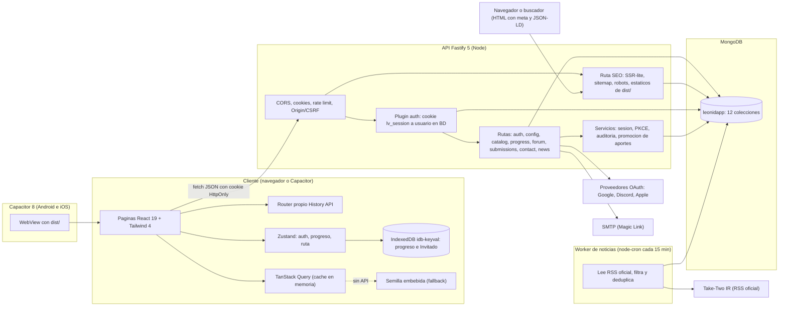

### 2.4 Decisiones de arquitectura

| Decisión | Qué implica | Estado y evidencia |
|---|---|---|
| **Offline-first** | La app arranca con datos de IndexedDB y semilla; la red solo sincroniza. El progreso se guarda local y se empuja cuando hay sesión y conexión | 🟡 Progreso offline sí (`useProgressStore.ts`); la caché de datos del servidor vive solo en memoria (sin `persistQueryClient`) y no hay service worker |
| **History API sin router externo** | URLs limpias (`/catalogo/armas/pistola`) con un router propio; migra `#/ruta` a `/ruta` | ✅ `useRouteStore.ts:390-503` |
| **SSR-lite en Fastify** | El servidor sirve el `index.html` del cliente con `<title>`, descripción, canonical, Open Graph, Twitter y JSON-LD según la ruta, sin renderizar React en servidor; 404 reales con `noindex`; caché de 5 min | ✅ `server/src/services/ssrLite.ts`; 🟡 la caché no se invalida en el CRUD de administración |
| **RBAC en servidor** | Jerarquía `GUEST < USER < MODERATOR < ADMIN < SUPER_ADMIN`; cada ruta aplica `requireAuth`/`requireRole`; el rol se lee de BD en cada petición; las guardas del cliente son cosméticas | ✅ `plugins/auth.ts:15-33` |
| **Polimorfismo `Entity` + JSON** | Una sola colección `Entity` para armas, vehículos, mapa, guías y coleccionables, con `stats_json` y `metadata_json` flexibles y clave única `{module_id, slug}`; añadir un módulo no exige nuevas colecciones | ✅ `models/Entity.ts:48-49` |
| **Sesión por cookie HttpOnly** | El cliente nunca lee el token; solo se guarda `guestMode` en IndexedDB | ✅ `useAuthStore.ts:262-267` |
| **Aprobación automática de aportes** | Al aprobar (o si el autor es MODERATOR+), un aporte se promueve a `MapMarker`/`Entity`/corrección con auditoría | ✅ `services/submissions.ts:93-210` |
| **Zero Bloat** | Sin librerías de UI, sin carpetas fuera del mapa aprobado, sin colecciones no aprobadas | 🟡 Dependencias limpias; varios archivos fuera del árbol del diseño (ver §20) |
| **Noticias solo oficiales** | Lista blanca de hosts (`www.rockstargames.com`, `rockstargames.com`, `ir.take2games.com`), respeto de robots.txt, deduplicación | ✅ `workers/sources.ts:20-43` |

> ⚠️ **Brecha:** el documento de datos habla de sesión con identificador en servidor, TTL de 30 días y rotación; el código usa un JWT HS256 sin estado, 7 días, sin rotación ni revocación al cerrar sesión (`services/session.ts:5-6,69-78`, `routes/auth.ts:162-165`). Ver §12 y §19.

### 2.5 Flujo de una petición típica

Ejemplo: un usuario con sesión marca un marcador como completado y luego abre el catálogo.

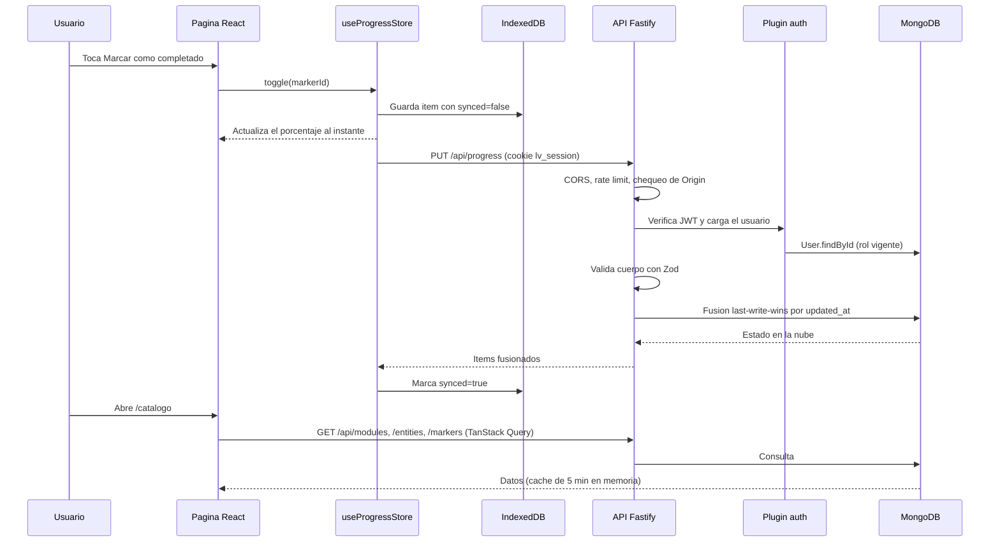

En prosa: (1) la UI cambia el estado local y lo persiste en IndexedDB de inmediato, así el usuario ve el cambio sin esperar a la red; (2) si hay API, sesión y conexión, se envía el lote pendiente; (3) el servidor valida el origen, aplica límite de peticiones, resuelve el usuario y su rol desde BD, valida el cuerpo con Zod, fusiona y responde; (4) el cliente marca lo enviado como sincronizado. Un cuerpo inválido devuelve 400 `Datos invalidos`; sin sesión 401; sin permiso 403; error interno 500 sin detalles.

### 2.6 Estrategia offline

| Elemento | Comportamiento actual | Estado |
|---|---|---|
| Invitado | Sin servidor; `guestMode` persistido en IndexedDB; todas las marcas (mapa, catálogo, guías) funcionan localmente | ✅ |
| Progreso | `items` y `guideSteps` en IndexedDB (`atlas-vice-progress`); empuje de pendientes y fusión last-write-wins al iniciar sesión y al volver la conexión (`online`) | ✅ |
| Datos del mundo | `useWorldData` arranca con `SEED_WORLD` y refresca desde la API; si la API falla conserva lo que hay; si devuelve 0 entidades y 0 marcadores usa la semilla | 🟡 La caché de consultas no se persiste: sin red tras recargar solo queda la semilla |
| Noticias | Sin API la lista queda vacía; nunca usa semilla | ✅ (por diseño) |
| Foro | Sin API publica solo "en esta sesión"; con API actualiza cada 20 s | 🟡 |
| Service worker / manifest | No existen | ❌ |
| Claves heredadas | IndexedDB usa claves `atlas-vice-auth` y `atlas-vice-progress` (nombre antiguo) | ⚠️ cosmético |

> ⚠️ **Brecha:** RNF-02 pide "carga < 2 s y catálogo/estado funcionando sin internet". Hoy lo que funciona offline es el progreso y la semilla embebida (23 entidades de ejemplo), no las 227 fichas reales, porque no se cachean en el dispositivo. La carga < 2 s no se midió (❓).

---

## 3. Requisitos funcionales y no funcionales

Leyenda: ✅ implementado · 🟡 parcial · ⚠️ divergente · ❌ no implementado · ❓ no verificado. Evidencia tomada de la auditoría de conformidad y del código.

### 3.1 Requisitos funcionales heredados (actualizados al producto actual)

| ID | Descripción (actualizada) | Criterio de aceptación verificable | Estado | Evidencia / brecha |
|---|---|---|---|---|
| **RF-01** Acceso híbrido | El usuario explora sin cuenta (progreso en IndexedDB, nunca en `localStorage` ni con tokens en el cliente) o inicia sesión con **4 proveedores como máximo** (Google, Discord, Apple, Magic Link) por OAuth2 + PKCE y cookie HttpOnly, para sincronizar entre dispositivos | (a) Desde `/entrar`, "Continuar como invitado" lleva a `/hub` sin bloqueo; (b) hay 4 botones como máximo; (c) tras login el progreso local y el de la nube quedan fusionados; (d) ningún token en `localStorage`/`sessionStorage` | 🟡 | Invitado ✅ (`LandingAuthPage.tsx:288`), sin tokens en almacenamiento ✅ (`useAuthStore.ts:262-267`), fusión ✅ (`routes/progress.ts:12`). Brecha: tras login siempre se redirige a `/?auth=ok` y se pierde `?next` (`routes/auth.ts:46`); botones dependen de credenciales/SMTP no verificados (❓); regex rota en el diálogo de Magic Link (`LandingAuthPage.tsx:52`) |
| **RF-02** Mapa interactivo | Mapa con zoom (rueda, pinch, botones), filtros por capas, búsqueda y marcado de puntos completados | (a) 7 capas conmutables con conteo; (b) búsqueda devuelve hasta 6 resultados; (c) tocar un pin abre ficha con "Marcar como completado" y el % global cambia; (d) `?marker=`, `?entity=`, `?region=` centran el mapa | 🟡 | Mecánica ✅ (`MapPage.tsx:262-404`). Brecha: **0 marcadores en BD**, no hay pines que probar; lienzo SVG vectorial, no mapa de alta resolución; capas/zoom no se reflejan en la URL |
| **RF-03** Catálogo e Inspector | Rejilla de selección, barras de estadísticas, vista previa, filtro por categoría, comparador y ficha con URL propia | (a) pestañas por módulo activo; (b) `StatBar` por stat; (c) `?comparar=a,b,c` abre comparador; (d) `/catalogo/:categoria/:itemSlug` indexable | ✅ | `CatalogPage.tsx:28-31,403-440`, `StatBar.tsx`. Menor: comparador en `BottomSheet` también en escritorio; coleccionables vacío; fidelidad visual a `Inspector.dc.html` ❓ |
| **RF-04** Tracker y retención | % global y por categoría, "Tip del día" rotativo, checklists y rutas sugeridas para incentivar el regreso | (a) anillo de % y barras en `/progreso`; (b) tip rotativo; (c) rutas con "Ir al siguiente punto"; (d) mecanismo de regreso diario | 🟡 | `DashboardPage.tsx:183-189`, `TipCard.tsx`. Brecha: sin racha ni notificaciones; checklists solo en guías; rutas vienen de `SEED_ROUTES` y con 0 marcadores quedan vacías (inferido); los 3 tips son de semilla |
| **RF-05** Guías y aportes | Consultar guías paso a paso con checklist y enviar hallazgos (marcador, ficha, corrección) con estado `pending`/`approved`/`rejected` | (a) guía con barra "N/M pasos"; (b) el formulario valida y crea aporte `pending`; (c) "Mis aportes" lista estados | ✅ | `GuidesPage.tsx`, `AdminSubmitPage.tsx`, `routes/submissions.ts:14-58`. Brecha: 0 aportes reales; imagen solo por URL |
| **RF-06** Módulos escalables | Activar/desactivar secciones por configuración sin tocar el núcleo | (a) alternar un módulo en el panel lo quita del dock y de las rutas; (b) la ruta de un módulo inactivo muestra "desactivado temporalmente" | ✅ | `routes/catalog.ts:114-164`, `App.tsx:286-297,457-478`. `radio` está inactivo |
| **RF-07** Foro contextual | Categorías (General, Guías/Ayuda, Secretos, Crews), hilos vinculados a ficha o marcador, upvotes, spoiler, respuestas, enlace a Discord y reporte de mensajes | (a) crear hilo con categoría/spoiler; (b) responder (profundidad hasta 3); (c) votar; (d) abrir hilo desde ficha o pin; (e) reportar mensaje | 🟡 | `routes/forum.ts:65-110`. Brecha: **no existe "reportar"**; enlace Discord es `https://discord.com/` genérico; `?categoria=` no se lee en `ForumPage` |

### 3.2 Requisitos no funcionales heredados

| ID | Descripción (actualizada) | Criterio de aceptación verificable | Estado | Evidencia / brecha |
|---|---|---|---|---|
| **RNF-01** Regla de 3 clics | Cualquier entidad, pin, guía o progreso accesible en 3 interacciones o menos desde el Hub | Con el dock de 5 ítems (Hub, Mapa, Catálogo, Foro, Aportar) y el % de cabecera, cada contenido se alcanza en 3 toques o menos | ✅ | `BottomDock.tsx:12-18`, `HomePage.tsx:174` |
| **RNF-02** Rendimiento y offline | Carga inicial < 2 s; datos críticos y estado del usuario funcionan sin internet y sincronizan al volver | LCP < 2 s en 4G; app usable en modo avión tras la primera visita | 🟡 | Progreso offline ✅ (`useProgressStore.ts:70`). Brecha: sin service worker ni manifest; sin caché persistente de datos del servidor; carga < 2 s sin medir (❓) |
| **RNF-03** Fidelidad visual Vice NUI | Paleta Vice Sunset (`#2E1A47`, `#7B2C6F`, `#E14B7B`, `#F69259`), glass `rgba(20,14,36,.78)` + blur 14 px, acento `#E1307E`→`#F67E56`, etiqueta `#1A0A22` peso 700 | Tokens presentes en `vice-nui.css`; contraste AA | ⚠️ | Los valores del documento heredado (`#160B14`..`#241021`, blur 12) se reemplazaron a propósito por los de CLAUDE.md §3 (`vice-nui.css:5-18,69-71`). Contraste AA no medido (❓); faltan tokens con nombre del diseño (`--hud-blur`, `--footer-bg`, `--vice-palms-opacity`) |
| **RNF-04** Experiencia nativa móvil | Áreas táctiles de 44x44 px o más, safe areas (notch/Dynamic Island) y respuesta háptica/visual en cada toque | `min-h-11`, `env(safe-area-inset-*)`, vibración en toque | 🟡 | 95 usos de `min-h-11`/44 px y safe areas ✅ (`vice-nui.css:19-24`). Brecha: sin respuesta háptica (búsqueda de `vibrate/haptic` sin resultados) |

### 3.3 Requisitos añadidos (el sistema los implementa y no estaban en el documento heredado)

| ID | Descripción | Criterio de aceptación verificable | Estado | Evidencia / brecha |
|---|---|---|---|---|
| **RF-08** SEO y SSR-lite | El servidor entrega por ruta título `X · LeonidApp` (hasta 60), descripción (hasta 160), canonical sin query, Open Graph, Twitter Card y JSON-LD (WebSite, CreativeWork, HowTo/Article, NewsArticle, CollectionPage, BreadcrumbList); slug inexistente devuelve 404 real `noindex`; `/sitemap.xml` y `/robots.txt` | (a) `curl` a una ficha muestra el `<head>` completo; (b) slug falso devuelve 404; (c) el sitemap lista fichas de módulos activos, guías y noticias; (d) `?comparar` es `noindex` | 🟡 | ✅ `ssrLite.ts:98-430`, `seo.ts:235-378`. Brechas: sin hreflang, `<html lang>`/`og:locale` fijos (`index.html:2`); `SearchAction` apunta a `/catalogo?q=` que el cliente no lee; descripción sin mínimo de 120; caché de 5 min no se invalida en CRUD admin; sin registro de 301 por cambio de slug; `robots.txt` dinámico, no existe `public/robots.txt`; solo opera con la API sirviendo `dist/` |
| **RF-09** Noticias oficiales automatizadas | Worker que cada 15 min lee fuentes oficiales, filtra por relevancia, deduplica y guarda `OfficialNews`; solo hosts en lista blanca y según robots.txt | Una noticia nueva del RSS aparece en `/noticias` en 15 min o menos; un host ajeno se rechaza | 🟡 | ✅ `officialNewsWorker.ts:18,56-85,206-214`. Brecha: solo Take-Two IR (1 noticia); Newswire sin RSS/API y YouTube prohibido por robots.txt; el panel solo lista fuentes, no las gestiona |
| **RF-10** Foro escaparate para invitados | Un invitado ve la lista reciente de hilos sin contenido ni respuestas; cualquier acción abre un muro de registro | `GET /api/forum` sin sesión devuelve `preview` sin `contenido`, máximo 50 hilos | ✅ | `routes/forum.ts:17-48`, `ForumPage.tsx:28,60,246-249` |
| **RF-11** Footer legal y cookies | `RockstarFooter` negro con Contacto y Suscripción (persistidos en MongoDB, con honeypot y límite 5/h), redes desde `AppConfig`, selector ES/EN, legales en modales y modal de cookies con 4 categorías (cookie `leonidapp_consent`) | (a) `POST /api/contact` y `/api/subscribe` guardan `Submission` tipo `contact`/`newsletter`; (b) el modal guarda la cookie de consentimiento | 🟡 | ✅ `contact.ts:9-35`, `Footer.tsx`. Brechas: no hay banner de consentimiento en el primer arranque; nada en el cliente lee `leonidapp_consent`; el idioma solo traduce el propio Footer; el contacto siempre guarda `userId: null` |
| **RF-12** Monetización (AdSlot) | Slots publicitarios configurables (`AppConfig.monetization`: `ads_enabled`, proveedor, `publisher_id`, slots, máximo 2 activos por ruta), solo en guías, noticias y fichas; nunca en mapa/hub/entrar/aportar/progreso ni en nativo; espacio fijo, etiqueta "Publicidad", carga diferida del script y respeto al consentimiento | Con `ads_enabled=true` y un slot habilitado aparece el hueco; el script del proveedor se inyecta solo con consentimiento de Marketing y al entrar en pantalla | 🟡 | ✅ exclusiones, espacio fijo, etiqueta y panel (`AdSlot.tsx:36-61`, `AdminSubmitPage.tsx:889`). ❌ no se carga ningún script ni se usa `publisher_id` ni el consentimiento (`AdSlot.tsx:11`); `slot.route` ignorado; `/guias/:slug` puede mostrar 3 slots (`GuidesPage.tsx:261,315,322`); `/foro` sin slot. **Hoy los ingresos son 0** |
| **RF-13** Auditoría | Toda acción administrativa relevante deja un `AuditLog` (actor, rol, acción, objetivo) legible desde el panel | Tras editar la configuración o un rol aparece un registro en `/api/admin/audit-logs` | 🟡 | ✅ `services/audit.ts:15-24`, `AuditPanel`. Brechas: lectura permitida a ADMIN (el diseño dice SUPER_ADMIN, `routes/config.ts:76`); nombres de acción distintos (`config.update`, `user.role.update` frente a `config.updated`, `user.role_changed`); solo inserta |
| **RF-14** Comparador NUI | Comparar 2-3 fichas del mismo módulo con mejor cifra resaltada y `—` para no comparables; `?comparar` es `noindex` | `?comparar=a,b` muestra columnas; descarta fichas de otro módulo con aviso | ✅ | `CatalogPage.tsx:151,412-425,607-622`, `ssrLite.ts:339` |
| **RF-15** Panel de administración y Control Total | Por rol: aportes (USER+), moderación (MODERATOR+), catálogo y mapa con CRUD (ADMIN+), Control Total (SUPER_ADMIN): configuración, módulos, monetización, roles, auditoría | Cada pestaña solo aparece al rol correspondiente y el servidor responde 403 a quien no tiene rango | ✅ (con brechas) | `AdminSubmitPage.tsx:1067-1136`, `CatalogAdminPanel.tsx`, `routes/config.ts`. Brechas: ocultar hilos no existe; sin gestión de fuentes de noticias; sin bandeja de contacto/suscripción en el cliente (la API existe, `routes/submissions.ts:23-26`); slug duplicado en POST cae en 500 (`catalog.ts:176`) |
| **RF-16** Importación de catálogo | Script que valida fichas JSON con Zod y hace *upsert* por `(module_id, slug)`; simula por defecto y escribe con `--apply`; marca origen `grabacion`, confianza y evidencia; no pisa fichas de otra fuente | `pnpm --dir server import:catalog <json>` informa sin escribir; con `--apply` crea o actualiza de forma idempotente | ✅ | `server/src/scripts/importCatalog.ts`; 225 fichas importadas. Brecha: la extracción previa no está en el repositorio (❓) |
| **RF-17** Acceso demo de desarrollo | Script que crea un SUPER_ADMIN temporal con sesión que caduca (120 min por defecto, máximo 480) y enlace local de un solo uso; se niega con `NODE_ENV=production` o con BD no local; al terminar borra al usuario | `pnpm --dir server demo:access` publica un enlace en 127.0.0.1 y, al cerrarlo, el acceso muere al instante | ✅ | `server/src/scripts/demoAccess.ts:1-40`. Riesgo: es una vía de acceso deliberada solo para local; debe excluirse de cualquier despliegue (ver §19, §23) |
| **RF-18** Progreso y sincronización | PUT/GET `/api/progress` con fusión last-write-wins por `updated_at`; un solo envío en vuelo; reintento al volver la conexión | Dos dispositivos convergen al mismo estado tras sincronizar | ✅ (con brecha) | `routes/progress.ts:12-30`, `useProgressStore.ts:399-472`. Brecha: el PUT hace N consultas secuenciales; los pasos de guía solo suben como marca de guía completa |
| **RNF-05** Seguridad | Cookies HttpOnly + SameSite; RBAC en servidor; validación Zod en cada ruta; límite de peticiones; chequeo de Origin | Una petición con Origin ajeno recibe 403; un USER recibe 403 en rutas ADMIN | 🟡 | ✅ `plugins/auth.ts`, `app.ts:52,56-61`. Brechas: sin cabeceras de seguridad (CSP/HSTS); CSRF permite peticiones sin Origin (`app.ts:343-348`); `Secure` solo en producción; sin revocación de sesión (ver §19) |
| **RNF-06** Calidad de construcción | `typecheck` y `build` sin errores antes de avanzar de fase | Ambos terminan con código 0 en cliente y servidor | 🟡 | ✅ ejecutados en verde. Sin pruebas, linter ni CI |
| **RNF-07** Accesibilidad | Roles ARIA, foco atrapado en diálogos, `prefers-reduced-motion` | Diálogos con `role=dialog`, `aria-modal`, Esc y retorno de foco | 🟡 | ✅ `Modal.tsx`, `BottomSheet.tsx:24-45`, `vice-nui.css:180`; contraste AA ❓ |

---

## 4. Historias de usuario (backlog priorizado)

Prioridad MoSCoW: **M** debe, **S** debería, **C** podría, **W** no por ahora.

### 4.1 Historias heredadas, actualizadas

| ID | Rol | Historia | Criterios de aceptación | Prior. | Estado | Brecha |
|---|---|---|---|---|---|---|
| HU-01 | Jugador invitado | Quiero explorar mapa, armas y guías sin crear cuenta, para obtener valor desde el primer segundo | Desde `/` o `/entrar` llego a cualquier sección sin bloqueo de login; mis marcas se guardan en el dispositivo | M | ✅ | Ninguna funcional (el foro es muro por decisión de diseño §7.5) |
| HU-02 | Jugador registrado | Quiero iniciar sesión con Google, Discord, Apple o enlace por correo y que mi progreso local se fusione con la nube | Máximo 4 botones; tras login el estado se fusiona; vuelvo a la página de origen | M | 🟡 | `?next` se pierde (`auth.ts:46`); credenciales y SMTP sin verificar; regex rota en el diálogo de Magic Link |
| HU-03 | Explorador | Quiero filtrar pines del mapa y marcar los recogidos, para no revisar zonas ya exploradas | Filtro por 7 capas; la ficha del pin permite marcar y actualiza el % | M | 🟡 | Código completo, pero **0 pines** en la BD |
| HU-04 | Estratega | Quiero inspeccionar y comparar armas y vehículos con barras de estadísticas | Rejilla, visor, `StatBar`, comparador de 2-3 | M | ✅ | Solo 12 armas y 20 vehículos; coleccionables vacíos |
| HU-05 | Colaborador | Quiero reportar un secreto o coleccionable con imagen y coordenadas | El formulario valida; el aporte queda `pending` en la cola de revisión | S | 🟡 | Imagen solo por URL (sin subida de archivos); 0 aportes reales |
| HU-06 | Administrador | Quiero activar módulos y aprobar aportes desde un panel protegido | Acceso por rol; módulos conmutables; aprobar promueve el aporte | M | ⚠️ | El documento heredado decía solo ADMIN; el vigente permite a MODERATOR revisar aportes y a ADMIN gestionar catálogo |
| HU-07 | Jugador registrado | Quiero crear hilos, comentar en la ficha de un arma o pin, votar y reportar mensajes indebidos | Hilo con categoría y spoiler; respuestas; upvote; reporte | S | 🟡 | **No existe "reportar mensajes"** |

### 4.2 Historias nuevas

| ID | Rol | Historia | Criterios de aceptación | Prior. | Estado | Brecha |
|---|---|---|---|---|---|---|
| HU-08 | Administrador de catálogo | Quiero crear, editar y borrar entidades, marcadores y módulos desde el panel, para mantener el catálogo sin tocar la base | Formularios con validación (slug `^[a-z0-9]+(-[a-z0-9]+)*$`, JSON de stats/metadata); borrado con confirmación; auditoría | M | ✅ | Slug duplicado cae en 500 (`catalog.ts:176`); cambiar slug rompe URLs sin 301; caché SSR no se invalida |
| HU-09 | Administrador de catálogo | Quiero importar fichas desde un JSON validado, con simulación previa, para cargar contenido masivamente | `import:catalog` sin `--apply` informa; con `--apply` hace upsert idempotente sin pisar otras fuentes | S | ✅ | Extracción de fichas fuera del repositorio (JSON versionado en `server/data/`) |
| HU-10 | Moderador | Quiero revisar, aprobar o rechazar aportes y moderar el foro (fijar, borrar) | Filtro por estado; aprobar promueve al catálogo; fijar/borrar hilos con confirmación | M | 🟡 | No puede **ocultar** hilos ni atender **reportes** (no existen) |
| HU-11 | Moderador | Quiero que mis propios aportes se publiquen directamente | Autor con rol MODERATOR o superior: aporte aprobado con `reviewedBy: 'system'` | C | ✅ | — |
| HU-12 | Super administrador | Quiero gestionar roles, configuración global, módulos, monetización y consultar la auditoría | Cambiar rol de otro usuario; no degradar al único SUPER_ADMIN; cambios auditados | M | 🟡 | 0 SUPER_ADMIN persistidos; sin gestión de fuentes de noticias; la auditoría la ve también ADMIN |
| HU-13 | Super administrador | Quiero activar y configurar la publicidad con consentimiento, para generar ingresos | `ads_enabled`, `publisher_id`, slots por ruta (máximo 2 activos); anuncios solo con consentimiento Marketing | S | 🟡 | Panel ✅; **la carga real del anuncio no existe** |
| HU-14 | Visitante desde buscador | Quiero aterrizar en una ficha o guía con título y descripción correctos y compartirla con vista previa | `<head>` con meta, Open Graph y JSON-LD; sitemap; 404 real | M | 🟡 | Sin hreflang; `SearchAction` rota; sin 301 de slugs |
| HU-15 | Invitado en el foro | Quiero ver qué se discute antes de registrarme | Lista reciente sin contenido; pulsar un hilo o "+ Hilo" abre muro de registro | S | ✅ | — |
| HU-16 | Usuario móvil nativo | Quiero instalar la app (iOS/Android), iniciar sesión y volver a la app por deep link | App con identidad `com.leonidapp.companion`; el login OAuth vuelve por `leonidapp://`; sin anuncios en nativo | M (para tiendas) | ❌ | `appId` y nombre antiguos; sin esquema `leonidapp://`; sin `@capacitor/app` ni `appUrlOpen`; web embebida desactualizada; sin háptica |
| HU-17 | Lector de noticias | Quiero leer noticias oficiales de Rockstar y Take-Two sin rumores de terceros | Solo fuentes en lista blanca; enlace a la fuente original | M | 🟡 | 1 fuente y 1 noticia |
| HU-18 | Jugador recurrente | Quiero un motivo para volver cada día (tip, racha, avisos) | Tip del día, % de progreso, rutas sugeridas, foro "en vivo" | S | 🟡 | Sin racha ni notificaciones; rutas probablemente vacías sin marcadores |
| HU-19 | Visitante | Quiero escribir al equipo y suscribirme desde el pie de página, y gestionar mis cookies | Contacto y suscripción se guardan; modal de cookies con 4 categorías | S | 🟡 | Sin banner de primer arranque; nadie lee el consentimiento; el administrador no tiene bandeja en el cliente |

### 4.3 Backlog pendiente ordenado por impacto de negocio

| # | Elemento | Historias | Por qué importa | Esfuerzo (estimación inferida) |
|---|---|---|---|---|
| 1 | Cargar marcadores reales en el mapa (o convertir fichas del módulo mapa en pines) | HU-03 | Sin pines el módulo estrella no entrega valor ni retención | Alto (datos) |
| 2 | Verificar y activar el login real: credenciales OAuth y SMTP, corregir `?next` y la regex de correo | HU-02 | Sin login no hay cuentas, foro completo, aportes ni sincronización | Medio |
| 3 | Resolver derechos de imagen de `public/assets` y definir cómo se publican las fichas derivadas de grabaciones | HU-04, HU-14 | Riesgo legal que bloquea la monetización y las tiendas | Medio |
| 4 | Implementar la carga real de anuncios (script diferido, consentimiento, banner de primer arranque, límite de 2 slots) | HU-13, HU-19 | Hoy los ingresos son 0 | Medio |
| 5 | Despliegue: hosting, dominio, HTTPS, MongoDB gestionado, backups, monitoreo, CI | todas | Sin producción no hay producto público | Alto |
| 6 | Identidad nativa (`com.leonidapp.companion`, `leonidapp://`), `@capacitor/app`, intent-filter / URL scheme, `cap sync` | HU-16 | Bloquea tiendas y login nativo | Medio |
| 7 | Endurecer sesión: revocación en logout, rotación, `Secure`, Origin obligatorio, cabeceras de seguridad | HU-02, HU-12 | Seguridad antes de abrir al público | Medio |
| 8 | Moderación completa: reportar mensajes, ocultar hilos, bandeja de contacto/suscripción, auditoría solo SUPER_ADMIN | HU-07, HU-10, HU-19 | Necesario con comunidad real | Medio |
| 9 | Más fuentes oficiales de noticias y gestión desde el panel | HU-17 | La sección de noticias está casi vacía | Medio |
| 10 | SEO: hreflang, `SearchAction`, 301 por cambio de slug, invalidar caché en CRUD, `public/robots.txt` | HU-14 | Tráfico orgánico | Bajo-Medio |
| 11 | Pruebas automáticas, linter y CI | todas | Cero red de seguridad ante regresiones | Medio |
| 12 | Retención: racha, notificaciones, PWA (manifest + service worker), caché persistente de datos | HU-18 | Regreso diario y uso offline real | Medio-Alto |
| 13 | Subida de imágenes (bucket) para aportes y fichas | HU-05 | Hoy solo URL externa | Medio |
| 14 | Higiene: reubicar o documentar `CatalogAdminPanel.tsx`, scripts, `PDF/`, claves `atlas-vice-*`, tokens de diseño faltantes | — | Cumplimiento de Zero Bloat | Bajo |

---

## 5. Mapa de procesos (flujo operativo y de retención)

### 5.1 (a) Ingreso y autenticación

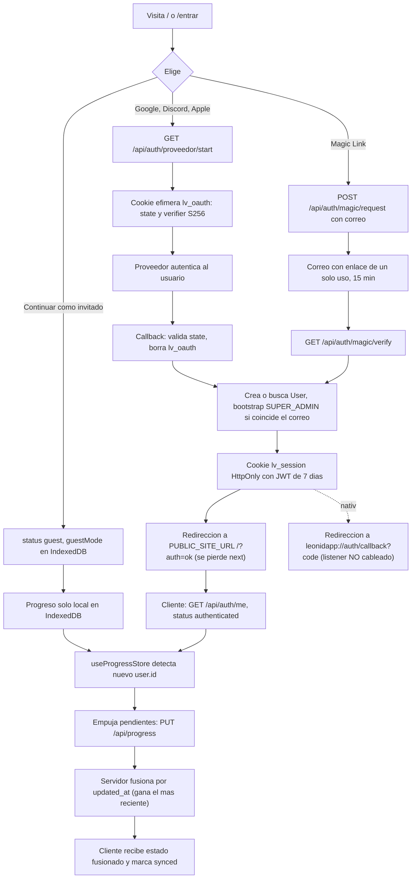

**Explicación.** Hay dos caminos: el invitado, que no toca el servidor y guarda solo un indicador `guestMode`, y la cuenta, con tres proveedores OAuth con PKCE más un enlace por correo (máximo 4 botones). En OAuth el servidor guarda `state` y `verifier` en una cookie efímera firmada, valida el retorno, crea o busca el usuario y emite la cookie de sesión HttpOnly; el cliente nunca ve el token y solo pregunta `/api/auth/me`. Al detectar un nuevo usuario, el almacén de progreso envía lo pendiente y el servidor fusiona por fecha de actualización (gana el cambio más reciente), de modo que lo que el invitado marcó no se pierde. Dos brechas: tras el login siempre se vuelve a `/` (se pierde `?next`) y la rama nativa existe en el servidor pero el cliente no escucha el deep link.

### 5.2 (b) Ciclo de contenido

```mermaid
flowchart LR
  A["Grabaciones de stream (sesiones)"] --> B["Analisis por fotogramas (proceso externo al repo)"]
  B --> C["catalogo_grabaciones.json: ficha, stats, confianza, evidencia"]
  C --> D["pnpm import:catalog sin --apply = simulacion"]
  D --> E{"Valida con Zod y sin conflicto"}
  E -->|"No"| F["Informe de errores o conflicto, no escribe"]
  E -->|"Si"| G["--apply: upsert por modulo y slug en Entity"]
  G --> H["Publicacion: visible en catalogo, guias, mapa y sitemap"]
  H --> I["Jugadores usan y marcan progreso"]
  I --> J["Aporte: marcador, ficha o correccion (POST /api/submissions)"]
  J --> K{"Autor es MODERATOR o superior?"}
  K -->|"Si"| L["Aprobado automaticamente, reviewedBy system"]
  K -->|"No"| M["Estado pending en cola de moderacion"]
  M --> N{"Moderador decide"}
  N -->|"Rechaza"| O["rejected, nunca se promueve"]
  N -->|"Aprueba"| L
  L --> P["Promocion: crea MapMarker o Entity o aplica correccion + AuditLog"]
  P --> Q["Invalida cache SSR, el contenido entra al sitemap"]
  P --> H
```

**Explicación.** El contenido nace de dos fuentes: la importación masiva de fichas obtenidas de grabaciones (con nivel de confianza y evidencia por ficha; hoy 225 fichas) y los aportes de la comunidad. La importación valida con Zod y por defecto solo simula; con `--apply` hace *upsert* idempotente y no pisa fichas de otra fuente. Los aportes pasan por moderación y, al aprobarse (o al ser de un moderador o superior), el sistema los promueve solo a `MapMarker`/`Entity`/corrección dentro de una transacción (en MongoDB sin réplica degrada a escritura sin atomicidad), deja registro de auditoría e invalida la caché SSR. Los aportes de tipo `contact` y `newsletter` nunca se promueven. Brecha: la extracción previa a la importación no está documentada en el repositorio.

### 5.3 (c) Bucle de retención

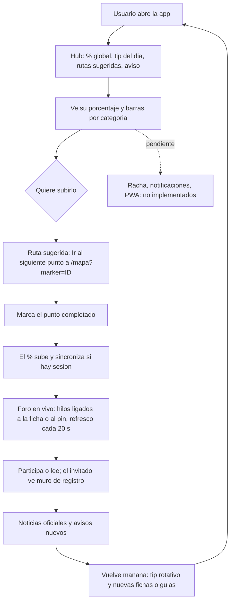

**Explicación.** El bucle gira alrededor del porcentaje de progreso: el Hub muestra cuánto falta, un tip rotativo y rutas sugeridas que llevan directamente a un punto del mapa; completarlo sube el porcentaje y lo sincroniza; el foro "en vivo" y las noticias dan razones para volver; el contenido nuevo (fichas, guías, noticias) renueva el Hub. Estado real: la mecánica existe, pero con 0 marcadores las rutas sugeridas probablemente quedan vacías (inferido) y no hay racha, notificaciones ni PWA, de modo que el regreso diario depende solo de que el usuario recuerde volver.

### 5.4 (d) Moderación y auditoría

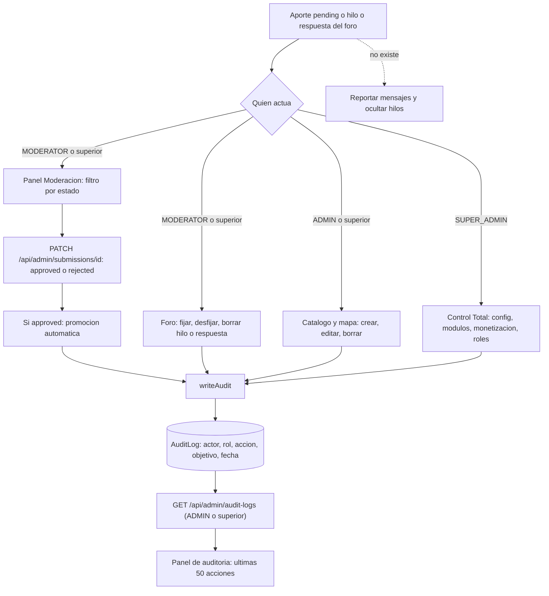

**Explicación.** Cada rol tiene acciones acotadas y toda acción administrativa pasa por `writeAudit`, que inserta un registro con actor, rol, acción y objetivo; el panel lista las últimas 50. La autorización la aplica el servidor (403 si el rango no alcanza), no la interfaz. Brechas: no existen "reportar" ni "ocultar" (solo borrar y fijar), los nombres de acción difieren del diseño y la auditoría la puede leer ADMIN (el diseño la reserva a SUPER_ADMIN). Hoy hay 3 registros de auditoría.

### 5.5 (e) Ciclo de noticias oficiales

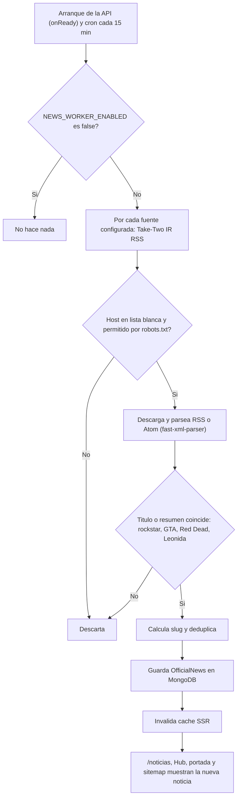

**Explicación.** El worker se inicia con la API, se ejecuta de inmediato y luego cada 15 minutos. Solo acepta URLs `https` de hosts oficiales, respeta robots.txt, filtra por relevancia y deduplica por slug antes de guardar. Tras guardar invalida la caché SSR y la noticia aparece en `/noticias`, portada, Hub y sitemap. Estado real: solo está configurada una fuente (Take-Two IR, 1 noticia guardada); Rockstar Newswire no tiene RSS ni API pública documentada y el feed de YouTube lo prohíbe su robots.txt, por lo que no se ingieren; no hay endpoint para añadir fuentes.

---

## 6. Diagramas de casos de uso

### 6.1 Diagrama general por actor

Herencia de permisos: cada rol incluye los del anterior (`GUEST < USER < MODERATOR < ADMIN < SUPER_ADMIN`).

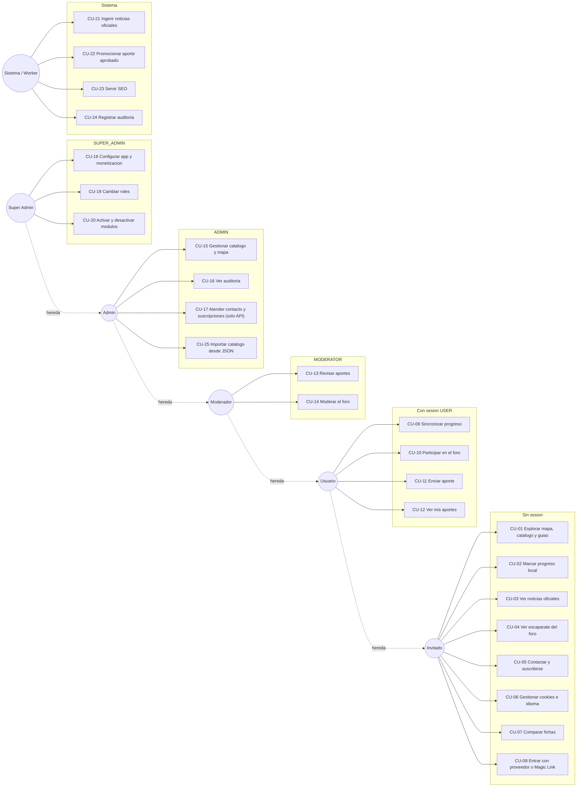

### 6.2 Tabla de casos de uso

| CU-ID | Caso de uso | Actor | Precondición | Flujo principal | Postcondición | Estado |
|---|---|---|---|---|---|---|
| CU-01 | Explorar mapa, catálogo y guías | Invitado | Ninguna | Abre la app, usa dock o portada, abre fichas y guías | Navega sin login | ✅ (mapa sin pines) |
| CU-02 | Marcar progreso local | Invitado | Ficha, pin o paso de guía visibles | Pulsa "marcar"; se guarda en IndexedDB con `synced:false` | % actualizado en el dispositivo | ✅ |
| CU-03 | Ver noticias oficiales | Invitado | API activa | Abre `/noticias` y el detalle | Lee la noticia y el enlace a la fuente | 🟡 (1 noticia) |
| CU-04 | Ver escaparate del foro | Invitado | API activa | Abre `/foro`; ve lista reciente sin contenido; toca un hilo y aparece el muro de registro | Es invitado a registrarse | ✅ |
| CU-05 | Contactar o suscribirse | Invitado | API activa; no supera 5/h | Completa el Footer; se valida; honeypot vacío | `Submission` `contact`/`newsletter` guardada | ✅ (el contacto no asocia `userId`) |
| CU-06 | Gestionar cookies e idioma | Invitado | — | Abre "Ajustes de cookies" y guarda; cambia ES/EN | Cookies `leonidapp_consent` y `leonidapp_lang` | 🟡 (nada consume el consentimiento; idioma solo en el Footer) |
| CU-07 | Comparar fichas | Invitado | 2 fichas o más del mismo módulo | Pulsa "Comparar con..."; elige hasta 3 | Comparador con mejor cifra resaltada | ✅ |
| CU-08 | Entrar con proveedor o Magic Link | Invitado | Proveedor configurado y habilitado | Ver §5.1 | Cookie `lv_session`; estado `authenticated` | 🟡 (`?next` perdido, credenciales ❓, regex rota, nativo sin deep link) |
| CU-09 | Sincronizar progreso | Usuario | Sesión, API y conexión | Detecta usuario; PUT de pendientes; fusión LWW | Progreso idéntico entre dispositivos | ✅ |
| CU-10 | Participar en el foro | Usuario | Sesión | Crea hilo (categoría, spoiler, vínculo a ficha/pin), responde, vota | Hilo/post/voto persistidos | ✅ (sin reportar) |
| CU-11 | Enviar aporte | Usuario | Sesión | Elige tipo, completa formulario, envía | `Submission` `pending`; si el autor es MODERATOR+ se aprueba solo | ✅ (imagen solo URL) |
| CU-12 | Ver mis aportes | Usuario | Sesión | `GET /api/submissions/mine` | Lista con estado | ✅ |
| CU-13 | Revisar aportes | Moderador | Rol MODERATOR o superior; aportes pendientes | Filtra por estado; aprueba o rechaza | Aprobado: promoción + auditoría; rechazado: no se promueve | ✅ |
| CU-14 | Moderar el foro | Moderador | Rol MODERATOR o superior | Fija/desfija o borra hilo o respuesta con confirmación | Cambio persistido | 🟡 (sin "ocultar" ni "reportes") |
| CU-15 | Gestionar catálogo y mapa | Admin | Rol ADMIN o superior | Crea/edita/borra entidad, marcador o módulo | Datos y auditoría guardados | ✅ (slug duplicado 500; sin 301; caché SSR no se invalida) |
| CU-16 | Ver auditoría | Admin | Rol ADMIN o superior | Abre el panel o `GET /api/admin/audit-logs` | Últimos 50 eventos | ⚠️ (el diseño la reserva a SUPER_ADMIN) |
| CU-17 | Atender contacto y suscripciones | Admin | Rol ADMIN o superior | `GET /api/admin/submissions` filtrando tipos | Ver mensajes | 🟡 (existe en API; sin pantalla en el cliente) |
| CU-18 | Configurar app y monetización | Super Admin | Rol SUPER_ADMIN | Edita mantenimiento, aviso, proveedores (máx. 4), flags, redes, monetización | `AppConfig` actualizado y auditado | ✅ (la publicidad no se carga realmente) |
| CU-19 | Cambiar roles | Super Admin | Rol SUPER_ADMIN | Busca usuario, elige rol | Rol actualizado; nunca degrada al último SUPER_ADMIN | ✅ |
| CU-20 | Activar y desactivar módulos | Super Admin | Rol SUPER_ADMIN | Conmuta `isActive` | Dock y rutas se ajustan | ✅ |
| CU-21 | Ingerir noticias oficiales | Sistema/Worker | API activa; `NEWS_WORKER_ENABLED` distinto de `false` | Ver §5.5 | `OfficialNews` nueva e invalidación SSR | 🟡 (1 fuente) |
| CU-22 | Promocionar aporte aprobado | Sistema | Aporte `approved` válido | Crea marcador/ficha/corrección en transacción; si Zod falla queda `pending` (422) | Contenido publicado + auditoría | ✅ (transacción degrada sin réplica) |
| CU-23 | Servir SEO | Sistema | `dist/` compilado y servido por la API | Inyecta head y JSON-LD; sirve sitemap y robots; 404 real | Páginas indexables | 🟡 (ver RF-08) |
| CU-24 | Registrar auditoría | Sistema | Acción de un usuario autenticado | `writeAudit` inserta `AuditLog` | Registro guardado (solo inserta) | ✅ |
| CU-25 | Importar catálogo desde JSON | Admin técnico (línea de comandos) | JSON válido y BD accesible | `import:catalog` simula; con `--apply` hace upsert | Fichas creadas o actualizadas | ✅ |
| CU-26 | Acceso demo de desarrollo | Desarrollador | `NODE_ENV` distinto de production; BD local | `demo:access` crea SUPER_ADMIN temporal y enlace local | Sesión que caduca; usuario borrado al terminar | ✅ (solo local) |
| CU-27 | Instalar y usar la app nativa | Usuario móvil | App compilada con identidad correcta | Instala, abre, inicia sesión y vuelve por `leonidapp://` | Sesión activa en la app | ❌ |

## 7. Propósito y estrategia de escalabilidad de datos

### 7.1 Propósito

El modelo de datos de LeonidApp tiene un objetivo: poder **añadir contenido nuevo (un módulo, un DLC, un tipo de ficha) sin migrar el esquema de MongoDB ni tocar el código del servidor**. Para lograrlo, el catálogo no usa una colección por tipo de contenido (armas, vehículos, etc.), sino un único modelo genérico (`Entity`) cuyo contenido específico va en campos JSON libres. Esto permite comparar con un sitio de referencia (GTABase) por *contenido*, no por *estructura*.

### 7.2 Principio polimórfico: Entity + stats_json / metadata_json + Module

| Pieza | Rol | Dónde |
|---|---|---|
| `Module` | Agrupa fichas bajo un "módulo" (mapa, armas, vehículos, coleccionables, guías, foro, radio). Tiene `slug`, `nombre`, `icono`, `activo`, `orden`. | `server/src/models/Module.ts` |
| `Entity` | Ficha genérica: `module_id`, `slug`, `titulo`, `subtitulo`, `categoria` (texto libre ≤80), `imagen_url` y dos bolsas JSON. | `server/src/models/Entity.ts:34-47` |
| `stats_json` | Estadísticas numéricas **comparables** (barras 0-100 que dibuja el cliente y que alimentan el comparador). Las claves dependen del módulo. | Campo `Mixed` |
| `metadata_json` | Todo lo demás: descripción, alias, precio, pasos de guía, procedencia (`fuente`, `confianza`, `evidencia`). Las claves dependen del módulo. | Campo `Mixed` |
| `MapMarker` | Pin con coordenadas; puede apuntar a una `Entity` (`entity_id`). Separado porque tiene geometría e índice `2d`. | `server/src/models/MapMarker.ts` |

Consecuencia: una "ficha de mapa" (lugar), una "guía" y un "arma" son el mismo tipo de documento; cambian el `module_id` y el contenido de los dos JSON.

### 7.3 Cómo se añade un módulo o un DLC sin migrar esquema

1. Crear el `Module` (`POST /api/modules`, rol ADMIN, o desde el panel de administración): `slug`, `nombre`, `icono`, `activo`, `orden`. ✅ (`routes/catalog.ts:50`)
2. Crear las fichas: `POST /api/entities` (ADMIN), por aportes aprobados (`Submission` tipo `entity`, ver §13) o con el importador (`import:catalog`, ver §14). Basta con elegir `categoria` y las claves de `stats_json`/`metadata_json`. ✅
3. El cliente muestra los módulos de `GET /api/config/public` (con `isActive`) y las fichas de `GET /api/entities`. ✅ (`routes/config.ts:40`, `routes/catalog.ts:76`)
4. El sitemap (§17) incluye las entidades de módulos activos (`/catalogo/:categoria/:itemSlug`; el módulo `guias` va en `/guias/:slug`). ✅ (`routes/seo.ts`)

No hay migraciones: Mongo no impone esquema y Mongoose solo valida los campos declarados.

> ⚠️ **Brecha (UI de módulos nuevos):** que el *dato* exista sin migrar no implica que la *pantalla* sepa dibujarlo. ❓ No se auditó cuánto de la UI de catálogo es genérica y cuánto está atada a módulos concretos; un módulo nuevo puede requerir ajustes de cliente para mostrar sus claves de forma amigable.

### 7.4 Límites reales del enfoque

| Límite | Realidad verificada | Referencia |
|---|---|---|
| Sin validación de forma en Mongoose | `stats_json`, `metadata_json`, `AppConfig.feature_flags`, `social_links`, `monetization`, `Submission.payload`, `coords`, `promotedTo` y `AuditLog.metadata` son `Mixed`: MongoDB acepta cualquier cosa. | `models/*.ts` |
| La única validación es Zod en la API | `entitySchema` solo exige que `stats_json`/`metadata_json` sean un objeto (`record<string, unknown>`). No valida qué claves hay ni que los valores de `stats_json` sean números 0-100. Cualquier escritura que no pase por la API (scripts, consola Mongo) ni siquiera pasa por eso. | `models/Entity.ts`, `models/common.ts` |
| Claves no garantizadas | Dos fichas del mismo módulo pueden tener claves distintas (p. ej. `waink`, `propietario` solo en algunos vehículos; ver §10.13). El comparador y las barras deben tolerar claves ausentes. | §10.13 |
| `categoria` es texto libre | No hay lista cerrada ni colección de categorías; un error tipográfico crea una categoría nueva. | `Entity.ts` |
| Sin integridad referencial | `module_id`, `entity_id`, `marker_id`, `user_id`, `thread_id`, `target_id` son strings; MongoDB no los comprueba. La API valida solo algunos al crear (§9.4). | §9, §10 |
| Zod de usuario no aplicado en Mongoose | `username` 2-40 solo existe en Zod; `findOrCreateUser` y `demoAccess` crean usuarios sin pasar por él. | `models/User.ts` |

### 7.5 Índices (estado actual)

Resumen (detalle por colección en §10): `Entity {module_id, categoria}` y `{module_id, slug}` único; `MapMarker {coord:'2d'}` (rango −100000..100000) y `{region}`; `UserProgress {user_id, target_type, target_id}` único; `OfficialNews {sourceUrl}` único, `{publishedAt:-1}`, `{slug}` único; `Submission {userId}` y `{status, createdAt:-1}`; `ForumThread {categoria, created_at:-1}` y `{entity_id}` parcial; `ForumPost {thread_id}`; `ForumVote {user_id, target_type, target_id}` único; `AuditLog {created_at:-1}` y `{actor_id, created_at:-1}`; `User`: `username`, `email` (parcial), `discord_id` (parcial), `{identities.provider, identities.subject}`.

> ⚠️ **Brecha:** `GET /api/entities` con filtro solo por `categoria` (sin `module_id`) no tiene índice que lo cubra (el compuesto empieza por `module_id`). Con 227 fichas no se nota. Es una inferencia a partir de los índices declarados (❓ no se midió con `explain`).

### 7.6 Puntos de crecimiento detectados en el código

| # | Punto | Hoy | Riesgo al crecer | Referencia |
|---|---|---|---|---|
| 1 | `GET /api/entities` sin paginación | Devuelve **todas** las entidades (también de módulos inactivos); el cliente la llama al arrancar junto con `/api/modules` y `/api/markers` (`useWorldData`). Hoy 227 fichas. No hay `limit` ni selección de campos. | Respuesta y memoria del cliente crecen linealmente; con miles de fichas el arranque se encarece. | `routes/catalog.ts:76`; `src/data/seed.ts:499` |
| 2 | `GET /api/markers` sin paginación | Devuelve todos (hoy 0). | El mapa necesitará carga por región o viewport. | `routes/catalog.ts:108` |
| 3 | `PUT /api/progress`: N consultas por lote | Hasta 2000 ítems en serie; por ítem un `findOne` y, si procede, un `updateOne` upsert (hasta ~4000 operaciones) y al final un `find` de todo el progreso del usuario. Sin `bulkWrite` ni rate limit específico. | Un usuario con mucho progreso acumulado offline genera lotes lentos. | `routes/progress.ts:13-35` |
| 4 | Sitemap | Una consulta para entidades de módulos activos y otra para noticias, con tope de 50 000 por consulta; si el total supera 50 000 responde `sitemapindex` con `/sitemap-N.xml`. Se recalcula en cada petición (`max-age=3600`, sin caché en servidor). | ❓ No se verificó el comportamiento exacto al superar 50 000 con varias fuentes (el tope es por consulta). | `routes/seo.ts:134-150` |
| 5 | Foro sin paginación real | Con sesión: hasta 500 hilos y 5000 posts de una vez (más un `aggregate` de respuestas); invitado: máx 50 hilos. Ignora filtros. | El tope descarta contenido antiguo. | `routes/forum.ts:17` |
| 6 | `UserProgress` | Un documento por (usuario, objetivo): usuarios × entidades marcadas. | Sin TTL ni limpieza de objetivos huérfanos. | `models/UserProgress.ts` |
| 7 | `AuditLog` | Un documento por acción administrativa; sin TTL ni rotación. | Crecimiento indefinido; el panel lee con `limit` ≤200 y `before`. | `routes/config.ts:76` |
| 8 | Caché SSR | `Map` en memoria por instancia (TTL 5 min, 500 entradas). Las mutaciones de catálogo no la invalidan (solo `promote()` y la ingesta de noticias). | Con varias instancias hay cachés distintas; tras editar una ficha el `<head>` SEO puede quedar desfasado hasta 5 min. | `services/ssrLite.ts` |
| 9 | Estado en memoria | `consumeOnce` (uso único de Magic Link/canje) y rate limit son por instancia. | Al escalar horizontalmente deben pasar a un almacén compartido. | `services/session.ts:49`; `app.ts:52` |
| 10 | Lectura de usuario por petición | El plugin de auth hace `User.findById` en cada petición (rol siempre fresco). | Una lectura extra por petición; aceptable hoy. | `plugins/auth.ts:28-38` |
| 11 | Imágenes | Las propias están en `public/assets`; las fichas usan URLs. | Sin bucket/CDN, el repositorio y el despliegue cargan los binarios (ver §23). | el inventario de infraestructura |

### 7.7 Estrategia offline y de sincronización

| Dato | Dónde se guarda en el cliente | Cómo se sincroniza | Estado |
|---|---|---|---|
| Progreso (marcadores, entidades, pasos de guía) | IndexedDB (`idb-keyval`, clave `atlas-vice-progress`: `items`, `guideSteps`, `lastSyncedAt`). Funciona también como **Invitado**. | `PUT /api/progress` con los ítems pendientes (`synced:false`); si no hay pendientes, `GET /api/progress`. Fusión **last-write-wins** por `updated_at` (el servidor descarta fechas futuras y respeta el registro más reciente). Disparadores: cambio de usuario (el login fusiona el progreso de Invitado con la nube) y evento `online`. Un solo vuelo a la vez. | ✅ |
| Preferencia de Invitado | IndexedDB (`atlas-vice-auth`, solo `guestMode`). | Local. | ✅ |
| Catálogo, mapa, foro, noticias | Solo caché en memoria de TanStack Query (`staleTime` 5 min, `gcTime` 24 h, `networkMode:'offlineFirst'`); **sin persistidor**. | `GET` al arrancar. Si la API falla o devuelve 0 entidades y 0 marcadores, el cliente usa la **semilla embebida** (`src/data/seed.ts`, con `sample:true`). | 🟡 |
| Aplicación (HTML/JS/CSS) | Web: nada (sin service worker ni manifest). Nativo (Capacitor): empaquetada en la app. | — | 🟡 |
| Sesión | Cookie HttpOnly (el cliente no la lee). Nada en localStorage/sessionStorage. | — | ✅ |

> ⚠️ **Brecha (offline):** tras recargar sin red, el navegador vuelve a la semilla de ejemplo (23 entidades y 20 marcadores ficticios), no a los datos reales vistos antes, porque la caché de consultas no se persiste.

## 8. Modelo de datos escalable

### 8.1 Colecciones reales

Hay **14 modelos Mongoose** (14 archivos de entidad en `server/src/models/`, más `common.ts` e `index.ts`: 16 archivos en total) y **14 colecciones físicas** en MongoDB. El documento maestro las agrupa en **12 colecciones lógicas** porque cuenta el foro (`ForumThread`, `ForumPost`, `ForumVote`) como una sola; `MediaAsset` y `PipelineRun` se añadieron el 2026-11-21 con el pipeline de datos. Entity suma `contentHash`, `manualEdits` y `capturaPropiaPendiente`; `Submission` admite `origin: 'pipeline'` y `AuditLog` admite `actor_label` (detalle en el maestro de datos §2.4, §2.8, §2.10 y §2.12).

> Conteo vigente (comprobado en `server/src/models`): 14 modelos Mongoose, 14 colecciones físicas y 12 colecciones lógicas (el foro cuenta como una).

| # | Colección lógica (doc maestro) | Modelo(s) Mongoose | Colección MongoDB | Propósito | Documentos hoy |
|---|---|---|---|---|---|
| 1 | User | `User` | `users` | Cuentas, rol e identidades de acceso | 5 (USER 4, ADMIN 1; sin SUPER_ADMIN) |
| 2 | AppConfig | `AppConfig` | `appconfigs` | Configuración global (singleton `key:'global'`) | 1 |
| 3 | Module | `Module` | `modules` | Módulos del catálogo | 7 |
| 4 | Entity | `Entity` | `entities` | Ficha genérica polimórfica | 227 |
| 5 | MapMarker | `MapMarker` | `mapmarkers` | Pines del mapa | 0 |
| 6 | UserProgress | `UserProgress` | `userprogresses` | Progreso por usuario | 0 |
| 7 | OfficialNews | `OfficialNews` | `officialnews` | Noticias oficiales ingeridas por el worker | 1 |
| 8 | Submission | `Submission` | `submissions` | Aportes, correcciones y bandeja Footer (contact/newsletter) | 0 |
| 9 | Foro | `ForumThread`, `ForumPost`, `ForumVote` | `forumthreads`, `forumposts`, `forumvotes` | Hilos, respuestas y votos | 6 / 9 / 0 |
| 10 | AuditLog | `AuditLog` | `auditlogs` | Registro de acciones administrativas | 3 |

(Conteos de el inventario de infraestructura; los nombres físicos son el plural en minúsculas que genera Mongoose y coinciden con los de la base.)

### 8.2 Convenciones

| Convención | Detalle | Excepciones |
|---|---|---|
| Identificador | `_id` String UUID (`idField` = `{type:String, default: randomUUID}`, `models/common.ts:5`), expuesto como `id` en los DTO. | `OfficialNews`, `ForumVote` y `AppConfig` usan **ObjectId** (comprobado en la base para `officialnews` y `appconfigs`). Ver §8.4. |
| Timestamps | `createdOnly` = `{createdAt:'created_at', updatedAt:false}`: solo fecha de creación. | `Submission.createdAt` (camelCase); `OfficialNews` con `timestamps:true`; `AppConfig` solo `updatedAt`; `UserProgress.updated_at` es campo manual. |
| Nombres de campo | snake_case heredado del DER SQL. | camelCase en `Submission` y `OfficialNews`; `AppConfig` mezcla. |
| Par Mongoose + Zod | Cada colección tiene interfaz `XDoc`, schema Mongoose, schema Zod de entrada, `xUpdateSchema = partial()` cuando aplica y mapeador `toXDTO`. | `AuditLog` **no tiene schema Zod**. |
| DTO | Las respuestas se construyen con `toXDTO` y no se validan con Zod. `toPublicUserDTO` (sin correo; `discord_id` siempre `null`), `toSelfUserDTO` (con correo), `MarkerDTO` aplana `coord` en `coord_x`/`coord_y`. | — |
| Opciones de schema | `versionKey:false` en la mayoría; `minimize:false` donde se guardan objetos vacíos (Entity, AppConfig, Submission, AuditLog). | `officialnews` conserva `__v`. |
| Validación de entrada | Zod 4 en cada ruta (`parse` → 400 `Datos invalidos` con `details`); parámetros de id con `z.uuid()`. | Los scripts escriben directo a Mongoose: `import:catalog` valida con `entitySchema`; `seed` no valida. |

### 8.3 Reglas de escritura relevantes

- **Slug único por módulo:** índice único `{module_id, slug}` y regex `^[a-z0-9]+(?:-[a-z0-9]+)*$` (máx 120).
- **Upsert por clave natural:** el importador usa `updateOne({module_id, slug}, …, {upsert:true})`; reimportar no duplica.
- **Contadores no transaccionales:** `upvotes_count` se actualiza con `$inc` después de crear/borrar el voto.
- **Referencias por id:** todas las relaciones son strings sin FK (§9, §10.14).

### 8.4 Excepciones y divergencias detectadas

| # | Divergencia | Estado | Detalle |
|---|---|---|---|
| 1 | `_id` ObjectId en `OfficialNews`, `ForumVote` y `AppConfig` | ⚠️ | El documento maestro (§1) dice que los `_id` son UUID String. Impacto bajo: ninguno se referencia por id desde otras colecciones. |
| 2 | `AuditLog` sin schema Zod | ⚠️ | `CLAUDE.md` §2 exige par Mongoose+Zod para todo modelo. |
| 3 | Dos `officialNewsSchema` distintos | ⚠️ | `models/OfficialNews.ts` (no lo usa el worker) y `workers/officialNewsWorker.ts:15` (más estricto; es el que valida la ingesta). |
| 4 | `submissionSchema` completo definido pero no usado para validar | 🟡 | Las rutas solo usan `submissionCreateSchema`. |
| 5 | Zod de `username` (2-40) no aplicado en Mongoose | 🟡 | Usuarios por OAuth/demo no pasan por Zod. |
| 6 | `moduleSlug` de `Submission` no se valida al crear | ⚠️ | El documento exige que exista salvo tipos Footer; el código solo lo comprueba al promover `entity`. |
| 7 | Nombres de acción de auditoría | ⚠️ | El documento cita `config.updated` y `user.role_changed`; el código emite `config.update` y `user.role.update`. |
| 8 | `_id` generado por upsert | ❓ | `UserProgress` se crea con `updateOne(..., {upsert:true})`; el comentario de `importCatalog.ts:78` indica que un upsert no aplica el `default` UUID (el importador lo resuelve con `$setOnInsert:{_id: randomUUID()}`, `PUT /api/progress` no). No se verificó qué `_id` queda (hoy 0 documentos). |
| 9 | `ForumThread.categoria` literal `'Guias/Ayuda'` | 🟡 | La UI muestra "Guías / Ayuda"; se guarda sin acento. |
| 10 | Foro: "ocultar hilos" | ❌ | Previsto para MODERATOR; solo existe fijar. |
| 11 | Semilla del cliente vs base real | ⚠️ | `src/data/seed.ts` y `seedData.json` conservan 23 entidades y 20 marcadores de ejemplo (`sample:true`) que ya NO existen en la base. |

## 9. Diagrama Entidad-Relación (DER)

> **Nota sobre MongoDB:** MongoDB no tiene claves foráneas. Todas las relaciones de los diagramas son **referencias lógicas por id (string) sin integridad referencial en la base de datos**: nada impide guardar un `module_id` inexistente ni borrar un documento al que otros apuntan. `PK` = `_id`; `FK` = referencia lógica; `UK` = índice único.

### 9.1 Diagrama A: núcleo de catálogo, mapa, progreso y noticias

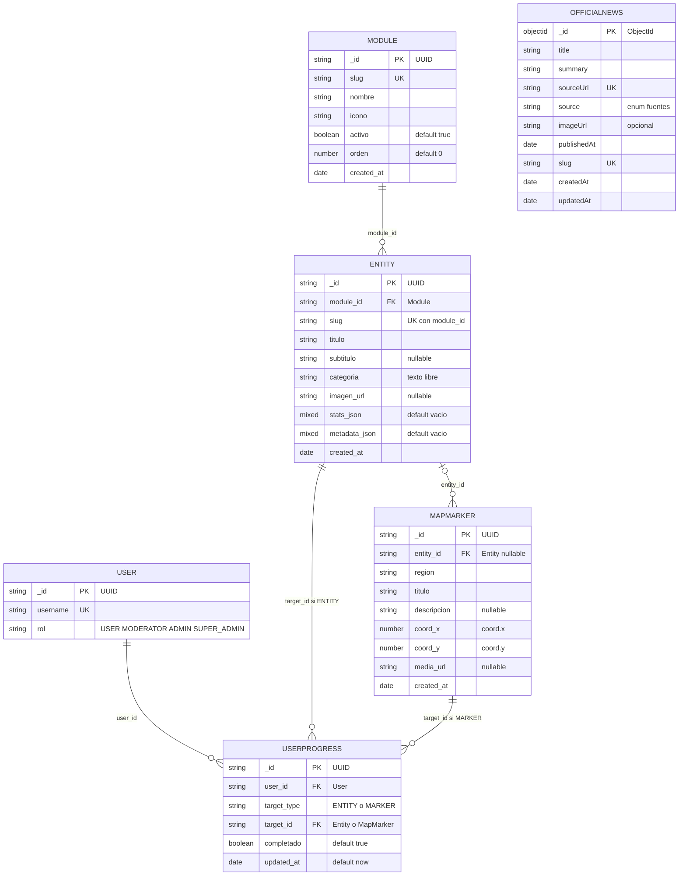

`OfficialNews` no se relaciona con ninguna otra colección (solo la escribe el worker). `USER` aparece abreviado: sus campos completos están en el diagrama B.

### 9.2 Diagrama B: comunidad, aportes y administración

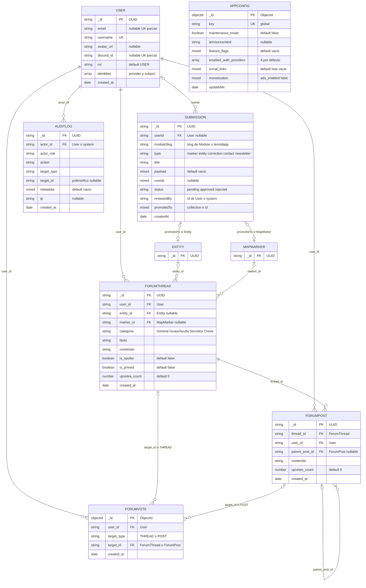

`ENTITY` y `MAPMARKER` se muestran solo con su clave; sus campos están en el diagrama A.

### 9.3 Diagrama C: relaciones polimórficas y por slug

`erDiagram` no expresa bien las referencias cuyo destino depende de otro campo; este diagrama las resume.

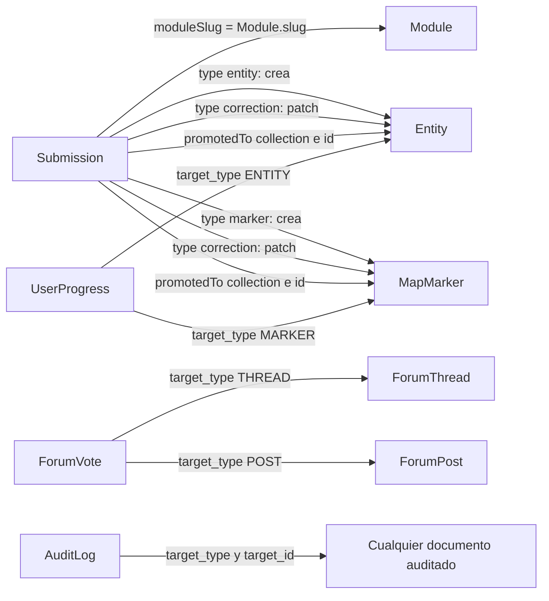

### 9.4 Qué se resuelve a nivel de aplicación (no en la base)

| Relación | Quién la mantiene | Comportamiento |
|---|---|---|
| `Entity.module_id` → `Module` | `POST /api/entities` | 422 `module_id inexistente`. ❓ `PATCH` no vuelve a comprobarlo según el inventario. No impide luego borrar el módulo. |
| `Submission.moduleSlug` → `Module.slug` | Solo `promote()` para tipo `entity` | 422 si no existe o está inactivo; al crear la `Submission` no se comprueba. |
| `ForumPost.thread_id` y `parent_post_id` | `POST /api/forum/posts` | 422 si el hilo no existe o el post padre no es de ese hilo. |
| `ForumVote.target_id` | `POST /api/forum/votes/toggle` | 404 si el hilo/post no existe. |
| `ForumThread.entity_id` / `marker_id` | Nada comprobado | El Zod solo exige UUID nullable; ❓ no se vio comprobación de existencia. |
| `MapMarker.entity_id` | Nada | Sin validación de existencia. |
| `UserProgress.target_id` | Nada | Solo se valida el formato UUID. |
| Cascadas de borrado | Código de las rutas | Solo en el foro (hilo → posts y votos; post → votos). Ver §10.14. |
| Unicidad | Índices únicos en MongoDB | Garantías reales de la base: slug por módulo, voto por usuario/objetivo, progreso por usuario/objetivo, `sourceUrl`, etc. |

## 10. Diccionario de entidades y relaciones

Convenciones: **Mongoose** = tipo del schema; **Zod** = regla de entrada en la API; **Req.** = requerido; **Índice** = índice declarado. "—" = no aplica o no existe. Los modelos están en `server/src/models/<Modelo>.ts`.

### 10.1 User (`users`)

| Campo | Mongoose | Zod (`userSchema`) | Req. | Default | Índice | Descripción y reglas |
|---|---|---|---|---|---|---|
| `_id` | String (UUID) | `id` uuid | Sí | `randomUUID` | PK | Se expone como `id`. |
| `email` | String, lowercase, trim | opcional | No | — | único parcial (solo si es string) | Se usa para enlazar identidades (solo si `emailVerified`) y para el bootstrap de SUPER_ADMIN. Lo ven el propio usuario y el SUPER_ADMIN; nunca el DTO público. |
| `username` | String | string 2-40 | Sí | — | único | Nombre visible; generado al registrarse (`slugName` ≤24, sufijo hex si choca). El rango 2-40 no se aplica en Mongoose. |
| `avatar_url` | String | nullable | No | `null` | — | Avatar del proveedor. |
| `discord_id` | String | nullable | No | `null` | único parcial | `toPublicUserDTO` siempre lo devuelve `null`. |
| `rol` | String enum `USER/MODERATOR/ADMIN/SUPER_ADMIN` | `roleSchema`, default `USER` | Sí | `USER` | — | `GUEST` nunca se guarda. Cambia solo por `PATCH /api/admin/users/:id/role` (SUPER_ADMIN) o por bootstrap con `SUPER_ADMIN_EMAIL`. No se puede degradar al último SUPER_ADMIN (409). |
| `identities` | Array de `{provider enum google/discord/apple/magic-link, subject String}` sin `_id` | array | No | `[]` | `{identities.provider, identities.subject}` | Cuentas de acceso enlazadas. Los 5 usuarios semilla no tienen identidades (no pueden iniciar sesión). |
| `created_at` | Date (solo creación) | coerce date | — | now | — | — |

### 10.2 AppConfig (`appconfigs`)

Singleton: un único documento con `key:'global'` (`getGlobalConfig()` lo crea por upsert).

| Campo | Mongoose | Zod (`appConfigSchema`) | Req. | Default | Índice | Descripción y reglas |
|---|---|---|---|---|---|---|
| `_id` | ObjectId | — | — | — | PK | No UUID (§8.4). |
| `key` | String | — | Sí | `'global'` | único | Clave del singleton. |
| `maintenance_mode` | Boolean | boolean | No | `false` | — | Modo mantenimiento (público en `/api/config`). |
| `announcement` | String | ≤500, nullable | No | `null` | — | Anuncio global. |
| `feature_flags` | Mixed | `record<string, boolean>` | No | `{}` | — | Banderas de funcionalidad. |
| `enabled_auth_providers` | [String] | array de enum google/discord/apple/magic-link, máx 4 | No | los 4 | — | Proveedores visibles en la pantalla de acceso (máx. 4 botones). |
| `social_links` | Mixed | array máx 12 de `{platform 1-30, url}` | No | `[]` | — | Redes del footer; Mongoose no valida el contenido. |
| `monetization` | Mixed | `monetizationSchema`: `ads_enabled`, `provider` none/adsense, `publisher_id` ≤60 nullable, `require_consent` literal `true`, `slots` máx 20 `{id 1-40, route, position, width, height, enabled}` | No | `{ads_enabled:false, provider:'none', publisher_id:null, require_consent:true, slots:[]}` | — | Ver §18. Estado actual: anuncios desactivados, sin slots. |
| `hero_slides` | [Mixed] | `z.array(heroSlideSchema).max(6)` | No | `[]` | — | Carrusel del Hero (2026-11-21): `{id uuid, activa, orden, kicker ≤60, titulo ≤90, descripcion ≤220, boton_texto ≤30, boton_enlace (ruta `/…` o https), boton_secundario_texto/enlace (opcionales), imagen_url (`/media/<id>` o https), imagen_alt ≤140}`. Escribe ADMIN+ con `PUT /api/admin/hero`; `PATCH /api/admin/config` la rechaza. |
| `updatedAt` | Date (solo actualización) | — | — | — | — | — |

Regla: `PATCH /api/admin/config` hace `$set` del parche; si se envía `monetization`, se **reemplaza entero**.

#### MediaAsset (`mediaassets`, 2026-11-21)

Imagen subida desde el panel (Hero) o creada por `promote()` a partir de la tarjeta WebP de una ficha del pipeline: `_id` UUID, `mime` (`image/webp` | `image/jpeg`), `width` 1600, `height` 900, `bytes` ≤ 409600, `data` Buffer, `created_by` (UUID de `User`, o `'system'` si la crea `promote()` sin revisor humano), `created_at`. Servida en `GET /media/:id`. Detalle y reglas en Arquitectura §2.11.

### 10.3 Module (`modules`)

| Campo | Mongoose | Zod (`moduleSchema`) | Req. | Default | Índice | Descripción y reglas |
|---|---|---|---|---|---|---|
| `_id` | String UUID | `id` uuid opcional | Sí | `randomUUID` | PK | — |
| `slug` | String | 1-60 | Sí | — | único | Identificador de URL (mapa, armas, vehiculos, coleccionables, guias, foro, radio). Un slug duplicado provoca error Mongo 11000 (❓ sin mapeo específico; probablemente 500). |
| `nombre` | String | 1-80 | Sí | — | — | Nombre visible. |
| `icono` | String | 1-60 | Sí | — | — | Nombre de icono. |
| `activo` | Boolean | default `true` | No | `true` | — | Si es `false`, el módulo se oculta en `GET /api/modules` público y en `/api/modules/:slug/entities` (404), pero **sus entidades siguen saliendo en `GET /api/entities`**. Hoy `radio` está inactivo. |
| `orden` | Number | int, default 0 | No | `0` | — | Orden de aparición. |
| `created_at` | Date | — | — | now | — | — |

### 10.4 Entity (`entities`)

| Campo | Mongoose | Zod (`entitySchema`) | Req. | Default | Índice | Descripción y reglas |
|---|---|---|---|---|---|---|
| `_id` | String UUID | `id` uuid opcional | Sí | `randomUUID` | PK | — |
| `module_id` | String (ref Module) | uuid | Sí | — | `{module_id, categoria}` y `{module_id, slug}` único | Se valida su existencia solo en `POST /api/entities` (422). |
| `slug` | String | regex `^[a-z0-9]+(?:-[a-z0-9]+)*$`, ≤120 | Sí | — | único con `module_id` | URL de la ficha. Al promover aportes se añade sufijo `-N` si choca (hasta 199 intentos). |
| `titulo` | String | 1-160 | Sí | — | — | Nombre de la ficha. |
| `subtitulo` | String | ≤240, nullable, opcional | No | `null` | — | Descriptor corto. |
| `categoria` | String | 1-80 | Sí | — | con `module_id` | Texto libre (valores actuales en §14.4). |
| `imagen_url` | String | nullable, opcional | No | `null` | — | URL de imagen. |
| `stats_json` | Mixed | `record<string, unknown>` | No | `{}` | — | Estadísticas comparables (0-100). |
| `metadata_json` | Mixed | `record<string, unknown>` | No | `{}` | — | Datos descriptivos y de procedencia. |
| `created_at` | Date | — | — | now | — | `lastmod` del sitemap y orden de listado. |

`entityUpdateSchema` es parcial e ignora `id`. El JSON-LD de guías usa `metadata_json.steps` (§10.13).

### 10.5 MapMarker (`mapmarkers`)

| Campo | Mongoose | Zod (`mapMarkerSchema`) | Req. | Default | Índice | Descripción y reglas |
|---|---|---|---|---|---|---|
| `_id` | String UUID | `id` opcional | Sí | `randomUUID` | PK | — |
| `entity_id` | String (ref Entity) | uuid nullable, opcional | No | `null` | `{entity_id}` | Ficha asociada; sin validación de existencia. |
| `region` | String | 1-80 | Sí | — | `{region}` | Región/zona (filtro `GET /api/markers?region=`). |
| `titulo` | String | 1-160 | Sí | — | — | Título del pin. |
| `descripcion` | String | ≤2000 | No | `null` | — | — |
| `coord` | `{x: Number req, y: Number req}` sin `_id` | `coord_x`, `coord_y`: `number().finite()` | Sí | — | `{coord:'2d'}` min −100000, max 100000 | Posición en el plano del mapa del cliente. El DTO las aplana; `PATCH` exige enviarlas juntas (400 si no). |
| `media_url` | String | opcional | No | `null` | — | Imagen del pin. |
| `created_at` | Date | — | — | now | — | — |

Estado actual: **0 marcadores** (§14.5).

### 10.6 UserProgress (`userprogresses`)

| Campo | Mongoose | Zod (`userProgressSchema`) | Req. | Default | Índice | Descripción y reglas |
|---|---|---|---|---|---|---|
| `_id` | String UUID | — | Sí | `randomUUID` | PK | Ver §8.4 punto 8. |
| `user_id` | String (ref User) | (se toma de la sesión) | Sí | — | `{user_id, target_type, target_id}` único | Dueño del progreso. |
| `target_type` | String enum `ENTITY/MARKER` | enum | Sí | — | idem | Tipo de objetivo. |
| `target_id` | String | uuid | Sí | — | idem | Solo se valida el formato. |
| `completado` | Boolean | default `true` | No | `true` | — | Estado. |
| `updated_at` | Date | coerce opcional | No | now | — | Base de la fusión last-write-wins; el servidor ignora fechas futuras. |

Lote de hasta 2000 ítems (`progressBatchSchema`); un registro con `updated_at` igual o posterior al entrante no se sobrescribe.

### 10.7 OfficialNews (`officialnews`)

| Campo | Mongoose | Zod | Req. | Default | Índice | Descripción y reglas |
|---|---|---|---|---|---|---|
| `_id` | ObjectId | — | — | — | PK | No UUID. |
| `title` | String | min 1 (modelo); 3-300 (worker) | Sí | — | — | — |
| `summary` | String | extracto sin HTML ≤280 (worker) | No | `''` | — | — |
| `sourceUrl` | String | URL con host en lista blanca (worker) | Sí | — | único | Clave de deduplicación de la ingesta. |
| `source` | String enum `NEWS_SOURCES` (rockstar-newswire, rockstar-youtube, take-two-ir) | enum | Sí | — | — | Hoy solo se ingiere `take-two-ir`. |
| `imageUrl` | String | URL opcional | No | — | — | — |
| `publishedAt` | Date | coerce date | Sí | — | `-1` | Orden de listado. |
| `slug` | String | min 1 | Sí | — | único | Título normalizado ≤80 + `-` + 8 hex de SHA-1 de la URL. |
| `createdAt` / `updatedAt` | Date | — | — | — | — | `timestamps:true`. |

Inserción con `$setOnInsert` y upsert por `sourceUrl`: una noticia **no se actualiza** tras insertarse. Solo la escribe el worker.

### 10.8 Submission (`submissions`)

| Campo | Mongoose | Zod | Req. | Default | Índice | Descripción y reglas |
|---|---|---|---|---|---|---|
| `_id` | String UUID | `id` opcional | Sí | `randomUUID` | PK | — |
| `userId` | String | uuid nullable (`null` solo en contact/newsletter) | No | `null` | `userId` | Autor. |
| `moduleSlug` | String | 1-60 | Sí | — | — | Módulo destino; `'leonidapp'` en tipos Footer. No se valida al crear. |
| `type` | String enum `marker/entity/correction/contact/newsletter` | en creación de usuario: solo los 3 primeros | Sí | — | — | Los dos últimos solo nacen en `/api/contact` y `/api/subscribe`. |
| `title` | String | 3-160 | Sí | — | — | — |
| `payload` | Mixed | `record`, default `{}` | No | `{}` | — | Contenido del aporte (§13). |
| `coords` | Mixed | `{x,y}` nullable; obligatorio si `marker` | No | `null` | — | Posición del marcador propuesto. |
| `status` | String enum `pending/approved/rejected` | enum | No | `pending` | `{status, createdAt:-1}` | En contact/newsletter, `approved` = atendido. |
| `reviewedBy` | String | uuid o `'system'` nullable | No | `null` | — | Revisor; `'system'` en auto-aprobación. |
| `reviewNote` | String | `.trim().max(500).optional()` | No | — | — | Motivo del rechazo (solo moderación). |
| `promotedTo` | Mixed | `{collection: MapMarker|Entity, id}` nullable | No | `null` | — | Documento creado/modificado; marca de idempotencia. |
| `createdAt` | Date (solo creación) | coerce | — | now | — | camelCase. |

### 10.9 ForumThread (`forumthreads`)

| Campo | Mongoose | Zod (`forumThreadSchema`) | Req. | Default | Índice | Descripción y reglas |
|---|---|---|---|---|---|---|
| `_id` | String UUID | `id` opcional | Sí | `randomUUID` | PK | — |
| `user_id` | String (ref User) | (de la sesión) | Sí | — | — | Autor; no es entrada. |
| `entity_id` | String | uuid nullable opcional | No | `null` | `{entity_id}` parcial (string) | Ficha relacionada. |
| `marker_id` | String | uuid nullable opcional | No | `null` | — | Marcador relacionado. |
| `categoria` | String enum `General/Guias/Ayuda/Secretos/Crews` (literal `'Guias/Ayuda'`) | enum | Sí | — | `{categoria, created_at:-1}` | La UI muestra "Guías / Ayuda". |
| `titulo` | String | 3-160 | Sí | — | — | — |
| `contenido` | String | 1-10000 | Sí | — | — | Los invitados no lo reciben (solo preview). |
| `is_spoiler` | Boolean | default `false` | No | `false` | — | — |
| `is_pinned` | Boolean | no es entrada | No | `false` | — | Solo MODERATOR+ vía `PATCH …/pin`. |
| `upvotes_count` | Number | no es entrada | No | `0` | — | Contador con `$inc`. |
| `created_at` | Date | — | — | now | `{categoria, created_at}` | — |

### 10.10 ForumPost (`forumposts`)

| Campo | Mongoose | Zod (`forumPostSchema`) | Req. | Default | Índice | Descripción y reglas |
|---|---|---|---|---|---|---|
| `_id` | String UUID | `id` opcional | Sí | `randomUUID` | PK | — |
| `thread_id` | String (ref ForumThread) | uuid | Sí | — | `{thread_id}` | 422 si el hilo no existe. |
| `user_id` | String | (de la sesión) | Sí | — | — | Autor. |
| `parent_post_id` | String | uuid nullable opcional | No | `null` | — | Respuesta anidada; debe ser del mismo hilo. |
| `contenido` | String | 1-10000 | Sí | — | — | — |
| `upvotes_count` | Number | no es entrada | No | `0` | — | — |
| `created_at` | Date | — | — | now | — | — |

### 10.11 ForumVote (`forumvotes`)

| Campo | Mongoose | Zod (`forumVoteSchema`) | Req. | Default | Índice | Descripción y reglas |
|---|---|---|---|---|---|---|
| `_id` | ObjectId | — | — | — | PK | No UUID. |
| `user_id` | String | (de la sesión) | Sí | — | `{user_id, target_type, target_id}` único | Un voto por usuario y objetivo. |
| `target_type` | String enum `THREAD/POST` | enum | Sí | — | idem | — |
| `target_id` | String | uuid | Sí | — | idem | 404 si el objetivo no existe. |
| `created_at` | Date | — | — | now | — | — |

`POST /api/forum/votes/toggle` alterna (borra o crea) y aplica `$inc ±1` al contador; ante carrera por el índice único (11000) el delta es 0.

### 10.12 AuditLog (`auditlogs`)

| Campo | Mongoose | Zod | Req. | Default | Índice | Descripción y reglas |
|---|---|---|---|---|---|---|
| `_id` | String UUID | `auditLogSchema` | Sí | `randomUUID` | PK | — |
| `actor_id` | String | — | Sí | — | `{actor_id, created_at:-1}` | Quien actuó; `'system'` posible. |
| `actor_role` | String | — | Sí | — | — | Rol en el momento. |
| `action` | String | — | Sí | — | — | Ver acciones abajo. |
| `target_type` | String | — | Sí | — | — | Tipo de objeto afectado. |
| `target_id` | String | — | No | `null` | — | Id afectado (polimórfico). |
| `metadata` | Mixed | — | No | `{}` | — | Detalle. Convención: `{before, after}` (solo campos cambiados, sin secretos), `{snapshot}` en borrados y `{restored_from}` en `*.restore` (Arquitectura §2.10). |
| `ip` | String | — | No | `null` | — | `req.ip`. |
| `created_at` | Date | — | — | now | `{created_at:-1}` | — |

Acciones emitidas: `module.create|update|delete`, `entity.create|update|delete`, `marker.create|update|delete`, `config.update`, `user.role.update`, `forum.thread.delete`, `forum.post.delete`, `forum.thread.pin`, `submission.approved|rejected` y, en promoción, `marker.created`, `entity.created`, `entity.updated`, `marker.updated`. En la base hay 3 registros (`entity.create`, `entity.update`, `entity.delete`). `writeAudit` no escribe si no hay usuario autenticado; altas de foro, contacto y suscripción no se auditan.

### 10.13 Contenido típico de `stats_json` y `metadata_json` por módulo

Claves **reales** de `server/data/catalogo_grabaciones.json` (225 fichas; el importador convierte `stats_juego` 0-10 en `stats_json` 0-100 y deja el valor exacto en `metadata_json.stats_juego`, ver §14) y del seed. Entre paréntesis, el número de fichas que la traen.

#### Armas (13 fichas vigentes; el desglose siguiente es de la instantánea histórica de 12)

| Bolsa | Claves |
|---|---|
| `stats_json` | `dano` (5), `precision` (5), `manejo` (5), `alcance` (5) |
| `metadata_json` | `alias` (12), `descripcion` (10), `precio` (6), `tienda` (6), `slot_rueda` (3), `ubicacion` (4), `estado_tienda` (4), `precio_lista` (2), `cantidad_paquete` (2), `marca` (2), `pagina_tienda` (2), y de una ficha: `slot`, `municion_inicial_hud`, `variantes`, `calibre`, `boton`, `cantidad` |

Ejemplo (Girardi ES9, Pistolas): `stats_juego {dano 4.2, precision 5.2, manejo 8.4, alcance 4.4}` → `stats_json {dano 42, precision 52, manejo 84, alcance 44}`; `metadata {slot:"Arma auxiliar", municion_inicial_hud:"15 / 57 (cargador / reserva)", descripcion:"…", alias:["Pistola (icono de rueda)"]}`.

#### Vehículos (200 fichas vigentes; el desglose siguiente es de la instantánea histórica de 20)

| Bolsa | Claves |
|---|---|
| `stats_json` | `velocidad`, `aceleracion`, `maniobrabilidad_asfalto`, `maniobrabilidad_todoterreno`, `fuerza` (solo **1 ficha de 20** trae estadísticas medidas) |
| `metadata_json` | `alias` (20), `descripcion` (16), `waink` (7), `color` (6), `matricula` (5), `anio` (4), `propietario` (3), `color_actual` (2); de una ficha: `calificacion`, `carroceria`, `almacenamiento_maletero`, `mejoras_taller` (objeto anidado con precio/posición/efecto), `restaurar`, `pintura`, `taller`, `motores`, `ocupantes`, `rotulo_capo`, `color_original`, `colores_pintura`, `marca_logo`, `precio_alquiler`, `metodo_pago` |

Ejemplo (Vapid Ganado 1970, Pickups): `stats_juego {velocidad 4.7, aceleracion 5.3, maniobrabilidad_asfalto 3.6, maniobrabilidad_todoterreno 4.5, fuerza 3}`; `metadata {anio:1970, matricula, almacenamiento_maletero:"0/4", mejoras_taller:{aleron_personalizado:{precio:790, posicion:"3/3", efecto:"…"}, …}, …}`.

> ⚠️ **Brecha:** el seed de ejemplo usaba otras claves (`cadencia`, `frenado`, `manejo` en vehículos; `rareza` en coleccionables) que no coinciden con las reales (`velocidad/aceleracion/maniobrabilidad_*/fuerza` y `dano/precision/manejo/alcance`). ❓ No se auditó si el cliente acepta las claves reales (ver §29).

#### Mapa (10 fichas vigentes con `marker`; el desglose siguiente es de la instantánea histórica de 138, sin estadísticas)

| Bolsa | Claves |
|---|---|
| `stats_json` | `{}` en todas |
| `metadata_json` | `alias` (138), `descripcion` (105), `region_padre` (29), `ubicacion` (16), `condado_base` (8), `tipo` (5), `estilo` (5), `incluye` (3), `servicios` (2); de una ficha: `zonas_cartel`, `cartel`, `nivel_seguridad`, `valor_botin`, `objetos_valor_unicos` |

Ejemplo (Leónida, Condados): `metadata {descripcion:"Nombre del estado en letras grandes…", alias:["Leonida"]}`. Son **fichas de lugares sin coordenadas** (sin `MapMarker` asociado).

#### Guías (20 fichas vigentes; el desglose siguiente es de la instantánea histórica 55 + 2)

| Bolsa | Claves |
|---|---|
| `stats_json` | `{}` |
| `metadata_json` (grabación) | `spoiler` (55), `detalles` (41), `consejos` (21), `rol` (14, personajes), `orden_cronologico`, `capitulo`, `objetivos`, `videos` (11 cada una: Misión Principal), `descripcion` (11), `titulo_inferido` (4), `productos` (2), `negocio` (1) |
| `metadata_json` (seed "Basicos") | `spoiler`, `body_md`, `lore_refs`, `steps` (lista ordenada de `{id, title, body}`) |

Ejemplo (Prólogo, Misión Principal): `metadata {orden_cronologico:1, spoiler:true, capitulo:"Prólogo", objetivos:[…], titulo_inferido:true, detalles:[…], videos:[…]}`.

> ⚠️ **Brecha (SEO de guías):** el JSON-LD genera `HowTo` con `HowToStep` solo si `metadata_json.steps` tiene pasos con título (`services/ssrLite.ts`); las 55 guías de grabación usan `objetivos`/`detalles`, no `steps`, así que por la lógica descrita saldrían como `Article`. Es una inferencia del código (❓ no se verificó el HTML renderizado de una guía real).

#### Claves comunes del importador (todas las fichas de grabación)

`fuente:"grabacion"`, `confianza` (`alta|media|baja`), `evidencia` (≤5 cadenas) y `stats_juego` (valor exacto 0-10). El JSON de origen trae además `notas` en 45 de 225 fichas; ❓ no se confirmó si el importador las copia a `metadata_json`.

#### Coleccionables, foro, radio

Sin fichas. El seed de ejemplo definía `rareza`, `total`, `region`, `ubicacion`, `sample:true` (ya borrado de la base).

### 10.14 Tabla de relaciones

"Al borrar" describe lo que **realmente** hace el código; MongoDB no impone nada.

| Origen.campo → Destino | Cardinalidad | Validación al crear | Al borrar el destino | Al borrar el origen |
|---|---|---|---|---|
| `Entity.module_id` → `Module` | N:1 | 422 en `POST /api/entities`; en promoción, módulo por slug | `DELETE /api/modules/:id` **no borra** sus entidades: quedan con `module_id` colgante (y siguen saliendo en `GET /api/entities`). | — |
| `MapMarker.entity_id` → `Entity` | N:1 opcional | Ninguna | `DELETE /api/entities/:id` no toca los marcadores: referencia colgante. | — |
| `UserProgress.user_id` → `User` | N:1 | Sesión | ❓ No hay endpoint de borrado de usuarios. | — |
| `UserProgress.target_id` → `Entity`/`MapMarker` (por `target_type`) | N:1 polimórfica | Solo formato UUID | Borrar la entidad/marcador **no limpia** el progreso: quedan registros huérfanos. | — |
| `ForumThread.user_id` → `User` | N:1 | Sesión | Sin borrado de usuario. | — |
| `ForumThread.entity_id` → `Entity` | N:1 opcional | Sin comprobación de existencia (❓) | `DELETE /api/entities/:id` no toca hilos: referencia colgante. | — |
| `ForumThread.marker_id` → `MapMarker` | N:1 opcional | Sin comprobación (❓) | Referencia colgante. | — |
| `ForumPost.thread_id` → `ForumThread` | N:1 | 422 si no existe | — | `DELETE /api/forum/threads/:id` **borra el hilo, todos sus posts y los votos asociados** (auditoría `forum.thread.delete`). |
| `ForumPost.parent_post_id` → `ForumPost` | N:1 opcional | 422 si no es de ese hilo | — | `DELETE /api/forum/posts/:id` borra el post y sus votos; **no hay cascada** sobre respuestas hijas (quedan con `parent_post_id` colgante). |
| `ForumPost.user_id` → `User` | N:1 | Sesión | Sin borrado de usuario. | — |
| `ForumVote.target_id` → `ForumThread`/`ForumPost` | N:1 polimórfica | 404 si no existe | Se borran con el hilo o el post. | — |
| `ForumVote.user_id` → `User` | N:1 | Sesión | — | — |
| `Submission.userId` → `User` | N:1 opcional (`null` en contact/newsletter) | Sesión | — | — |
| `Submission.moduleSlug` → `Module.slug` | N:1 por slug | Solo al promover `entity` | Borrar el módulo no afecta aportes. | — |
| `Submission.promotedTo` → `Entity`/`MapMarker` | 1:1 opcional | Lo escribe `promote()` | Borrar el documento creado deja `promotedTo` colgante; la idempotencia seguiría considerando el aporte ya promovido. | — |
| `AuditLog.actor_id` → `User` | N:1 | Sesión o `'system'` | — | El log se conserva. |
| `AuditLog.target_id` → cualquier documento | N:1 polimórfica | — | — | El log se conserva. |
| `User.identities[]` (embebido) | 1:N embebida | — | — | Se va con el usuario (no hay endpoint de borrado). |

Borrados con cascada real en el código: **solo foro** (hilo → posts y votos; post → votos). El resto deja referencias colgantes y no hay procesos de limpieza.

## 11. RBAC (roles y permisos)

### 11.1 Jerarquía

`GUEST < USER < MODERATOR < ADMIN < SUPER_ADMIN`

| Rol | Persistido | Rango | Cómo se obtiene |
|---|---|---|---|
| `GUEST` | No (ausencia de sesión; `req.authUser === null`) | — | Sin cookie válida. En el cliente es `status:'guest'`/`guestMode`. |
| `USER` | Sí (default) | 0 | Rol por defecto al registrarse. |
| `MODERATOR` | Sí | 1 | Asignado por SUPER_ADMIN. |
| `ADMIN` | Sí | 2 | Asignado por SUPER_ADMIN. |
| `SUPER_ADMIN` | Sí | 3 | Asignado por SUPER_ADMIN o por bootstrap (`SUPER_ADMIN_EMAIL`, §12.8). Hoy hay **0** persistidos (solo existiría con el acceso demo temporal). |

Mecanismo (✅): el hook `onRequest` carga el usuario de la BD en cada petición (`plugins/auth.ts:28-38`, rol siempre fresco); `requireAuth` = USER+; `requireRole(R)` = rango ≥ R. Sin sesión → 401 `Sesion requerida`; rango insuficiente → 403 `Permisos insuficientes`. Un cambio de rol surte efecto en la siguiente petición.

### 11.2 Matriz de capacidades × rol (desde las guardas reales)

✅ = permitido por la guarda · — = no permitido · ❌ = no existe el endpoint.

| Capacidad | Endpoint(s) | GUEST | USER | MODERATOR | ADMIN | SUPER_ADMIN |
|---|---|---|---|---|---|---|
| Leer config pública, módulos activos, entidades, marcadores, noticias, sitemap | `GET /api/config`, `/api/modules`, `/api/modules/:s/entities`, `/api/entities`, `/api/markers`, `/api/news` | ✅ | ✅ | ✅ | ✅ | ✅ |
| Ver módulos inactivos | `GET /api/modules?all=1` | — | — | — | ✅ | ✅ |
| Foro: lista preview (sin contenido ni respuestas, máx 50 hilos) | `GET /api/forum` | ✅ | (ve completo) | (ve completo) | (ve completo) | (ve completo) |
| Foro: lectura completa y votos propios | `GET /api/forum`, `/api/forum/votes` | — | ✅ | ✅ | ✅ | ✅ |
| Crear hilo, responder, votar (20/min) | `POST /api/forum/threads`, `/posts`, `/votes/toggle` | — | ✅ | ✅ | ✅ | ✅ |
| Fijar hilo | `PATCH /api/forum/threads/:id/pin` | — | — | ✅ | ✅ | ✅ |
| Borrar hilo o post | `DELETE /api/forum/threads/:id`, `/posts/:id` | — | — | ✅ | ✅ | ✅ |
| "Ocultar" hilos | (no existe) | — | — | ❌ | ❌ | ❌ |
| Progreso sincronizado | `GET/PUT /api/progress` | — (solo local) | ✅ | ✅ | ✅ | ✅ |
| Enviar contacto / suscripción (5/h) | `POST /api/contact`, `/api/subscribe` | ✅ | ✅ | ✅ | ✅ | ✅ |
| Crear aporte marker/entity/correction (20/h) | `POST /api/submissions` | — | ✅ (queda `pending`) | ✅ (**se aprueba y promueve en el acto**) | ✅ (idem) | ✅ (idem) |
| Ver los propios aportes | `GET /api/submissions/mine` | — | ✅ | ✅ | ✅ | ✅ |
| Revisar aportes marker/entity/correction (incluye fichas del pipeline y su tarjeta) | `GET/PATCH /api/admin/submissions`, `GET /api/admin/submissions/:id/tarjeta.webp` | — | — | ✅ | ✅ | ✅ |
| Aprobar/rechazar en lote (por `ids` o por `filter` del pipeline; ≤ 500 por llamada) | `POST /api/admin/submissions/bulk` | — | — | ✅ | ✅ | ✅ |
| Ver y atender bandeja contact/newsletter | `GET/PATCH /api/admin/submissions` | — | — | — (excluidos; 403 al revisar) | ✅ | ✅ |
| CRUD de módulos | `POST/PATCH/DELETE /api/modules` | — | — | — | ✅ | ✅ |
| CRUD de entidades | `POST/PATCH/DELETE /api/entities` | — | — | — (indirecto vía aportes) | ✅ | ✅ |
| CRUD de marcadores | `POST/PATCH/DELETE /api/markers` | — | — | — (indirecto vía aportes) | ✅ | ✅ |
| Leer `AuditLog` | `GET /api/admin/audit-logs` | — | — | — | ✅ | ✅ |
| Editar `AppConfig` (mantenimiento, anuncio, flags, proveedores, redes, monetización) | `PATCH /api/admin/config` | — | — | — | — | ✅ |
| Listar usuarios (con correo) | `GET /api/admin/users` | — | — | — | — | ✅ |
| Cambiar roles | `PATCH /api/admin/users/:id/role` | — | — | — | — | ✅ (no degrada al último SUPER_ADMIN) |
| Cerrar sesión | `POST /api/auth/logout` | — | ✅ | ✅ | ✅ | ✅ |

### 11.3 Divergencias con el documento maestro (§3)

| # | Documento maestro | Código real | Estado |
|---|---|---|---|
| 1 | Lectura de `AuditLog`: SUPER_ADMIN | `GET /api/admin/audit-logs` exige **ADMIN** (`routes/config.ts:76`) | ⚠️ |
| 2 | MODERATOR: "fijar/ocultar hilos" | Solo fijar; además puede **borrar** hilos y posts (el documento no lo menciona) | ⚠️ |
| 3 | ADMIN: CRUD de Module/Entity/MapMarker | Coincide (`requireRole('ADMIN')`) | ✅ |
| 4 | SUPER_ADMIN: gestión de "fuentes de noticias" en Control Total | No existe endpoint ni modelo para gestionarlas: están fijas en `workers/sources.ts` | ❌ |
| 5 | MODERATOR solo revisa | Un MODERATOR crea y modifica `Entity`/`MapMarker` por auto-aprobación de sus aportes y puede aprobar los de otros, incluidas `correction` que parchean cualquier campo de una ficha. Es el diseño previsto (§13), pero amplía de hecho su alcance al de ADMIN sobre el contenido | ⚠️ (gobernanza) |
| 6 | GUEST: foro solo preview | Coincide (`preview:true`, máx 50 hilos, sin contenido) | ✅ |
| 7 | GUEST puede enviar contact y newsletter | Coincide (públicos, sin sesión) | ✅ |
| 8 | Roles en el cliente | El store colapsa el rol del perfil a USER/ADMIN (`toProfile`) y guarda aparte el `role` real; la UI oculta por rol solo de forma cosmética | 🟡 |

> ⚠️ **Brecha:** la autorización se aplica en servidor por guardas de ruta (✅), pero no hay pruebas automáticas de RBAC (el repositorio no tiene tests; ver §22).

## 12. Autenticación y sesión

### 12.1 Resumen de componentes

| Componente | Implementación real | Referencia |
|---|---|---|
| OAuth2 + PKCE | Google, Discord, Apple; cada uno solo si sus variables de entorno están definidas (si no, 503 `Proveedor X no configurado en el servidor`) | `services/oauth.ts`; `routes/auth.ts:69` |
| Magic Link | Enlace por correo (SMTP, nodemailer); sin `SMTP_HOST` → 503 | `routes/auth.ts:120,129`; `services/mailer.ts` |
| Canje nativo | Código JWT de 60 s y un solo uso canjeado por `POST /api/auth/exchange` | `routes/auth.ts:148` |
| Sesión | JWT HS256 (`jose`) dentro de la cookie `lv_session`; sin estado en servidor | `services/session.ts` |
| Cookie PKCE temporal | `lv_oauth` firmada con `COOKIE_SECRET` | `routes/auth.ts:69` |
| Bootstrap SUPER_ADMIN | Variable `SUPER_ADMIN_EMAIL` | `services/users.ts:56-58` |
| Acceso demo (solo desarrollo) | Script `pnpm --dir server demo:access` | `scripts/demoAccess.ts` |
| Máx. botones en UI | 4 (`enabled_auth_providers.slice(0,4)`) | `src/pages/LandingAuthPage.tsx` |

### 12.2 Flujo OAuth2 + PKCE (web)

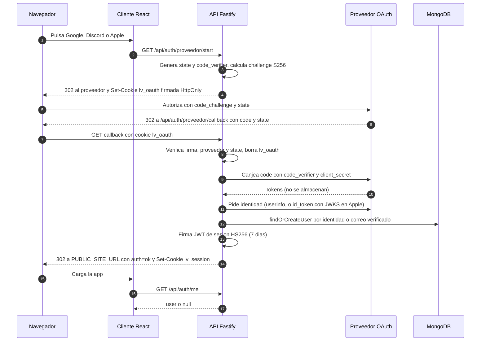

Detalles reales:

- PKCE: `code_verifier` = base64url de 48 bytes aleatorios; `state` = base64url de 24 bytes; `code_challenge` = base64url(SHA-256) con método `S256`. `redirect_uri` = `API_PUBLIC_URL/api/auth/<proveedor>/callback`. Scopes: Google `openid email profile`, Discord `identify email`, Apple `name email` (con `response_mode=form_post`).
- Apple: `client_secret` es un JWT ES256 firmado con la clave `.p8` (exp 5 min); el `id_token` se verifica contra el JWKS de Apple (emisor y audiencia). El callback de Apple llega por **POST form**, por eso `/api/auth/*/callback` está exento de la comprobación de Origin.
- Los tokens del proveedor **no salen del servidor ni se guardan**.
- El callback responde **siempre 302**. Errores: `?auth_error=` con `sesion_oauth_invalida`, `state_invalido`, `acceso_denegado` o `fallo_proveedor`.
- Enlace de cuentas: busca por `identities.{provider, subject}`; si no, por correo **solo si el proveedor lo marca verificado**; si no existe, crea un `USER` con `username` derivado y único.
- Rate limit: 15 por minuto en `start`, `callback`, `magic/verify` y `exchange`.

### 12.3 Flujo Magic Link

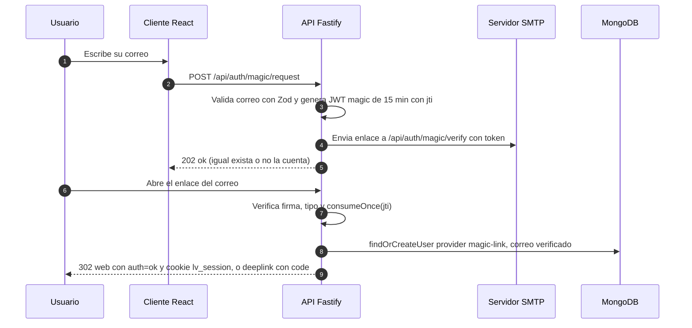

Reglas: `POST /api/auth/magic/request` limitado a 5 por 10 minutos; el token es un JWT (no hay hash en base de datos); el uso único se controla con `consumeOnce(jti)` en **memoria del proceso**; enlace inválido → `auth_error=enlace_invalido`.

### 12.4 Flujo nativo (app Capacitor) y canje

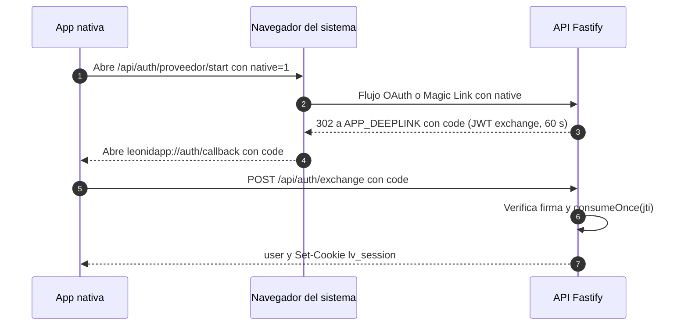

### 12.5 Cookies reales

| Cookie | Contenido | HttpOnly | Secure | SameSite | Path | TTL | Firma |
|---|---|---|---|---|---|---|---|
| `lv_session` | JWT HS256 (`iss` `leonidapp`, `typ` `session`, `sub` = id de usuario) | Sí | Solo en producción (`isProd`) | `Lax` | `/` | 7 días (604 800 s) | El propio JWT (no usa `signed:true`) |
| `lv_oauth` | `{state, verifier, provider, native}` | Sí | En producción y siempre en Apple | `Lax` (Apple: `None`) | `/api/auth` | 600 s | Firmada con `COOKIE_SECRET` (`signed:true`) |

El cliente nunca lee tokens: no hay tokens en localStorage/sessionStorage/IndexedDB (solo `guestMode` en IDB).

### 12.6 JWT sin estado, logout y revocación

- La verificación fija `algorithms:['HS256']` y el emisor (`services/session.ts:25,62`). Los tokens de propósito (`exchange`, `magic`) llevan `typ` y `jti` UUID.
- `POST /api/auth/logout` (USER+) solo **borra la cookie**; no hay lista de revocación ni rotación.
- Mitigación parcial real: como cada petición relee al usuario en la BD, **borrar al usuario o cambiar su rol** surte efecto de inmediato; un JWT robado de un usuario que sigue existiendo vale hasta 7 días.

### 12.7 CSRF y Origin

- Hook global (`app.ts:56-61`): en métodos distintos de GET/HEAD/OPTIONS, si hay cabecera `Origin` y no está en la lista permitida → 403 `Origen no permitido`. Lista: `CLIENT_ORIGIN`, `PUBLIC_SITE_URL`, `capacitor://localhost`, `ionic://localhost`, `http://localhost`, `https://localhost`.
- **Si no hay cabecera `Origin`, la petición pasa.** Exención: rutas `/api/auth/*/callback` (Apple form_post).
- CORS con credenciales solo para los orígenes permitidos; sesión con `SameSite=Lax`.

### 12.8 Bootstrap de SUPER_ADMIN

Si el correo **verificado** de un inicio de sesión coincide con `SUPER_ADMIN_EMAIL`, el usuario se crea o se eleva a `SUPER_ADMIN` (`services/users.ts:56`). Es la forma prevista de obtener el primer SUPER_ADMIN; después los roles se gestionan desde el panel. Estado actual: ❓ el valor de la variable no se verificó (no se leyeron los valores de entorno) y hay 0 SUPER_ADMIN persistidos.

### 12.9 Acceso demo de desarrollo (`demo:access`)

Comando: `pnpm --dir server demo:access [-- --minutes N] [-- --ir /ruta] [-- --revoke]`.

| Aspecto | Comportamiento real |
|---|---|
| Guardas (`assertLocalOnly`) | Se niega si `NODE_ENV=production` y si el host de `MONGODB_URI` no es `127.0.0.1`, `localhost`, `::1` o `[::1]`. |
| Creación | Borra restos previos y crea el usuario `demo-temporal` con rol `SUPER_ADMIN`, sin identidades. |
| Duración | `--minutes` 1-480 (por defecto 120): TTL del JWT de sesión. |
| Entrega | Servidor HTTP efímero en 127.0.0.1 y ::1 con ruta secreta aleatoria (48 hex) de un solo uso que responde 302 con `Set-Cookie lv_session` (HttpOnly, SameSite=Lax, Path=/, Max-Age) hacia `CLIENT_ORIGIN` + destino (`--ir`, por defecto `/aportar`). El enlace caduca a los 10 min si no se usa. |
| Fin | Al terminar (Ctrl+C, SIGTERM/SIGHUP/SIGBREAK, vencimiento o excepción) **borra el usuario**; las sesiones mueren porque cada petición revalida al usuario en la BD. `--revoke` solo borra los usuarios `demo-temporal`. |

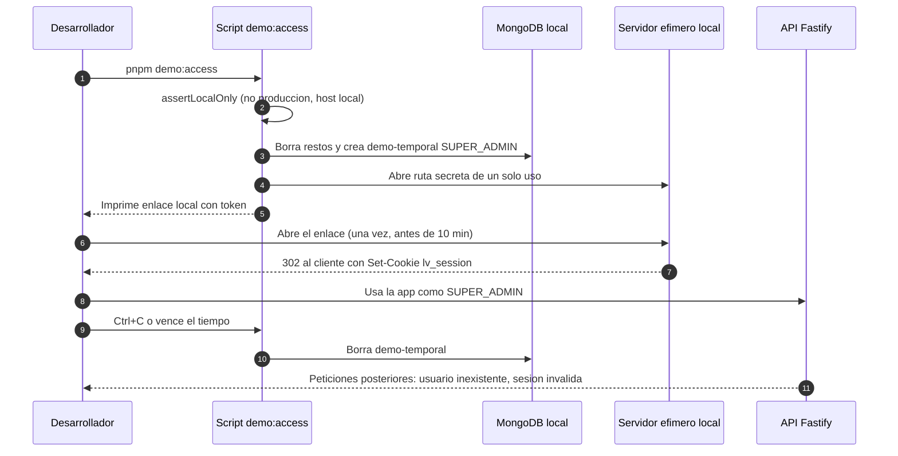

> ⚠️ **Brecha:** `seed` e `import:catalog` no tienen guardas de entorno equivalentes; solo `demo:access` las tiene.

### 12.10 Divergencias con el documento maestro (§4) y riesgos

| # | Documento maestro | Código real | Estado |
|---|---|---|---|
| 1 | `start?next=<ruta>` y `?platform=native` | `?native=1`; sin `next`; destino fijo `${PUBLIC_SITE_URL}/?auth=ok` | ⚠️ |
| 2 | Magic Link en `/api/auth/magic-link` y `/magic-link/verify`, token aleatorio con **hash almacenado** | `/api/auth/magic/request` y `/magic/verify`; JWT sin estado, sin hash en BD; un solo uso solo en memoria | ⚠️ |
| 3 | Cookie con ID de sesión firmado, 30 días con rotación, logout invalida en servidor, nativo `SameSite=None` | JWT 7 días sin rotación; logout solo borra la cookie; `SameSite` siempre `Lax` (Apple `None` solo en la cookie PKCE); nativo usa canje | ⚠️ |
| 4 | Mutaciones exigen cabecera `Origin` válida | Solo se rechaza un Origin presente y no permitido; ausente pasa | ⚠️ |
| 5 | Tokens de sesión con hash en BD | No se almacenan tokens | ⚠️ |

Riesgos (severidad = juicio del redactor):

| Riesgo | Detalle | Severidad |
|---|---|---|
| Sin revocación de sesión | Un JWT filtrado vale hasta 7 días mientras el usuario exista; logout no lo invalida. | Alta |
| Regex del correo rota en `/entrar` | `LandingAuthPage.tsx:52` valida con `/^S+@S+.S+$/` (sin barras invertidas: `S` literal), de modo que un correo normal siempre da "Introduce un correo electrónico válido." y **el Magic Link no se puede solicitar desde `/entrar`**. El Footer usa una regex correcta (`/^[^\s@]+@[^\s@]+\.[^\s@]+$/`). Verificado en el inventario del cliente. | Alta (funcional) |
| Anti-reuso en memoria | `consumeOnce` se pierde al reiniciar y no se comparte entre instancias: un enlace Magic Link o código de canje podría reutilizarse tras un reinicio o en otra instancia, dentro de su TTL (15 min / 60 s). | Media |
| Origin opcional | Una petición mutante sin cabecera `Origin` no se rechaza; la defensa real es `SameSite=Lax` y CORS. | Media |
| Sin cabeceras de seguridad | No hay helmet/CSP/HSTS/X-Frame-Options (ver §19). | Media |
| Rate limit por instancia | Estado en memoria del plugin (❓ no se verificó almacén compartido). | Media |
| Elevación por correo | `SUPER_ADMIN_EMAIL` otorga SUPER_ADMIN a quien presente ese correo verificado: depende de que el proveedor verifique correos y de que el Magic Link llegue solo al dueño del buzón. | Media |
| Sin timeout explícito en `fetch` a proveedores | ❓ No se verificó si Node aplica uno por defecto. | Baja |
| Secretos | `JWT_SECRET`/`COOKIE_SECRET` ≥32 caracteres; en producción el arranque falla si empiezan por `dev-only` (✅). | Informativo |

## 13. Regla de aprobación automática de aportes

### 13.1 Tipos de Submission

| Tipo | Quién lo crea | ¿Se promueve? | Qué hace al promoverse |
|---|---|---|---|
| `marker` | USER+ (`POST /api/submissions`) | Sí | Crea un `MapMarker` (exige `coords` al aprobar; el aporte público las deja en `null` y el equipo las indica en la bandeja) |
| `entity` | USER+ | Sí | Crea una `Entity` en el módulo de `moduleSlug` |
| `correction` | USER+ | Sí | Aplica un `patch` a una `Entity` o `MapMarker` existente |
| `contact` | Público (`POST /api/contact`) | **Nunca** | Solo bandeja ADMIN; `approved` = atendido |
| `newsletter` | Público (`POST /api/subscribe`) | **Nunca** | Solo bandeja ADMIN; deduplicado por correo |

`POST /api/submissions` rechaza `contact`/`newsletter` con `Tipo no permitido`. Límite: 20 aportes por hora.

### 13.2 Disparadores

| Disparador | Cuándo | Resultado |
|---|---|---|
| **A. Revisión manual** | `PATCH /api/admin/submissions/:id {status:'approved'}` por MODERATOR+ | `reviewSubmission` → `promote` con el revisor como actor |
| **B. Autor de confianza** | Al crear un aporte, si el rol del autor es ≥ MODERATOR | Se crea `pending` y se promueve **en la misma petición** con actor `SYSTEM` (`reviewedBy:'system'`) |

Rechazar (`status:'rejected'`) solo cambia estado y `reviewedBy`; nunca crea ni modifica destino. Un aporte ya promovido no puede rechazarse (409).

### 13.3 Validaciones previas (antes de la transacción)

| Tipo | Validación |
|---|---|
| `marker` | `coords` no nulo; `payload` valida con `markerPayloadSchema` (= `mapMarkerSchema` sin `id`, `coord_x`, `coord_y`) |
| `entity` | `payload` valida con `entitySchema` sin `id`/`module_id` (slug opcional); el módulo por `moduleSlug` debe existir y estar activo; slug único por módulo (sufijo `-N`, hasta 199 intentos; si no, 409) |
| `correction` | `payload = {target: 'Entity'|'MapMarker', id uuid, patch}`; el `patch` valida con el schema `partial` del destino; el destino debe existir (422 si no) |
| Tipos Footer | `promote` responde 409 |

Si la validación falla: **422 `Payload invalido`**; la `Submission` queda `pending` y no se escribe nada en el destino.

### 13.4 Transacción, degradación e idempotencia

1. `runAtomic` abre una transacción Mongo. Si el servidor es **standalone** (error "replica set"/"Transaction numbers"), **degrada a escritura sin transacción**. El entorno local actual es un `mongod` standalone (el inventario de infraestructura), así que hoy se ejecuta sin atomicidad.
2. "Claim" atómico: `updateOne` con `promotedTo:null` y `status≠rejected` → `approved`, `reviewedBy`. Si otra petición ganó la carrera, no se duplica.
3. Se ejecuta el plan (crear marcador/entidad o aplicar patch), se escribe `promotedTo {collection, id}` y se registran **dos entradas de auditoría**: `submission.approved` + (`marker.created` | `entity.created` | `entity.updated` | `marker.updated`).
4. Se llama `clearSsrCache()` para refrescar los metadatos SEO.
5. **Idempotencia:** si la `Submission` ya tiene `promotedTo`, `promote` la devuelve sin repetir; si está `rejected` y no promovida, 409.

> ⚠️ **Brecha (atomicidad):** en standalone, un fallo a mitad (p. ej. se crea el destino pero falla la escritura de `promotedTo`) puede dejar un documento creado y la `Submission` sin marcar. El diseño correcto requiere replica set (ver §23).

### 13.5 Errores y casos en que queda `pending`

| Situación | Respuesta | Estado de la Submission |
|---|---|---|
| Payload no válido | 422 `Payload invalido` | `pending` |
| Módulo inexistente o inactivo (entity) | 422 | `pending` |
| Destino de `correction` inexistente | 422 | `pending` |
| Auto-aprobación de MODERATOR+ falla (422) | La petición responde 422 | La Submission **ya creada** queda `pending` |
| Slug agotado (199 intentos) | 409 | `pending` |
| Rechazar un aporte ya promovido | 409 | Sin cambios |
| Revisar tipos Footer con rol < ADMIN | 403 | Sin cambios |
| MODERATOR sobre contact/newsletter | Excluidos del listado; 403 al revisar | Sin cambios |

### 13.6 Diagrama de estados

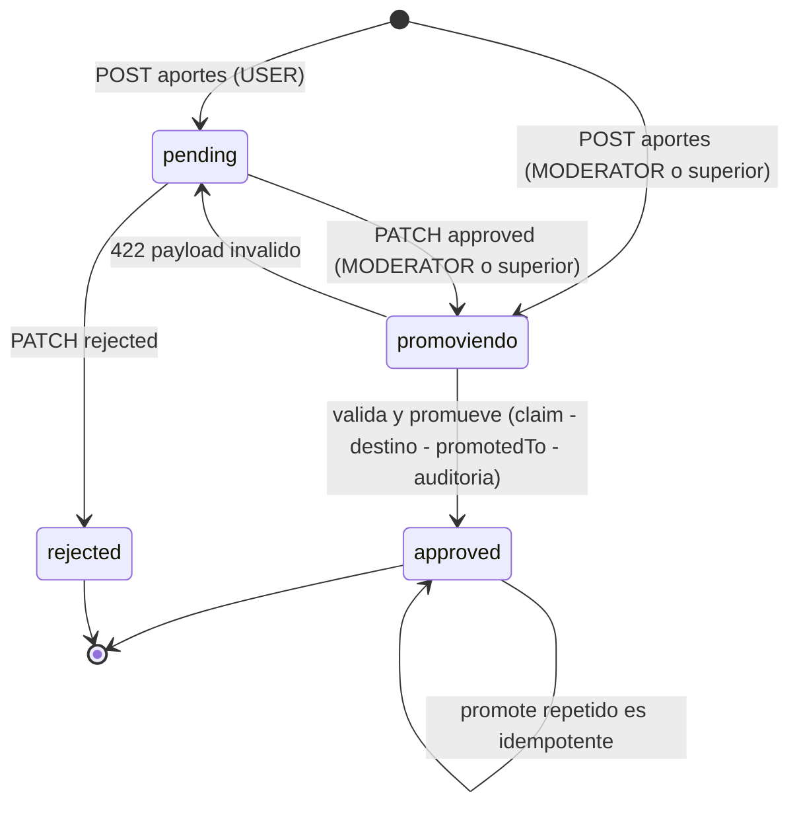

`promoviendo` es un estado transitorio del proceso (no se persiste): representa la ejecución de `promote`.

### 13.7 Divergencias con el documento maestro (§5)

| Punto | Documento | Código | Estado |
|---|---|---|---|
| Disparadores A y B, tipos y reglas 1-4 | Descritos | Implementados como se describe | ✅ |
| Regla 5: el cliente invalida las consultas de mapa/catálogo tras la promoción | Prevista | ❓ No verificado en el cliente | ❓ |
| `moduleSlug` debe existir | Exigido | Solo se valida al promover `entity` | ⚠️ |
| Transacción | Siempre en transacción | Solo con replica set; degrada en standalone | 🟡 |

## 14. Pipeline y estado del catálogo de datos

### 14.1 Procedencia de los datos reales

El catálogo vivo **no proviene de una API oficial ni de una base de terceros**: sale de **grabaciones de un stream** (sesiones del 2026-11-18) analizadas **por fotogramas mediante agentes**, que extrajeron los datos visibles en pantalla (nombres, estadísticas, precios, rótulos del mapa). Cada ficha conserva **evidencia** (fotogramas y marca de tiempo) y una **confianza**.

> ⚠️ **Brecha (trazabilidad):** el proceso de extracción por fotogramas **no está en el repositorio**; sí están el resultado (`server/data/catalogo_grabaciones.json`, 166 KB) y el importador. El JSON está versionado en `server/data/` (commit `ecfcacf`). Los datos son observación propia de vídeo, no datos oficiales ni contrastados con terceros (❓ no verificado contra fuente externa).

### 14.2 Formato de ficha (entrada del importador)

```json
{
  "modulo": "armas",
  "slug": "girardi-es9",
  "titulo": "Girardi ES9",
  "subtitulo": "Pistola militar",
  "categoria": "Pistolas",
  "stats_juego": { "dano": 4.2, "precision": 5.2, "manejo": 8.4, "alcance": 4.4 },
  "metadata": { "slot": "Arma auxiliar", "descripcion": "...", "alias": ["..."] },
  "confianza": "alta",
  "evidencia": ["2026-11-18_08-08-46: t_0080@arriba-der ~ 00:26:25 (...)"],
  "notas": "Stats verificados en fotograma. ..."
}
```

| Campo | Regla |
|---|---|
| `modulo` | Debe existir como `Module.slug`; si no, error de ficha |
| `slug` | Único por módulo |
| `stats_juego` | Objeto con valores 0-10 (el valor del juego) |
| `metadata` | Objeto libre |
| `confianza` | `alta` / `media` / `baja` |
| `evidencia` | Hasta 5 cadenas, formato `fecha_sesión: t_NNNN@cuadrante ~ hh:mm:ss` (en mapa también `MAPA_n: f_NNNN ~ hh:mm:ss …`) |
| `notas` | Texto libre del analista (45 de 225 fichas) |

### 14.3 El importador `import:catalog`

Comando: `pnpm --dir server import:catalog <archivo.json> [--apply]` (`server/src/scripts/importCatalog.ts`).

| Aspecto | Comportamiento real |
|---|---|
| Modo por defecto | **Simulación**: valida y cuenta (nuevas, actualizadas, conflictos, errores); no escribe |
| `--apply` | Escribe en la base |
| Validación | `fichaSchema` (Zod) de la ficha y `entitySchema` del documento resultante |
| Clave | Upsert por **(módulo, slug)**: `updateOne({module_id, slug}, {$set: doc, $setOnInsert: {_id: randomUUID()}}, {upsert:true})`; reimportar no duplica (idempotente) |
| Estadísticas | `stats_json` = `stats_juego × 10` redondeado (escala 0-100 de las barras); el valor exacto 0-10 queda en `metadata_json.stats_juego` |
| Procedencia | `metadata_json.fuente = 'grabacion'`, más `confianza` y `evidencia` |
| Protección | Si ya existe una entidad con ese (módulo, slug) cuya `metadata_json.fuente` **no** sea `'grabacion'` → **conflicto**, se omite: nunca pisa fichas de otra fuente (semilla o manuales) |
| Salida | Resumen y `exitCode=1` si hubo errores |
| Guardas de entorno | Ninguna (apunta a la `MONGODB_URI` configurada) |
| Caché SSR | No invoca `clearSsrCache` (proceso aparte); la caché del servidor expira por TTL ≤5 min |

> ⚠️ **Brecha:** el uso del script con `catalogo_grabaciones.json` es lo que indican los conteos (225 fichas importadas, `fuente='grabacion'` en la base); el inventario lo marca como inferencia (❓).

### 14.4 Conteos (instantánea histórica 2026-11-18)

> **Vigencia:** conteos vigentes en §0.2: 243 entidades (armas 13, vehículos 200, guías 20, mapa 10) y 10 `MapMarker`. La tabla siguiente se conserva como historia del lote de grabaciones.

Fuentes: el inventario de infraestructura y análisis del JSON.

| Módulo | Entidades en BD | Fichas en el JSON | Observación |
|---|---|---|---|
| mapa | 138 | 138 | Lugares sin coordenadas |
| guias | 57 | 55 | Las 2 adicionales son de seed (`Basicos`: "Cómo ganar dinero rápido" y "Domina los vehículos de Leonida") |
| vehiculos | 20 | 20 | |
| armas | 12 | 12 | |
| coleccionables | 0 | 0 | Sin datos |
| foro / radio | 0 | 0 | `radio` inactivo |
| **Total** | **227** | **225** | |

Otros datos de hoy: 0 marcadores, 6 hilos de foro (semilla: General 2, Guías/Ayuda 2, Secretos 1, Crews 1), 9 posts, 5 usuarios, 1 noticia, 7 módulos. En la base, el único valor de `metadata_json.fuente` es `grabacion` (las 2 guías de seed no llevan `fuente`).

**Por categoría**

| Módulo | Categorías (nº de fichas) |
|---|---|
| mapa (138) | Negocios 43 · Ciudades y Barrios 25 · Puntos de Interés 22 · Islas y Cayos 18 · Aguas 16 · Condados 14 |
| guias (55 + 2) | Sistemas 15 · Personajes 14 · Misión Principal 11 · Teléfono y Apps 8 · Actividades 3 · Tiendas 2 · Talleres 2 (+2 "Basicos" de seed) |
| vehiculos (20) | Otros 4 · Pickups 3 · SUV 2 · Deportivos 2 · Sedanes 2 · Clásicos 2 · Todoterreno 2 · Náuticos 1 · Motos 1 · Aéreos 1 |
| armas (12) | Rifles de Asalto 3 · Cuerpo a cuerpo 3 · Pistolas 2 · Munición 2 · Escopetas 1 · Equipo 1 |

**Por confianza**

| Módulo | Alta | Media | Baja | Total |
|---|---|---|---|---|
| armas | 9 | 3 | 0 | 12 |
| vehiculos | 17 | 3 | 0 | 20 |
| mapa | 84 | 46 | 8 | 138 |
| guias | 44 | 11 | 0 | 55 |
| **Total** | **154** | **63** | **8** | **225** |

### 14.5 Qué quedó fuera (histórico)

> **Vigencia:** el mapa ya tiene 10 marcadores; la ausencia de pines descrita abajo es histórica.

| Elemento | Estado | Detalle |
|---|---|---|
| Coleccionables | ❌ 0 fichas | Módulo activo, sin contenido |
| Marcadores de mapa con coordenadas | ❌ 0 | Las **138 entidades de mapa son fichas de lugares sin pin** (sin coordenadas ni `MapMarker`). Los 20 marcadores de ejemplo se borraron de la base el 2026-11-18; siguen en `seedData.json` y `src/data/seed.ts` como fallback sin API |
| Estadísticas de vehículos | 🟡 | Solo 1 de 20 vehículos tiene `stats_juego` medidas |
| Radio | ❌ | Módulo inactivo, sin fichas |
| Imágenes de fichas | ❓ | El formato de ficha no incluye `imagen_url`; no se verificó qué imagen muestra el cliente (fallback visual) |

### 14.6 Límites de calidad y dudas conocidas

- **Confianza baja (8 fichas, todas de mapa)** y **media (63)**: lecturas inciertas o equivalencias sin confirmar. Notas reales: "Solo consta en la lista de subdivisiones de un hallazgo; verificar rótulo en el mapa" (p. ej. `condado-de-kelly-norte`), "Nombre no confirmado. Carteles de autopista citan 'VCI Airport'" (`aivc`), "Lectura incierta" (`louis-diner`), "equivalencia probable no confirmada" (`the-rusty-anchor`).
- **Títulos inferidos en guías:** 4 guías tienen `titulo_inferido:true` (el título no aparece en pantalla). Las 11 de Misión Principal son todas de confianza media.
- **Cobertura limitada a lo visto en vídeo:** lo que no apareció en las grabaciones no existe en el catálogo; no hay garantía de exhaustividad frente a una base consolidada como GTABase.
- **Estadísticas:** los valores 0-10 son los mostrados en las fichas del juego; ×10 es solo escala de dibujo (valor exacto en `metadata_json.stats_juego`).
- **Variantes de nombre:** el slug por módulo evita duplicados exactos, no variantes; por eso `alias` está en las 138 fichas de mapa y las 20 de vehículos.

### 14.7 Cómo se actualiza el catálogo en adelante

1. **Regenerar o ampliar** el JSON con nuevas fichas (más grabaciones, dudas resueltas, coordenadas).
2. **Simular:** `pnpm --dir server import:catalog <json>` y revisar nuevas/actualizadas/conflictos.
3. **Aplicar:** con `--apply`. Es idempotente: actualiza por (módulo, slug) y no toca fichas de otra fuente.
4. **Refresco SEO:** esperar el TTL de la caché SSR (≤5 min) o reiniciar la API (el script no la limpia).
5. **Edición puntual:** panel de administración (ADMIN+) o aportes aprobados (§13). Ojo: una edición manual de una ficha con `fuente:'grabacion'` se **sobrescribe** en la siguiente importación si el JSON conserva el mismo slug (el `$set` reemplaza los campos importados); ❓ no hay bloqueo de campos editados a mano.
6. **Versionado:** el JSON ya está versionado en `server/data/` (commit `ecfcacf`); mantenerlo como fuente reproducible.
7. **Semilla:** `pnpm --dir server seed` repuebla los ejemplos (sobrescribe por `_id`) y no borra lo importado; el cliente sin API usa la semilla embebida (23 entidades y 20 marcadores ficticios).
8. **Coordenadas del mapa:** pendiente. Hay que crear `MapMarker` (`coord_x`/`coord_y` en el plano del cliente, opcionalmente `entity_id` a la ficha) por el panel, por aportes o con un importador nuevo (❌ no existe importador de marcadores).

## 15. API REST completa

Servidor Fastify 5 (`server/src/app.ts`). Todas las rutas cuelgan de `/api/*` salvo las de SEO/estáticos (§15.10). Fuente: inventario del backend verificado contra el código (referencias `archivo:línea` relativas a `server/src/`).

### 15.0 Convenciones transversales

| Tema | Regla real |
|---|---|
| Guardas | `requireAuth` = rol USER o superior; `requireRole(R)` = rango ≥ R (`plugins/auth.ts:18-26`). Rangos: USER 0, MODERATOR 1, ADMIN 2, SUPER_ADMIN 3 (`models/User.ts:7`). GUEST = petición sin sesión (`req.authUser === null`, no persistido). |
| Resolución de sesión | Hook `onRequest` lee la cookie `lv_session`, verifica el JWT y hace `User.findById` en CADA petición (`plugins/auth.ts:28-38`): el rol siempre sale de la base de datos, no del token. |
| Sin sesión / sin permiso | 401 `{error:"Sesion requerida"}` · 403 `{error:"Permisos insuficientes"}`. |
| Validación | Zod 4 en cada entrada (`validate.ts:14-18`). Fallo → 400 `{error:"Datos invalidos", details:<z.treeifyError>}`. Los parámetros `:id` son `z.uuid()`. |
| Formato de error | `{error: string, details?: object}`. `HttpError` conserva su `statusCode`; `ZodError` → 400; cualquier otro error: su `statusCode` o 500; los ≥500 se registran en log y responden `{error:"Error interno"}` (`app.ts:63-71`). |
| Códigos de estado usados | 200 lectura/actualización · 201 creación · 202 magic link solicitado · 204 borrado · 302 redirecciones de auth · 301 redirecciones SEO · 400 datos inválidos · 401 · 403 · 404 · 409 conflicto · 422 referencia/payload inválido · 429 rate limit · 502 fallo del proveedor OAuth · 503 proveedor/SMTP no configurado. |
| DTO | Las respuestas NO se validan con Zod; se mapean con funciones `toXDTO` (p. ej. `toPublicUserDTO` sin email, `toSelfUserDTO` con email). La mayoría de colecciones usa `_id` UUID (String) expuesto como `id`; `OfficialNews` y `ForumVote` usan ObjectId. |
| Rate limit global | `@fastify/rate-limit`: 200 peticiones/minuto (`app.ts:52`). Estado en memoria del plugin, por instancia (❓ clave exacta del límite y store compartido: no verificado). Cuando una ruta indica otro límite, sustituye al global. |
| Límite de cuerpo | 1 MiB (`bodyLimit`, `app.ts:41`). |
| CORS | Orígenes permitidos: `CLIENT_ORIGIN`, `PUBLIC_SITE_URL`, `capacitor://localhost`, `ionic://localhost`, `http://localhost`, `https://localhost`; peticiones sin Origin se aceptan; `credentials: true`; métodos GET, POST, PUT, PATCH, DELETE, OPTIONS (`app.ts:21-28,45-49`). |
| Control de Origin en mutaciones | Para métodos distintos de GET/HEAD/OPTIONS: si hay cabecera `Origin` fuera de la lista → 403 `Origen no permitido`. Si NO hay Origin, la petición pasa. Excepción: URLs `/api/auth/*/callback` (Apple `form_post`) (`app.ts:56-61`). |
| Auditoría | `writeAudit` (`services/audit.ts:24`) inserta en `AuditLog` solo si hay `req.authUser`; guarda actor, rol, IP, acción, objetivo y metadata. Solo-inserción (sin endpoints de edición/borrado). |
| Caché SSR | `clearSsrCache()` solo se invoca en `promote()` de aportes (`services/submissions.ts:177`) y en la ingesta de noticias (`workers/officialNewsWorker.ts:185`). |

> ⚠️ **Brecha:** los CRUD de catálogo (`/api/modules`, `/api/entities`, `/api/markers`) y `PATCH /api/admin/config` NO limpian la caché SSR; los metadatos de fichas dinámicas pueden quedar desfasados hasta 5 min (ver §17).

### 15.1 Salud

| Método y ruta | Guarda | Rate | Salida |
|---|---|---|---|
| GET `/api/health` (`app.ts:73`) | pública | global | `{ok:true}` |

### 15.2 Autenticación (`routes/auth.ts`)

Constante `strict` = 15 peticiones/min (`auth.ts:55`). Cookies: `lv_oauth` (PKCE) y `lv_session` (sesión); detalle en §16 y §19.

| Método y ruta | Guarda | Rate | Entrada y validación | Salida | Errores | Efectos |
|---|---|---|---|---|---|---|
| GET `/api/auth/providers` | pública | global | — | `{providers:[{id,enabled,configured}]}` para google, discord, apple y `magic-link` (`configured` = SMTP definido) | — | `enabled` viene de `AppConfig.enabled_auth_providers` |
| GET `/api/auth/:provider/start` | pública | 15/min | `provider` ∈ google/discord/apple; query `native` `'0'`/`'1'` opcional | 302 al proveedor con `code_challenge` S256, `state`, scope | 400; 503 `Proveedor X no configurado en el servidor` | Set-Cookie `lv_oauth` firmada `{state, verifier, provider, native}`: HttpOnly, path `/api/auth`, 600 s, Secure si prod o Apple, SameSite `lax` (`none` en Apple) |
| GET y POST `/api/auth/:provider/callback` | pública, exenta del control de Origin | 15/min | query (GET) o formulario (POST): `state`, `code`, `error` | Siempre 302. Éxito web: `${PUBLIC_SITE_URL}/?auth=ok` + cookie de sesión. Éxito nativo: `${APP_DEEPLINK}?code=<JWT de canje 60 s>`. Fallo: `…?auth_error=<motivo>` | Motivos: `sesion_oauth_invalida`, `state_invalido`, `acceso_denegado`, `fallo_proveedor` | Borra siempre `lv_oauth`; `exchangeCode` + `findOrCreateUser` |
| POST `/api/auth/magic/request` | pública | 5 por 10 min | `{email: z.email(), native?: boolean}` | 202 `{ok:true}` idéntico exista o no la cuenta | 400; 503 `Magic Link no configurado (SMTP)` | JWT `magic` (15 min) → correo con enlace `${API_PUBLIC_URL}/api/auth/magic/verify?token=` |
| GET `/api/auth/magic/verify` | pública | 15/min | query `token` (mín. 20 caracteres) | 302 igual que el callback | Fallo → `auth_error=enlace_invalido` | Valida firma + `consumeOnce(jti)` (uso único, en memoria); `findOrCreateUser('magic-link', emailVerified true)` |
| POST `/api/auth/exchange` | pública | 15/min | `{code: string ≥ 20}` | `{user: SelfUserDTO}` + cookie de sesión | 401 `Codigo invalido o caducado` / `Usuario inexistente` | Canje del código nativo, uso único (60 s) |
| GET `/api/auth/me` | pública | global | — | `{user: SelfUserDTO \| null}` (id, username, avatar_url, discord_id=null, rol, created_at, email) | — | — |
| POST `/api/auth/logout` | USER+ | global | — | `{ok:true}` | 401 | Solo borra la cookie; el JWT no se revoca en servidor |

> ⚠️ **Brecha respecto al documento maestro:** el documento de datos §4 prevé `?next=`, `?platform=native`, `/api/auth/magic-link`, token con hash en servidor, sesión de 30 días con rotación y logout con invalidación. El código usa `?native=1`, `/api/auth/magic/request|verify`, JWT sin estado (7 días, sin rotación), y no acepta `next` (redirección final fija a `/?auth=ok`). Ver §12.

### 15.3 Configuración y administración (`routes/config.ts`)

| Método y ruta | Guarda | Entrada | Salida | Errores | Efectos |
|---|---|---|---|---|---|
| GET `/api/config` y GET `/api/config/public` | pública | — | `{maintenance_mode, announcement, feature_flags, enabled_auth_providers, social_links, monetization, modules:[{id,slug,nombre,icono,orden,isActive}]}`; `Cache-Control: public, max-age=30` | 500 | `getGlobalConfig()` hace upsert del singleton. Expone TODOS los módulos (activos e inactivos, con `isActive`). Si `monetization` no valida, devuelve el valor por defecto del schema |
| PATCH `/api/admin/config` | SUPER_ADMIN | `appConfigUpdateSchema` = `appConfigSchema.partial()`: `maintenance_mode` bool; `announcement` ≤500 nullable; `feature_flags` record de bool; `enabled_auth_providers` ≤4 de google/discord/apple/magic-link; `social_links` ≤12 `{platform 1-30, url}`; `monetization` | `AppConfig` completo | 400 | `$set` del patch (reemplaza `monetization` entero si se envía); auditoría `config.update`; NO limpia caché SSR |
| GET `/api/hero` | pública | cubo `read` | — | `{slides:[{id,kicker,titulo,descripcion,boton_texto,boton_enlace,boton_secundario_texto,boton_secundario_enlace,imagen_url,imagen_alt}]}` solo activas y ordenadas | — | `Cache-Control: public, max-age=30`, ETag débil |
| GET `/api/admin/hero` | ADMIN+ | global | — | `{slides: HeroSlide[], max: 6}` (todas, ordenadas) | 404 uniforme sin staff | `no-store` |
| PUT `/api/admin/hero` | ADMIN+ | global | `{slides: HeroSlide[]}` (máx. 6, ids únicos, enlaces e imagen validados) | `{slides}` | 400; 404 uniforme sin staff | Reemplaza `AppConfig.hero_slides` (normaliza `orden`), borra los `MediaAsset` propios huérfanos, audita `hero.update`/`media.delete`, limpia caché SSR |
| POST `/api/admin/media` | ADMIN+ | 20/min | cuerpo binario `image/webp` o `image/jpeg` ≤ 400 KB, 1600×900, firma real | `201 {id,url,mime,width,height,bytes}` | 400 legible (tamaño, firma, tipo, dimensiones); 404 uniforme sin staff; 413 > 600 KB; 415 tipo no admitido; 429 | Crea `MediaAsset`; audita `media.upload` |
| POST `/api/admin/entities/:id/image` | ADMIN+ | 20/min | cuerpo binario `image/jpeg`/`image/png`/`image/webp` ≤ 12 MB | `200 {id,url,bytes,width,height,capturaPropiaPendiente:false}` | 400 (formato/tipo/compresión); 404 uniforme sin staff o ficha inexistente; 413; 429 | Optimiza a WebP 1600×900 ≤ 400 KB en `MediaAsset`, actualiza `imagen_url`, baja `capturaPropiaPendiente`, borra el `/media` anterior huérfano; audita `entity.image.replace` |
| GET `/media/:id` | pública | cubo `read` | `id` uuid | binario con `Content-Type` real, `nosniff`, `Cache-Control: public, max-age=31536000, immutable`, ETag | 404 `text/plain` | Sin listados |
| GET `/api/admin/users` | SUPER_ADMIN | query `limit` 1-200 (def. 50), `q` ≤80 | `{users: SelfUserDTO[]}` (incluye email) | 400 | Búsqueda: `username` por regex escapado (i) o `email` exacto en minúsculas; orden `created_at` desc |
| PATCH `/api/admin/users/:id/role` | SUPER_ADMIN | `id` uuid; `{rol: USER/MODERATOR/ADMIN/SUPER_ADMIN}` | `{user: PublicUserDTO}` | 404; 409 `No se puede degradar al ultimo SUPER_ADMIN` | Auditoría `user.role.update {from,to}` |
| GET `/api/admin/audit-logs` | ADMIN | query `limit` 1-200 (def. 50), `before` fecha, `actor_id` uuid | `{logs:[…AuditLog]}` por `created_at` desc | 400 | — |

> ⚠️ **Brecha:** el documento maestro reserva la lectura de `AuditLog` a SUPER_ADMIN; el código la permite a ADMIN. Los nombres de acción reales (`config.update`, `user.role.update`) difieren de los del documento (`config.updated`, `user.role_changed`).

### 15.4 Catálogo: módulos, entidades y marcadores (`routes/catalog.ts`)

Escritura = ADMIN o superior (`requireRole('ADMIN')`). Todas las mutaciones auditan; ninguna limpia la caché SSR.

| Método y ruta | Guarda | Entrada | Salida | Errores | Auditoría |
|---|---|---|---|---|---|
| GET `/api/modules` | pública | query `all=1` opcional | `ModuleDTO[]` por `orden`; solo `activo:true` salvo `all=1` con rol ADMIN+ | 400 | — |
| GET `/api/modules/:moduleSlug/entities` | pública | slug 1-60 | `EntityDTO[]` por `created_at` asc | 404 `Modulo no encontrado` (solo módulos activos) | — |
| GET `/api/modules/:moduleSlug/entities/:slug` | pública | slug 1-120 | `EntityDTO` + `module_slug` | 404 módulo o `Entidad no encontrada` | — |
| POST `/api/modules` | ADMIN | `moduleSchema`: id? uuid, slug 1-60, nombre 1-80, icono 1-60, activo (def. true), orden int (def. 0) | 201 `ModuleDTO` | 400; slug duplicado = error Mongo 11000 sin mapeo → 500 (❓ no verificado en ejecución) | `module.create` |
| PATCH `/api/modules/:id` | ADMIN | `moduleUpdateSchema` (parcial) | `ModuleDTO` | 404 | `module.update` |
| DELETE `/api/modules/:id` | ADMIN | — | 204 | 404 | `module.delete` (NO borra sus entidades) |
| GET `/api/entities` | pública | query `module_id` uuid?, `categoria`? | `EntityDTO[]` (incluye módulos inactivos) | 400 | — |
| POST `/api/entities` | ADMIN | `entitySchema`: id?, module_id uuid, slug (`^[a-z0-9]+(?:-[a-z0-9]+)*$`, ≤120), titulo 1-160, subtitulo ≤240, categoria 1-80, imagen_url, stats_json, metadata_json | 201 `EntityDTO` | 422 `module_id inexistente`; 400; slug duplicado en el módulo → 11000 → 500 | `entity.create` |
| PATCH `/api/entities/:id` | ADMIN | `entityUpdateSchema` (parcial; `id` ignorado) | `EntityDTO` | 404 | `entity.update {patch}` |
| DELETE `/api/entities/:id` | ADMIN | — | 204 | 404 | `entity.delete` |
| GET `/api/markers` | pública | query `region`? | `MarkerDTO[]` (`coord_x`, `coord_y` aplanados) | 400 | — |
| POST `/api/markers` | ADMIN | `mapMarkerSchema`: entity_id?, region 1-80, titulo 1-160, descripcion ≤2000, coord_x/coord_y finitos, media_url | 201 `MarkerDTO` | 400 | `marker.create` |
| PATCH `/api/markers/:id` | ADMIN | `mapMarkerUpdateSchema`; `coord_x` y `coord_y` deben ir juntas | `MarkerDTO` | 400 `coord_x y coord_y deben enviarse juntas`; 404 | `marker.update` |
| DELETE `/api/markers/:id` | ADMIN | — | 204 | 404 | `marker.delete` |

> ⚠️ **Brechas:** (a) no hay consultas geoespaciales (`$near`/`$geoWithin`) aunque existe el índice `2d`; `GET /api/markers` solo filtra por región. (b) No hay registro de redirecciones 301 si se cambia un `slug` con PATCH. (c) La colisión de slug cae en 500 en lugar de 409.

### 15.5 Foro (`routes/forum.ts`)

| Método y ruta | Guarda | Rate | Entrada | Salida | Errores / efectos |
|---|---|---|---|---|---|
| GET `/api/forum` | pública, dos modos | global | — (ignora filtros) | Cabeceras `Cache-Control: no-store`, `Vary: Cookie`. **Invitado** (`preview:true`): hilos SIN `contenido`, `created_at` desc, máx. 50, `posts: []`, perfiles solo `{id, username, avatar_url}`, `replies_count` por hilo. **Con sesión** (`preview:false`): hasta 500 hilos (fijados primero, luego `created_at` desc) con `contenido`, hasta 5000 posts, perfiles públicos | — |
| GET `/api/forum/votes` | USER+ | global | — | `{votes:[{target_type,target_id}]}` del usuario | 401 |
| POST `/api/forum/threads` | USER+ | 20/min | `forumThreadSchema`: entity_id?/marker_id? uuid, `categoria` ∈ General/Guias/Ayuda/Secretos/Crews (el literal guardado es `Guias/Ayuda`), `titulo` 3-160, `contenido` 1-10000, `is_spoiler` (def. false) | 201 `ThreadDTO` (`user_id` = sesión; `is_pinned` no es entrada) | 400; sin auditoría |
| POST `/api/forum/posts` | USER+ | 20/min | `forumPostSchema`: thread_id uuid, parent_post_id? uuid, contenido 1-10000 | 201 `PostDTO` | 422 `thread_id inexistente` / `parent_post_id inexistente en este hilo`; sin auditoría |
| POST `/api/forum/votes/toggle` | USER+ | 20/min | `{target_type: THREAD\|POST, target_id uuid}` | `{voted, upvotes_count}` | 404 `Objetivo no encontrado`. Voto único por usuario: si existe lo borra (−1), si no lo crea (+1); luego `$inc` atómico del contador (no transaccional respecto al voto) |
| DELETE `/api/forum/threads/:id` | MODERATOR+ | global | `id` uuid | 204 | 404. Borra hilo, sus posts y votos asociados; auditoría `forum.thread.delete` |
| DELETE `/api/forum/posts/:id` | MODERATOR+ | global | `id` | 204 | 404. Borra post y sus votos; auditoría `forum.post.delete`. Sin cascada a respuestas hijas (`parent_post_id`) |
| PATCH `/api/forum/threads/:id/pin` | MODERATOR+ | global | `{is_pinned: boolean}` | `ThreadDTO` | 404; auditoría `forum.thread.pin` |

> 🟡 **Parcial:** no existe edición de hilos/posts, ni "ocultar" (el documento maestro lo prevé para MODERATOR), ni "reportar mensaje" (HU-07).

### 15.6 Noticias (`routes/news.ts`)

Solo lectura; escribe únicamente el worker (§16.7).

| Método y ruta | Guarda | Entrada | Salida | Errores |
|---|---|---|---|---|
| GET `/api/news` | pública | query `source` ∈ rockstar-newswire/rockstar-youtube/take-two-ir?, `limit` 1-50 (def. 12) | `[{id,title,summary,sourceUrl,source,imageUrl\|null,publishedAt,slug}]` por `publishedAt` desc; `Cache-Control: public, max-age=60` | 400 |
| GET `/api/news/:slug` | pública | slug 1-200 | mismo DTO; `max-age=60` | 404 `Noticia no encontrada` |

### 15.7 Progreso (`routes/progress.ts`)

| Método y ruta | Guarda | Entrada | Salida | Lógica |
|---|---|---|---|---|
| GET `/api/progress` | USER+ | — | `{items:[{target_type,target_id,completado,updated_at}]}` | Filtra por `user_id` de la sesión |
| PUT `/api/progress` | USER+ | `{items:[{target_type ENTITY\|MARKER, target_id uuid, completado (def. true), updated_at? fecha}]}`, máx. 2000 | `{items}` con el estado fusionado completo del usuario | **Última escritura gana**: `at` = `updated_at` si existe y no es futura, si no la hora actual; si ya hay registro con `updated_at ≥ at` se ignora; si no, upsert. Procesa ítem por ítem (N consultas). Sin rate limit propio |

### 15.8 Aportes (`routes/submissions.ts`)

| Método y ruta | Guarda | Rate | Entrada | Salida | Errores / efectos |
|---|---|---|---|---|---|
| POST `/api/submissions` | USER+ | 20/hora | `moduleSlug` 1-60, `type` ∈ marker/entity/correction (contact/newsletter → `Tipo no permitido`), `title` 3-160, `payload` (def. {}), `coords {x,y}` (opcional; el aporte público `marker` va con `coords: null` y el equipo lo completa al aprobar) | 201 `SubmissionDTO` | 400. Crea `pending`; si el autor es MODERATOR+ se promueve en la misma petición como actor `SYSTEM` (`reviewedBy:'system'`). Si la promoción falla (422) la Submission ya creada queda `pending` y la petición responde 422. No valida que `moduleSlug` exista al crear |
| GET `/api/submissions/mine` | USER+ | global | — | `SubmissionDTO[]` (máx. 100, `createdAt` desc) | — |
| GET `/api/admin/submissions` | MODERATOR+ | global | query `status`?, `limit` 1-200 (def. 50), `origin`? (`user`|`pipeline`), `runId`? (uuid del `PipelineRun`), `reason`? (`nueva`|`actualizada`|`conflicto`) | `SubmissionDTO[]` (los de origen `pipeline` añaden `pipeline_reason`, `pipeline_run_id`, `conflict_fields`; `payload.tarjeta` solo como `{ bytes, sha256 }`) | MODERATOR no ve `contact` ni `newsletter`; ADMIN+ sí; `runId` inválido 400 |
| GET `/api/admin/submissions/:id/tarjeta.webp` | MODERATOR+ (404 uniforme sin staff) | global | — | `image/webp` (`private, no-store`, `nosniff`) | 404 si el aporte no existe, no es del pipeline o no tiene tarjeta |
| POST `/api/admin/submissions/bulk` | MODERATOR+ (404 uniforme; RBAC antes que Zod) | 10/min | `{ action: approve|reject, ids?: uuid[] (1-200) | filter?: { origin: 'pipeline', status: 'pending', runId?, reason? }, reviewNote? }` (exactamente uno de `ids`/`filter`) | `{ action, requested, ok, failed, truncated, results }` | `approve` por filtro excluye `conflicto` salvo `reason: 'conflicto'`; ≤ 500 por llamada (`truncated`); no aborta ante fallos; auditoría por ítem |
| PATCH `/api/admin/submissions/:id` | MODERATOR+ | global | `{status: approved, coords?: {x,y} (coords solo con approved: ubica el pin de un marker sin coordenadas); status: approved\|rejected}` | `SubmissionDTO` | 404; 403 si tipo contact/newsletter y rol < ADMIN; 409 `Aporte ya procesado` si ya no está `pending` o ya fue promovido (el rechazo usa una guarda atómica); promoción 422/409. Auditoría `submission.<status>` + `marker.created\|entity.created\|entity.updated\|marker.updated`; limpia caché SSR al promover |

Regla completa de promoción en §13.

### 15.9 Contacto y suscripción del Footer (`routes/contact.ts`)

Límite 5/hora en ambas. Honeypot: campo opcional `website`; si trae texto se trata como bot.

| Método y ruta | Entrada | Salida | Lógica |
|---|---|---|---|
| POST `/api/contact` | `email` (`z.email()` ≤254, minúsculas), `message` 10-2000, `website?` | 201 `{ok:true}` siempre | Bot: no persiste pero responde 201. Persiste `Submission` tipo `contact`, `userId:null`, `moduleSlug:'leonidapp'`, `title` «Contacto de <email>» (≤160), `payload {email, message}` |
| POST `/api/subscribe` | `email` igual, `locale` ∈ es/en, `website?` | 201 `{ok:true}` siempre | Deduplica por `payload.email`; si ya existe no crea y responde igual (sin enumeración). `title` «Suscripción newsletter» |

Datos con formato inválido sí devuelven 400. No se envía correo de confirmación (doble opt-in ❌ no implementado; inferido: el mailer solo se usa para el enlace mágico).

### 15.10 SEO y estáticos (`routes/seo.ts`)

| Método y ruta | Guarda | Respuesta | Lógica |
|---|---|---|---|
| GET `/sitemap.xml` | pública | XML `urlset`, `Cache-Control: public, max-age=3600` | Ver §17.5 |
| GET `/sitemap-:n.xml` | pública | trozo de URLs | 404 si no existe el índice |
| GET `/robots.txt` | pública | texto, `max-age=86400` | Ver §17.6 |
| `setNotFoundHandler` | — | — | No GET/HEAD o ruta `/api/*` → 404 JSON `{error:'No encontrado'}`. Rutas con extensión (1-8 caracteres) → estático desde la carpeta de `dist/index.html`. `/assets/*` sin extensión → 404. Resto → fallback SPA con SSR-lite (301, 200 o 404 con `injectHead`; `Cache-Control: public, max-age=60` si 200, `no-store` si 404). Si no existe `dist/index.html` → 404 JSON `Cliente no compilado…` |
| `sendStatic` | — | archivo | Decodifica la ruta, rechaza `\0`, resuelve y exige que quede dentro de la raíz (anti path traversal), solo ficheros. Caché `public, max-age=31536000, immutable` para `/assets/`; `no-cache` para `index.html`, `sw.js` y el HTML de las páginas (200); `max-age=3600` el resto. Un `/assets/*` inexistente (hash de un despliegue anterior) responde `404` `text/plain` («No encontrado», `no-store`), nunca JSON; el área `/_staff/` conserva su 404 JSON uniforme. **Recuperación tras un despliegue:** `public/sw.js` (cache `leonidapp-static-v9`, Network-First para navegación, `skipWaiting` + `clients.claim`, purga de cachés antiguas) y `src/main.tsx` (`vite:preloadError` y rechazos «Failed to fetch dynamically imported module» recargan la página una sola vez, con un indicador en `sessionStorage` que no contiene datos de sesión y se retira a los 10 s). Nota: las afirmaciones anteriores de «sin service worker» de este documento están obsoletas: el SW existe (`public/sw.js`). MIME por extensión (js, css, html, json, svg, png, jpg, jpeg, webp, gif, ico, woff, woff2, txt, xml, webm, mp4; otro → octet-stream) |

> 🟡 **Nota:** no hay `@fastify/static`; la API sirve el cliente compilado (`dist/`) ella misma. En desarrollo el cliente corre en Vite y la API no sirve la SPA.

### 15.11 Pipeline de datos y catálogo (`routes/pipeline.ts`, ingesta externa)

Contrato vigente definido en `docs/LeonidApp-Rutas-SEO-Monetizacion.md` §1.6 (manda ese documento ante cualquier diferencia). Registro: `PipelineRun` (`docs/LeonidApp-Arquitectura-Datos-MongoDB.md` §2.12).

| Método y ruta | Guarda | Respuesta | Lógica |
|---|---|---|---|
| POST `/api/pipeline/ingest` (`?dry=1` simula) | Fuera de `/api/admin/*`, sin cookies ni CSRF: `Authorization: Bearer <PIPELINE_INGEST_TOKEN>` con `timingSafeEqual`; falta o fallo → 404 uniforme **antes de parsear el cuerpo** | `{ ok: true, runId, dryRun, nuevas, actualizadas, sin_cambios, conflictos, rechazados, errores, details }` | Cuerpo `{ source, modulo, archivo?, dryRun?, fichas: unknown[] }` (el que envía `import-atlas.ts` de FireCrawl). Zod ítem por ítem sin abortar el lote; `imagen_url` solo `null` o ruta interna (cero hotlinking); `contentHash` igual → `sin_cambios` sin escribir; nuevo/actualizado/conflicto → `Submission` con `origin: 'pipeline'` (moderación obligatoria, no publica directo); crea `PipelineRun` y evento `pipeline.batch` en `AuditLog` con `actor_label: 'system:pipeline'` |
| GET `/api/admin/pipeline/runs` | ADMIN+ (404 uniforme sin staff) | Lista de `PipelineRun`, más recientes primero, `no-store` | Alimenta la tarjeta del panel |
| POST `/api/admin/pipeline/trigger` | ADMIN+ (404 uniforme sin staff) | `202` con el `PipelineRun` en `queued` | Avisa a `PIPELINE_WEBHOOK_URL`; `409` si no está configurada (`PIPELINE_WEBHOOK_UNSET`) o ya hay una ejecución en curso (`PIPELINE_BUSY`); auditoría `pipeline.trigger` |

> Implementado en el backend (`server/src/routes/pipeline.ts`, `services/catalogIngest.ts`, `models/PipelineRun.ts`). La respuesta de `GET /api/admin/pipeline/runs` es `{ runs, estado }` (forma exacta en `LeonidApp-Rutas-SEO-Monetizacion.md` §1.6); `POST /trigger` devuelve el `PipelineRun` encolado. `GET /api/admin/audit-logs` admite `?actor_label=system:pipeline`.

> **Δ Contrato de ingesta (resumen; manda `LeonidApp-Rutas-SEO-Monetizacion.md` §1.6 y `LeonidApp-Arquitectura-Datos-MongoDB.md` §2.4/§2.12).** Las fichas se normalizan a claves canónicas de `metadata_json`: `descripcion` (≤ 4000; alias `descripcion_es`/`description`/`summary`), `steps` `[{ id?, title, body }]` (alias `pasos`, `{titulo,texto}`) y atributos con alias `fabricante`→`marca`, `asientos`→`plazas`, `cargador`→`municion`, `lugar`→`ubicacion`; sin nulos ni ruido de pipeline; `captura_propia_pendiente` pasa al flag `capturaPropiaPendiente` (expuesto en el DTO público de `Entity`, sin `contentHash` ni `manualEdits`). Campo opcional `tarjeta: { mime: 'image/webp', base64 }` (WebP 1600×900 ≤ 400 KB): al aprobar crea un `MediaAsset` y fija `imagen_url = '/media/<id>'` como imagen provisional. El `marker` y el `sha256` de la tarjeta entran en el `contentHash` solo cuando existen; el slug de pin es único (`-2`, `-3`…). Lote de moderación `POST /api/admin/submissions/bulk` (MODERATOR+, ≤ 500 por llamada, `approve` excluye `conflicto` por defecto), filtros `origin`/`runId`/`reason` en `GET /api/admin/submissions` y miniatura `GET /api/admin/submissions/:id/tarjeta.webp`. Los ciclos del worker de noticias se registran como `PipelineRun` (`trigger: 'scheduled'|'manual'`, `modulo: 'noticias'`, `kind: 'noticias'`) fuera del ETL de catálogo. SSR-lite usa `metadata_json.descripcion` para la `description`. Módulos fuera de `armas`/`vehiculos`/`coleccionables`/`guias`/`mapa` (p. ej. `radio`) requieren un `Module` activo y vista: decisión pendiente, no se crean ahora.

---

## 16. Servicios y worker de noticias oficiales

### 16.1 Resumen de servicios (`server/src/services/`)

| Servicio | Responsabilidad |
|---|---|
| `validate.ts` | `HttpError(statusCode, message, details?)`; `parse(schema, data)` → 400 con `z.treeifyError`; `idParamsSchema` (`{id: z.uuid()}`) |
| `audit.ts` | `writeAuditEntry` (insert directo, admite actor `system` y sesión Mongo) y `writeAudit(req, …)` (usa `req.authUser` e `req.ip`; no hace nada sin usuario) |
| `mailer.ts` | `mailerConfigured()` = `SMTP_HOST` definido; `sendMagicLink(to, link)` con nodemailer (un transporte por llamada; `secure` si puerto 465; autenticación solo si hay `SMTP_USER`); asunto «Tu enlace de acceso a LeonidApp», texto plano, caducidad 15 min |
| `oauth.ts` | PKCE y proveedores Google, Discord, Apple (§16.3) |
| `session.ts` | JWT de sesión, tokens efímeros, cookies, `consumeOnce` (§16.4) |
| `users.ts` | `findOrCreateUser`, bootstrap de SUPER_ADMIN (§16.5) |
| `submissions.ts` | Creación, revisión y promoción de aportes; contacto y newsletter (§16.6) |
| `ssrLite.ts` | Metadatos y JSON-LD por ruta, caché (ver §17) |

### 16.2 Auditoría

Acciones emitidas:`module.create|update|delete`, `entity.create|update|delete`, `marker.create|update|delete`, `config.update`, `user.role.update`, `forum.thread.delete`, `forum.post.delete`, `forum.thread.pin`, `submission.approved|rejected`, y en promoción `marker.created`, `entity.created`, `entity.updated`, `marker.updated`.

> ⚠️ **Brecha:** `AuditLog` no tiene schema Zod equivalente (CLAUDE.md §2 exige uno por modelo). Las altas de foro, contacto y suscripción no auditan.

### 16.3 OAuth 2.0 + PKCE (`oauth.ts`)

`redirect_uri` = `${API_PUBLIC_URL}/api/auth/<proveedor>/callback`. `code_verifier` = base64url de 48 bytes aleatorios; `state` = base64url de 24 bytes; `code_challenge` = base64url(SHA-256(verifier)), método `S256`. Los tokens del proveedor no salen del servidor ni se guardan; errores HTTP del proveedor → 502. No hay timeout explícito en los `fetch` (❓ si Node aplica uno por defecto).

| Proveedor | Autorización | Token | Scope | Identidad |
|---|---|---|---|---|
| Google | `accounts.google.com/o/oauth2/v2/auth` | `oauth2.googleapis.com/token` | `openid email profile` | `openidconnect.googleapis.com/v1/userinfo` (`sub`, `email`, `email_verified`, `name`, `picture`) |
| Discord | `discord.com/oauth2/authorize` | `discord.com/api/oauth2/token` | `identify email` | `discord.com/api/users/@me` (`id`, `email`, `verified`, `global_name`/`username`, avatar) |
| Apple | `appleid.apple.com/auth/authorize` (+`response_mode=form_post`) | `appleid.apple.com/auth/token` | `name email` | `id_token` verificado con JWKS `appleid.apple.com/auth/keys` (issuer Apple, audiencia = `APPLE_CLIENT_ID`); `client_secret` = JWT ES256 firmado con la clave `.p8`, caducidad 5 min |

Credenciales requeridas (solo nombres): Google y Discord `*_CLIENT_ID`/`*_CLIENT_SECRET`; Apple los cuatro `APPLE_CLIENT_ID`, `APPLE_TEAM_ID`, `APPLE_KEY_ID`, `APPLE_PRIVATE_KEY`. Sin ellas el proveedor responde 503.

### 16.4 Sesión (`session.ts`)

| Elemento | Valor real |
|---|---|
| Cookie de sesión | `lv_session`: JWT HS256 (`jose`), issuer `leonidapp`, `typ:'session'`, `sub` = id de usuario, TTL 7 días; HttpOnly, SameSite=Lax, Path=/, Secure solo en producción |
| Cookie PKCE | `lv_oauth`, firmada (`COOKIE_SECRET`), 600 s |
| Tokens efímeros | `signPurposeToken('exchange'\|'magic', claims, ttl)` con `jti` UUID; `verifyPurposeToken` exige `typ` y `jti` |
| Uso único | `consumeOnce(jti, ttlMs)`: mapa EN MEMORIA por instancia (se pierde al reiniciar y no se comparte entre instancias) |
| Revocación | No existe lista de revocación; cada petición revalida el usuario en BD, de modo que borrar al usuario sí invalida su sesión |

### 16.5 Usuarios (`users.ts`)

`findOrCreateUser`: busca por `identities.{provider, subject}`; si no, por email solo si `emailVerified`; si existe añade la identidad; si no, crea un `USER` con `username` único derivado del nombre (máx. 24 caracteres, sufijo hexadecimal aleatorio si choca). Bootstrap: si el email verificado coincide con `SUPER_ADMIN_EMAIL`, el rol es `SUPER_ADMIN`.

> ⚠️ **Brecha:** el Zod de `username` (2-40) no se aplica a la creación en `findOrCreateUser` ni en `demoAccess`.

### 16.6 Aportes (`services/submissions.ts`)

`promote()` valida el payload ANTES de la transacción (422 y la Submission queda `pending`), reclama de forma atómica (`promotedTo:null` y estado distinto de `rejected` → `approved`), ejecuta el plan, escribe `promotedTo` y dos entradas de auditoría, y limpia la caché SSR. `runAtomic` usa transacción Mongo y, en servidor standalone (sin réplica), degrada a escrituras sin atomicidad (🟡). Reglas funcionales en §13.

### 16.7 Worker de noticias oficiales (`workers/`)

| Aspecto | Comportamiento real |
|---|---|
| Fuente activa | UNA: `take-two-ir` → `https://ir.take2games.com/rss/news-releases.xml` (`workers/sources.ts:22-28`) |
| Filtro de relevancia | Título + resumen sin acentos y en minúsculas deben coincidir con `/rockstar\|grand theft auto\|\bgta\b\|red dead\|leonida/` |
| Lista blanca de hosts | `www.rockstargames.com`, `rockstargames.com`, `ir.take2games.com`; solo `https:`; se revalida tras redirecciones |
| robots.txt | Lee `/robots.txt` del host (caché 6 h), respeta `Disallow` de `User-agent: *` o `LeonidAppNewsBot`; si no puede leerlo asume permitido; si la ruta está prohibida omite la fuente |
| Petición HTTP | User-Agent `LeonidAppNewsBot/1.0`, timeout 10 s, 3 intentos (esperas 1 s y 2 s) |
| Formato | RSS (`rss.channel.item`) o Atom (`feed.entry`) con `fast-xml-parser`; no hay scraping de HTML |
| Volumen | Máx. 30 ítems por fuente y ciclo |
| Validación | Esquema propio (título 3-300, resumen ≤500 sin HTML y extracto ≤280, `sourceUrl` con host en lista blanca, `source` enum, `imageUrl?`, `publishedAt`); los inválidos se descartan en silencio |
| Deduplicación | `bulkWrite` no ordenado con `updateOne({sourceUrl}, {$setOnInsert}, upsert)`: único por URL e inmutable tras insertarse (no actualiza noticias existentes) |
| Slug | Título sin acentos en minúsculas, `[^a-z0-9]+`→`-`, máx. 80, `-` + 8 primeros hex de SHA-1 de la URL (base `noticia` si queda vacío) |
| Programación | `node-cron` `*/15 * * * *` (cada 15 min) + una ejecución inmediata al arrancar (hook `onReady`); bandera `running` evita solapes; `NEWS_WORKER_ENABLED=false` lo desactiva |
| Efectos | Si hay inserciones llama `clearSsrCache()` (solo en el mismo proceso) |
| Fallos | Error en una fuente: se registra y continúa con las demás; no hay reintentos más allá de los 3 intentos HTTP; sin alertas |

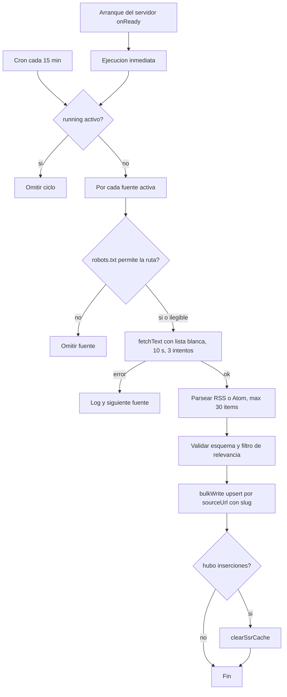

### 16.8 Límites reales de las fuentes oficiales

| Fuente (enum) | ¿Se ingiere? | Motivo (`workers/sources.ts:5-9`) |
|---|---|---|
| `take-two-ir` | ✅ Sí | RSS público de relaciones con inversores; única fuente activa |
| `rockstar-newswire` | ❌ No | Rockstar Newswire no ofrece RSS/API pública y no se hace scraping |
| `rockstar-youtube` | ❌ No | El `robots.txt` de YouTube prohíbe el acceso automatizado |

> ⚠️ **Brecha:** el pilar 3 («noticias 100% oficiales») se cumple en origen pero el volumen es mínimo (hoy 1 noticia en base de datos). El enum de `OfficialNews` sigue listando 3 fuentes. No existe endpoint de SUPER_ADMIN para gestionar fuentes (el documento maestro lo prevé). `models/OfficialNews.ts` y el worker definen cada uno su `officialNewsSchema`; el del worker (más estricto) es el que se usa.

### 16.9 Brechas de servicios

- `consumeOnce` y rate limit en memoria: no funcionan correctamente con varias instancias.
- Sin timeout explícito en llamadas a proveedores OAuth (❓).
- Sin invalidación de sesión en servidor.

---

## 17. SEO técnico (SSR-lite, sitemap, robots)

### 17.1 Cómo funciona

No hay renderizado de React en servidor. El servidor Fastify lee una vez `dist/index.html` (ruta configurable con `CLIENT_DIST_INDEX`; si falta, reintenta en la siguiente petición y responde 404 JSON «Cliente no compilado»), calcula los metadatos de la ruta pedida (`resolveRoute`, `services/ssrLite.ts:326`, nunca lanza) y los inyecta en `<head>` (`injectHead`). El contenido visible lo pinta después el cliente (SPA con History API).

| Elemento | Detalle |
|---|---|
| Inyección | Sustituye el bloque `<!--ssr-head-->…<!--/ssr-head-->` si existe; si no (caso actual, `index.html` sin marcadores) elimina title/description/robots/canonical previos e inyecta antes de `</head>` |
| Caché de metadatos | `Map` por ruta, TTL 5 min, máx. 500 entradas (se vacía entera al llenarse); solo páginas 200 de rutas dinámicas; `clearSsrCache()` la limpia |
| `<title>` | `… · LeonidApp`, truncado a 60 caracteres |
| Description | Tope 160 (sin mínimo de 120) |
| Canonical y `og:url` | Solo en respuestas 200, sin query |
| Open Graph | `og:type` website/article, título, descripción, imagen (por defecto `/assets/hero-gas-station.jpg`), `og:locale` fijo `es_ES`; `article:published_time` en noticias |
| Twitter | `summary_large_image` |
| Escape | `escHtml` en meta; `safeJsonLd` neutraliza `<`, `>`, `&`, U+2028/2029; `absolute()` solo admite http/https o rutas que empiecen por `/` |
| Fallo de BD | Cabecera de landing con `noindex,nofollow` y HTTP 200 |

### 17.2 Robots y JSON-LD por ruta

| Ruta | Indexación | JSON-LD |
|---|---|---|
| `/` | index | `WebSite` (con `SearchAction`) + `Organization` |
| `/mapa`, `/catalogo`, `/guias`, `/noticias`, `/foro` | index | `CollectionPage` + `BreadcrumbList` |
| `/noticias/:slug` | index (200) o 404 noindex | `NewsArticle` (`isBasedOn` = `sourceUrl`) + breadcrumb |
| `/guias/:slug` | idem | `HowTo` con `HowToStep` si `metadata_json.steps` tiene pasos con título; si no, `Article`; + breadcrumb |
| `/catalogo/:categoria/:itemSlug` | idem | `CreativeWork` (`isPartOf` CollectionPage) + breadcrumb |
| `/hub`, `/progreso`, `/entrar`, `/aportar` | noindex,nofollow | — |
| `/catalogo/:categoria` vacía (p. ej. `coleccionables`) | noindex (fuera del sitemap) | — |
| `/catalogo/mapa`, `/catalogo/mapa/:slug`, `/catalogo/ARMAS` | 301 a `/mapa`, `/mapa?pin=<slug>` y minúsculas respectivamente | — |
| `/catalogo?comparar=…` | noindex | — |
| Cualquier otra ruta | HTTP 404, noindex,nofollow | — |

Los slugs se validan con `^[a-z0-9]+(?:-[a-z0-9]+)*$` antes de consultar la BD. El foro no expone contenido de hilos en los metadatos.

### 17.3 Redirecciones 301

| Origen | Destino |
|---|---|
| `/aportes` | `/aportar` |
| `/catalogo?entity=<id>` | URL limpia de la ficha |
| `/noticias?item=<slug>` | `/noticias/<slug>` |
| `/catalogo/guias/:slug` | `/guias/:slug` |
| Barra final | Se normaliza |

### 17.4 Cliente

El cliente actualiza `title` y canonical al navegar (`src/store/useRouteStore.ts:154-174`).

### 17.5 Sitemap

`GET /sitemap.xml`: URLs estáticas (`/`, `/mapa`, `/catalogo`, `/guias`, `/noticias`, `/foro`), entidades de módulos activos (módulo `guias` → `/guias/:slug`; resto → `/catalogo/:categoria/:itemSlug`) y noticias (`/noticias/:slug`). `lastmod`: entidades `created_at`; noticias `updatedAt`/`publishedAt`; estáticas = máximo de sus hijos; `/mapa` y `/foro` sin `lastmod`. Si hay más de 50 000 URLs devuelve `sitemapindex` con `/sitemap-N.xml`. Segmentos con `encodeURIComponent` y XML escapado; las consultas están envueltas en `safe()` (error de BD → lista vacía). `Cache-Control: public, max-age=3600`.

### 17.6 robots.txt

Dinámico (`routes/seo.ts`): `Allow: /`; **solo `Disallow: /api/`**; `Sitemap: <PUBLIC_SITE_URL>/sitemap.xml`; caché 24 h. Las páginas privadas (`/hub`, `/progreso`, `/entrar`, `/aportar`) se excluyen del índice con `noindex` por meta, no listándolas en robots; la ruta oculta `/_staff` no aparece ni en robots ni en sitemap (§0.5).

### 17.7 Estado de implementación

| Capacidad | Estado | Nota |
|---|---|---|
| Meta + canonical + OG + Twitter | ✅ | |
| JSON-LD por tipo de ruta | ✅ | |
| 404 real con noindex | ✅ | |
| Sitemap, sitemapindex, robots | ✅ | |
| 301 definidos | ✅ | |
| Caché 5 min con invalidación | 🟡 | Se invalida en promoción de aportes y en ingesta de noticias, NO en CRUD admin de catálogo ni en `importCatalog` (proceso aparte) |
| Marcadores `<!--ssr-head-->` en la plantilla | ⚠️ | Funciona por la vía alternativa |
| hreflang es/en/x-default | ❌ | Sin resultados en el código; `<html lang="es">` fijo (`index.html:2`) y `og:locale` fijo aunque exista selector ES/EN |
| `SearchAction` → `/catalogo?q=` | ❌ | `ssrLite.ts:169` la anuncia pero `CatalogPage` no lee `q` |
| Registro de 301 al cambiar slug | ❌ | `PATCH /api/entities/:id` permite cambiar el slug sin redirección |
| Description 120-160 | 🟡 | Solo tope |
| Contenido pre-renderizado | ❌ | Un rastreador sin JavaScript ve solo el `<head>` (inferido del diseño: no hay render de React en servidor) |
| `lastmod` en `/mapa` y `/foro` | 🟡 | Ausente |
| Service worker / manifest | ❌ | |

## 18. Monetización (AdSlot)

### 18.1 Configuración (`AppConfig.monetization`)

Valor por defecto: `{ads_enabled:false, provider:'none', publisher_id:null, require_consent:true, slots:[]}`. Validación Zod solo en `PATCH /api/admin/config` (Mongoose lo guarda como `Mixed`):

| Campo | Regla |
|---|---|
| `ads_enabled` | bool |
| `provider` | `none` \| `adsense` |
| `publisher_id` | ≤60 caracteres, nullable |
| `require_consent` | literal `true` (no se puede desactivar) |
| `slots` | máx. 20: `{id 1-40, route, position, width, height (enteros positivos), enabled}` |

Estado actual en BD: `ads_enabled:false`, `provider:'none'`, sin slots. Existe un panel de monetización para SUPER_ADMIN en `src/pages/AdminSubmitPage.tsx`.

### 18.2 Reglas de colocación del documento maestro (`LeonidApp-Rutas-SEO-Monetizacion.md` §6)

| Ruta | Posiciones permitidas |
|---|---|
| `/guias` | `after-content` |
| `/guias/:slug` | `in-article` (tras el 2.º bloque, máx. 1), `after-content`, `sidebar` (solo ≥ 1280 px) |
| `/noticias`, `/noticias/:slug` | `after-content` |
| `/catalogo/:categoria/:itemSlug` | `after-content` (nunca en el Inspector HUD) |
| `/foro` | `after-content` (tras la lista de hilos) |

Máximo 2 AdSlot por página. Nunca en `/mapa`, Inspector HUD ni comparador, BottomDock/safe-area, `/`, `/entrar`, `/hub`, `/progreso`, `/aportar`, modales, Auth ni Footer; nunca como intersticial, sticky o vídeo con autoplay. Reglas técnicas: espacio fijo (CLS 0), consentimiento Marketing antes de cargar scripts de terceros, carga diferida (IntersectionObserver, margen 200 px), `ads_enabled=false` → `null` sin reservar espacio, etiqueta «Publicidad», desactivado en Capacitor nativo, no presentar como oficial.

### 18.3 Comportamiento REAL de `src/components/ui/AdSlot.tsx`

| Comportamiento | Estado |
|---|---|
| Devuelve `null` si `ads_enabled !== true` o `provider === 'none'` | ✅ |
| Devuelve `null` en plataforma nativa (Capacitor) | ✅ |
| Devuelve `null` si la ruta actual es `/mapa`, `/hub`, `/progreso`, `/aportar`, `/entrar` (regex `FORBIDDEN`) | ✅ |
| Busca el slot por `slotId` o por `position` entre los `enabled`; sin slot o sin ancho/alto → `null` | ✅ |
| Reserva hueco con `aspect-ratio` y `min-height`, etiqueta «Publicidad», superficie `glass` | ✅ |
| Inyecta el script de AdSense o usa `publisher_id` | ❌ Es solo un hueco vacío; no muestra anuncios |
| Lee el consentimiento (`leonidapp_consent`) | ❌ No lo lee (inocuo hoy porque no carga nada; el comentario del propio componente lo declara) |
| Respeta el campo `route` del slot de la configuración | ❌ Se ignora; solo se compara `position` |
| Carga diferida con IntersectionObserver | ❌ |
| Máx. 2 por página | ⚠️ `/guias/:slug` puede mostrar 3 (`in-article` + `after-content` + `sidebar`, `GuidesPage.tsx:261,315,322`) |
| `/foro` con AdSlot | ❌ No tiene |
| Ubicaciones presentes | Guías (`GuidesPage.tsx:111,261,315,322`), noticias (`NewsPage.tsx:145,210`), ficha de catálogo (`CatalogPage.tsx:950`) |

> ⚠️ **Brecha:** con la configuración y el código actuales los ingresos por publicidad son 0. Además, los carteles «Datos de ejemplo» conviven con los huecos publicitarios en varias páginas (❓ visual no verificado).

### 18.4 PROPUESTA (no implementada): plan para generar ingresos con AdSense

> Todo lo siguiente es una propuesta; nada de esto existe en el código.

1. **Requisitos previos de negocio:** dominio propio con HTTPS, política de privacidad y de cookies publicadas, contenido original suficiente (hoy hay 1 noticia y el catálogo deriva de grabaciones) y resolver derechos de imágenes (ver §23). AdSense puede rechazar sitios con contenido escaso o de terceros (criterio de Google; ❓ no verificado para este caso).
2. **Consentimiento:** leer `leonidapp_consent` (cookie del modal del Footer) desde `AdSlot` y no cargar nada sin categoría Marketing. Para usuarios del EEE/Reino Unido, Google exige una plataforma de gestión de consentimiento certificada; el modal propio probablemente no lo es (❓ requisito exacto a confirmar en la documentación vigente de Google).
3. **Carga del script:** inyectar una sola vez `adsbygoogle.js?client=<publisher_id>` tras consentimiento + `IntersectionObserver` (margen 200 px), con `async` y sin bloquear LCP, usando `publisher_id` de `AppConfig`.
4. **Slots:** cada `<ins class="adsbygoogle">` necesita `data-ad-client` y `data-ad-slot`. El schema de slot no tiene hoy un campo para el identificador de bloque de AdSense; añadirlo exige aprobar el cambio en el documento maestro (CLAUDE.md §2 prohíbe campos no aprobados).
5. **`ads.txt`:** servir `/ads.txt` con la línea de Google. Hoy no existe `public/ads.txt`; el manejador de estáticos del servidor serviría un archivo con extensión `.txt` de `dist/` (inferido), pero `/robots.txt` y `/sitemap.xml` son dinámicos y no pasan por ahí.
6. **Reglas de colocación:** hacer cumplir el máximo de 2 por página, añadir `/foro`, respetar `slot.route` y reservar la altura real para CLS 0.
7. **Cabeceras:** si se añade CSP (§19), permitir los dominios de Google Ads.
8. **App nativa:** AdSense no aplica a las apps de las tiendas; la monetización nativa requeriría otro producto (p. ej. AdMob), fuera del alcance actual.
9. **Medición:** Search Console + informe de rendimiento de AdSense; revisar Core Web Vitals tras activar.
10. **Orden recomendado:** dominio/HTTPS → políticas legales → contenido y derechos → consentimiento → `ads.txt` → script diferido → solicitud de revisión en AdSense → activar `ads_enabled` y `provider:'adsense'`.

---

## 19. Seguridad

### 19.1 Controles implementados y ausentes

| Control | Estado | Detalle |
|---|---|---|
| Cabeceras de seguridad (helmet, X-Frame-Options, nosniff, HSTS) | ❌ | Sin `@fastify/helmet` ni cabeceras fijas (verificado por búsqueda); solo cabeceras de caché por ruta |
| CSP | 🟡 | Estado objetivo: CSP y HSTS (solo producción) según §0.7; el texto de esta tabla es la instantánea histórica |
| Rate limit | 🟡 | Global 200/min; auth 15/min; magic request 5/10 min; contacto y suscripción 5/h; foro (hilos, posts, votos) 20/min; aportes 20/h. Sin límite propio en `PUT /api/progress` ni en endpoints admin. Estado en memoria por instancia (❓ store compartido no verificado) |
| Validación de entrada | ✅ | Zod 4 en todas las rutas, `z.uuid()` en parámetros, cuerpo ≤1 MiB. Las salidas no se validan con Zod |
| Hash de contraseñas | n/a | No hay contraseñas: acceso solo por OAuth o enlace mágico |
| JWT | 🟡 | HS256 con `algorithms:['HS256']` fijado, issuer `leonidapp`; sin revocación ni rotación; 7 días |
| PKCE | ✅ | `state` + `code_verifier` aleatorios, S256, cookie firmada HttpOnly 600 s; validación de firma, proveedor y `state`; se borra siempre |
| Cookies de sesión | 🟡 | HttpOnly y SameSite=Lax; `Secure` solo en producción; la firma es el propio JWT |
| Tokens en `localStorage` | ✅ | Ninguno (solo `guestMode` en IndexedDB) |
| CSRF por Origin | 🟡 | Rechaza Origin presente y ajeno; sin Origin pasa. SameSite=Lax mitiga parcialmente. El hook de auth (consulta a BD) corre antes de la comprobación |
| CORS | ✅ | Lista blanca con credenciales |
| Path traversal | ✅ | `sendStatic` decodifica, rechaza `\0`, comprueba prefijo de la raíz, solo ficheros |
| Escape en SSR | ✅ | `escHtml`, `safeJsonLd`, regex de slug, `absolute()` |
| Regex de búsqueda | ✅ | Metacaracteres escapados en `/api/admin/users` |
| Honeypot y no enumeración | ✅ | Contacto/suscripción siempre 201; magic link siempre 202 |
| Auditoría inmutable | 🟡 | Solo-inserción en la API (sin rutas de edición ni borrado), sin protección a nivel de base de datos; falta Zod de `AuditLog` |
| Autorización en servidor | ✅ | Rol releído de BD por petición; guardas en `preHandler`; protección del último SUPER_ADMIN |
| Secretos de desarrollo | ✅ | `JWT_SECRET`/`COOKIE_SECRET` ≥32 caracteres; el arranque FALLA en producción si empiezan por `dev-only` |
| Acceso demo SUPER_ADMIN | 🟡 | `demoAccess.ts` rechaza `NODE_ENV=production` y URIs no locales; crea y destruye un usuario temporal. Privilegio máximo protegido solo por esas guardas |
| Worker | ✅ | Lista blanca https, revalidación en redirecciones, robots.txt, timeout, extractos truncados |
| Backups de BD | ❌ | Sin copia programada (Mongo local) |
| Logging y monitoreo | 🟡 | Logger de Fastify (nivel info en prod, debug en dev); sin agregación ni alertas |
| Cifrado en reposo / TLS a BD | ❓ | No verificado (Mongo local) |
| Auditoría de dependencias | ❓ | Sin `pnpm audit`/Dependabot configurados (no hay CI) |
| Pruebas de seguridad | ❌ | No hay pruebas |
| Subida de archivos | n/a | No existe endpoint; las imágenes son URL |

### 19.2 Riesgos priorizados

| # | Riesgo | Severidad | Remedio |
|---|---|---|---|
| 1 | Sin cabeceras de seguridad ni CSP (clickjacking, sniffing, XSS sin red de seguridad) | Alta | `@fastify/helmet` o configuración en el proxy; CSP ajustada |
| 2 | JWT de 7 días sin revocación: un token robado vale hasta caducar (logout solo borra la cookie) | Alta | Sesiones con identificador almacenado o lista de revocación; rotación |
| 3 | Cookie `Secure` condicionada a `NODE_ENV=production`; con otro valor viajaría sin Secure | Alta | Forzar Secure bajo HTTPS |
| 4 | `consumeOnce` y rate limit en memoria: reutilización de enlaces mágicos tras reinicio o con varias instancias | Media | Almacén compartido (Redis o colección con TTL en Mongo) |
| 5 | CSRF permite peticiones sin cabecera Origin | Media | Exigir Origin o token CSRF en mutaciones con cookie |
| 6 | Sin backups y BD local | Alta (operativa) | MongoDB gestionado con copias |
| 7 | 0 SUPER_ADMIN persistido y existencia de `demoAccess` | Media | Definir `SUPER_ADMIN_EMAIL` real; no desplegar scripts de demo |
| 8 | Sin límite específico en `PUT /api/progress` (hasta 2000 ítems con N consultas) ni en admin | Media | Rate limit y operación en lote |
| 9 | Foro sin moderación completa (sin ocultar ni reportar) | Media | Endpoints de reporte y ocultación |
| 10 | Sin timeout explícito en llamadas OAuth (❓) | Baja | `AbortSignal.timeout` |
| 11 | Colisión de slug devuelve 500 (E11000) | Baja | Mapear a 409 |
| 12 | Lectura de auditoría abierta a ADMIN (el doc dice SUPER_ADMIN) | Baja | Alinear |
| 13 | Sin tests ni escaneo de dependencias | Media | CI con auditoría |

---

## 20. Estructura de carpetas (real vs permitida)

### 20.1 Árbol REAL actual

```text
Atlas Vice/
├─ CLAUDE.md                     Constitución técnica del proyecto
├─ .claude/                      CLAUDE.md, settings.json (hooks graphify), agents/00..05, skills/graphify
├─ package.json (atlas-vice)     Cliente: scripts y dependencias
├─ pnpm-lock.yaml
├─ index.html  vite.config.ts  tailwind.config.ts  tsconfig.json
├─ capacitor.config.ts           Config Capacitor (appId com.leonidapp.companion, appName LeonidApp; proyectos nativos pendientes de sync)
├─ .env / .env.example           VITE_API_URL
├─ public/assets/                hero-gas-station.jpg (único archivo; el resto de superficies usa degradados/SVG propios)
├─ src/                          Cliente Vite + React + TS
│  ├─ App.tsx  main.tsx
│  ├─ components/layout/         BottomDock, Footer (RockstarFooter), ViceShell
│  ├─ components/ui/             AdSlot, BottomSheet, CatalogAdminPanel, Modal, PalmButton, StatBar, TipCard
│  ├─ data/seed.ts               Datos semilla y capa de acceso offline-first
│  ├─ pages/                     AdminSubmit, Catalog, Dashboard, Forum, Guides, Home, LandingAuth, Map, News
│  ├─ store/                     useAuth, useProgress, useRoute (Zustand)
│  ├─ styles/vice-nui.css        Tokens Vice Sunset NUI
│  └─ types/database.ts
├─ server/                       API Fastify + Mongoose + Zod
│  ├─ package.json  tsconfig.json  .env.example
│  └─ src/
│     ├─ app.ts  index.ts
│     ├─ config/                 db.ts, env.ts
│     ├─ models/                 14 archivos de modelo (+ common.ts e index.ts), 14 modelos Mongoose, 12 colecciones lógicas
│     ├─ plugins/                auth.ts
│     ├─ routes/                 auth, catalog, config, contact, forum, news, progress, seo, submissions
│     ├─ services/               audit, mailer, oauth, session, ssrLite, submissions, users, validate
│     ├─ workers/                officialNewsWorker.ts, sources.ts
│     └─ scripts/                seed.ts, seedData.json, importCatalog.ts, demoAccess.ts
├─ android/  ios/                Proyectos nativos Capacitor generados
├─ docs/                         3 docs vigentes LeonidApp-*.md, 3 legados AtlasVice*.md, referencias-ui/
├─ supabase/                     LEGADO: schema.sql, 02_rls_and_triggers.sql, 03_seed_data.sql
├─ dist/                         Salida de build (ignorada)
├─ graphify-out/                 Grafo de conocimiento (ignorado)
└─ .tmp-mongo/                   Datos WiredTiger temporales (ignorado)
```

### 20.2 Contraste con lo permitido (CLAUDE.md y DesignSpec §6)

| Elemento | Permitido | Real | Estado |
|---|---|---|---|
| `src/` subcarpetas | components/layout, components/ui, data, pages, store, styles, types + App.tsx, main.tsx | Coincide | ✅ |
| `server/src/` subcarpetas | config, models, routes, plugins, services, workers, scripts + app.ts, index.ts | Coincide | ✅ |
| `src/components/ui/CatalogAdminPanel.tsx` | No figura en DesignSpec §6.1 | Existe | ⚠️ Excepción |
| `server/src/scripts/importCatalog.ts`, `demoAccess.ts`, `catalogo_grabaciones.json` | DesignSpec §6.2 lista solo `seed.ts` y `seedData.json` (CLAUDE.md permite la carpeta `scripts`) | Existen (el JSON de datos vive en `server/data/`, versionado) | ⚠️ Excepción |
| `docs/legado/PDF/` | Legado | 3 PDF legados movidos desde la raíz | ✅ |
| `.tmp-mongo/` | No listada | Datos temporales de MongoDB (ignorada en git) | ⚠️ Excepción |
| `supabase/` | Válida como legado, no se amplía | Presente | ✅ (deprecada) |
| `android/`, `ios/` | Válidas | Presentes, con identidad antigua `com.atlasvice.app` y nombre «ATLAS VICE» (CLAUDE.md §0 exige `com.leonidapp.companion` y `leonidapp://`) | ⚠️ Divergente |
| `graphify-out/`, `.claude/skills/graphify/` | Válidas | Presentes | ✅ |
| `public/robots.txt` | Mencionado en DesignSpec §6.3 | No existe (el robots es dinámico) | ⚠️ |
| `public/assets/` | — | Solo `hero-gas-station.jpg`; capturas de terceros eliminadas | ✅ |
| `tests/` | — | No existe | ❌ |

### 20.3 Árbol limpio recomendado (propuesta, no aplicada)

```text
Atlas Vice/
├─ src/  server/  android/  ios/  public/        sin cambios de estructura
├─ docs/
│  └─ legado/       <- PDF/ ya movido aquí; AtlasVice*.md siguen en docs/
├─ server/
│  ├─ src/scripts/  importCatalog.ts y demoAccess.ts aprobados como excepciones en DesignSpec 6.2
│  └─ data/         catalogo_grabaciones.json (datos, no codigo), versionado (commit `ecfcacf`)
├─ public/robots.txt  opcional; o declarar en el documento que el robots es dinamico
├─ supabase/        archivar o eliminar cuando se cierre el legado
└─ (.tmp-mongo/ fuera del repositorio: dbpath de MongoDB en una ruta del sistema)
```

Acciones concretas: (1) actualizar DesignSpec §6.1/§6.2 para aprobar `CatalogAdminPanel.tsx`, `importCatalog.ts` y `demoAccess.ts`; (2) decidir el destino de `catalogo_grabaciones.json` y de `PDF/`; (3) mover el `dbpath` temporal de Mongo fuera del proyecto; (4) alinear `capacitor.config.ts` y los proyectos nativos al ID `com.leonidapp.companion`; (5) renombrar claves `atlas-vice-*` de IndexedDB y la cabecera «supabase/schema.sql» de `src/types/database.ts`.

---

## 21. Configuración, ejecución y scripts

### 21.1 Variables de entorno del servidor (`server/src/config/env.ts`)

Se validan con Zod al importar el módulo. Una cadena vacía equivale a ausente. Solo nombres; los valores reales no se documentan.

| Nombre | Tipo | Default | Obligatoria | Para qué |
|---|---|---|---|---|
| `NODE_ENV` | development/test/production | development | No | Activa Secure en cookies, `trustProxy` y nivel de log |
| `PORT` | entero | 3000 | No | Puerto de escucha |
| `HOST` | texto | 0.0.0.0 | No | Interfaz de escucha |
| `MONGODB_URI` | texto | `mongodb://127.0.0.1:27017/leonidapp` | No (sí en producción en la práctica) | Conexión a MongoDB |
| `JWT_SECRET` | texto ≥32 | valor `dev-only-…` | Sí en producción (el arranque falla con el de desarrollo) | Firma HS256 de sesión y tokens efímeros |
| `COOKIE_SECRET` | texto ≥32 | valor `dev-only-…` | Sí en producción | Firma de la cookie PKCE |
| `CLIENT_ORIGIN` | URL | `http://localhost:5173` | No en dev; necesaria en producción | Origen CORS/CSRF y destino de `demoAccess` |
| `PUBLIC_SITE_URL` | URL | `http://localhost:5173` | No en dev; necesaria en producción | Origen permitido, redirect tras login, canonical y sitemap |
| `API_PUBLIC_URL` | URL | `http://localhost:3000` | No en dev; necesaria en producción | `redirect_uri` OAuth y enlace de magic link |
| `APP_DEEPLINK` | texto | `leonidapp://auth/callback` | No | Retorno a la app nativa |
| `GOOGLE_CLIENT_ID`, `GOOGLE_CLIENT_SECRET` | texto opc. | — | Para activar Google | OAuth Google |
| `DISCORD_CLIENT_ID`, `DISCORD_CLIENT_SECRET` | texto opc. | — | Para activar Discord | OAuth Discord |
| `APPLE_CLIENT_ID`, `APPLE_TEAM_ID`, `APPLE_KEY_ID`, `APPLE_PRIVATE_KEY` | texto opc. | — | Los 4 para Apple | OAuth Apple (clave `.p8` con `\n` escapados) |
| `SMTP_HOST` | texto opc. | — | Para magic link | Sin él, magic link responde 503 |
| `SMTP_PORT` | entero | 587 | No | `secure` si 465 |
| `SMTP_USER`, `SMTP_PASS` | texto opc. | — | Según el proveedor SMTP | Autenticación (solo si hay `SMTP_USER`) |
| `SMTP_FROM` | texto | `LeonidApp <no-reply@localhost>` | No (cambiar en producción) | Remitente |
| `SUPER_ADMIN_EMAIL` | texto opc. | — | Recomendada | Bootstrap: ese email verificado entra como SUPER_ADMIN |
| `PIPELINE_INGEST_TOKEN` | texto ≥32 opc. | — | Sí para activar el pipeline | Secreto Bearer de `POST /api/pipeline/ingest` (comparación `timingSafeEqual`); sin él la ruta responde 404. Genéralo con `openssl rand -hex 32` |
| `PIPELINE_WEBHOOK_URL` | URL https opc. | — | No | Destino del aviso de «Sincronizar ahora» en `/_staff`; sin ella el botón queda desactivado |
| `NEWS_WORKER_ENABLED` | texto | activo | No | Leída con `process.env` fuera de `env.ts`; `'false'` desactiva el worker |
| `CLIENT_DIST_INDEX` | ruta | `<repo>/dist/index.html` | No | Leída fuera de `env.ts`; ubicación del `index.html` compilado |

Cliente: `VITE_API_URL` (en `.env` / `.env.example` de la raíz).

### 21.2 Puesta en marcha en desarrollo

1. **MongoDB:** en la máquina actual hay `mongod` 9.0 local en `127.0.0.1:27017`, `dbpath` `C:\mongodb-data`, base `leonidapp`. Arranque manual genérico: `mongod --dbpath <carpeta> --bind_ip 127.0.0.1` (❓ el comando exacto del propietario no consta; `.tmp-mongo/` sugiere pruebas con otra ruta). En modo standalone las transacciones degradan (§16.6).
2. **API** (puerto 3000): `pnpm --dir server dev` (compila una vez y arranca con `--watch` sobre `dist/`; no recompila al editar `src`) o `pnpm --dir server build` y `pnpm --dir server start`.
3. **Cliente** (Vite, puerto 5173): `pnpm dev` en la raíz.
4. **Datos de ejemplo (opcional):** `pnpm --dir server seed` (ver aviso en §21.4).
5. Procesos observados el 2026-11-18: API en 3000 (solo 127.0.0.1), dos procesos Vite en 5173/5174 (::1), mongod en 27017.

### 21.3 Scripts npm

| Paquete | Script | Qué hace |
|---|---|---|
| Cliente (`package.json`) | `dev` | `vite` |
| | `typecheck` | `tsc --noEmit -p tsconfig.json` |
| | `build` | `tsc --noEmit -p tsconfig.json && vite build` |
| | `preview` | `vite preview` |
| | `cap:sync` | `cap sync` |
| Server (`server/package.json`) | `dev` | `tsc -p tsconfig.json && node --env-file-if-exists=.env --watch dist/index.js` |
| | `typecheck` | `tsc --noEmit -p tsconfig.json` |
| | `build` | `tsc -p tsconfig.json` |
| | `start` | `node dist/index.js` |
| | `seed` | Compila y ejecuta `dist/scripts/seed.js` |
| | `demo:access` | Compila y ejecuta `dist/scripts/demoAccess.js` |
| | `import:catalog` | Compila y ejecuta `dist/scripts/importCatalog.js` |

No hay script `test` ni `lint` en ningún paquete.

### 21.4 `seed`

`pnpm --dir server seed`. Sin banderas ni guardas de entorno (no comprueba `NODE_ENV` ni la URI). Lee `seedData.json`: 5 perfiles (1 ADMIN y 4 USER), 7 módulos, 23 entidades, 20 marcadores, 6 hilos, 9 posts; añade 2 guías extra, rellena slugs de `OfficialNews`, crea el `AppConfig` y sincroniza índices. No siembra votos, progreso, auditoría ni noticias. Idempotente por `_id` (`updateOne` con `$set` y `upsert`).

> ⚠️ **Aviso:** reejecutar el seed SOBRESCRIBE los campos de los documentos sembrados que se hayan editado a mano (mismos `_id`) y volvería a crear las 23 entidades y 20 marcadores de ejemplo que ya se borraron de la base. Los perfiles semilla no tienen identidades y no pueden iniciar sesión por OAuth. No ejecutar contra una base de producción.

### 21.5 `import:catalog`

```bash
# Simulacion (no escribe)
pnpm --dir server import:catalog data/catalogo_grabaciones.json --source grabacion   # ruta relativa a server/ (= server/data/catalogo_grabaciones.json)
# Aplicar
pnpm --dir server import:catalog data/catalogo_grabaciones.json --source grabacion --apply
```
Valida cada ficha con Zod (`modulo`, `slug`, `titulo`, `subtitulo?`, `categoria`, `stats_juego` 0-10, `metadata`, `confianza` alta/media/baja, `evidencia` ≤5, `notas?` y `marker?`). El módulo debe existir. Convierte `stats_juego × 10` a `stats_json` (0-100), guarda `stats_juego` exacto en `metadata_json`, copia `notas` a `metadata_json.notas` y marca `fuente` con el valor de `--source` (por defecto `editorial`; el lote histórico de grabaciones usa `--source grabacion`), `confianza` y `evidencia`.

Opciones: `--apply` (sin ella es simulación), `--source <nombre>` y `--replace-source <nombre>` (permite sobrescribir fichas previas de esa otra fuente, p. ej. `grabacion`). Upsert por (módulo, slug): si la entidad existente tiene una fuente distinta de `--source` y de `--replace-source`, se omite como conflicto. Un bloque opcional `marker: { region, coord_x, coord_y, descripcion? }` hace upsert en `MapMarker` (por `entity_id`) solo con los campos aprobados (`entity_id`, `region`, `titulo`, `descripcion`, `coord: { x, y }`) y solo con `--apply`.

Resumen real impreso al terminar: `{ nuevas, actualizadas, reemplazadas, conflictos, errores, marcadores }` (`reemplazadas` cuenta las fichas de otra fuente sobrescritas vía `--replace-source`; `actualizadas`, las de la misma fuente). Código de salida 1 si hay errores. No invalida la caché SSR de un servidor en marcha (expira en ≤5 min). Sin guardas de entorno. Actualizar: regenerar el JSON y reimportar con `--apply` (idempotente). Ejemplo editorial: `pnpm --dir server import:catalog data/<archivo>.json --apply --source editorial`. El archivo histórico `server/data/catalogo_grabaciones.json` (166 KB, versionado) tiene 225 fichas (armas 12, vehículos 20, mapa 138, guías 55).
Valida cada ficha con Zod (`modulo`, `slug`, `titulo`, `subtitulo?`, `categoria`, `stats_juego` 0-10, `metadata`, `confianza` alta/media/baja, `evidencia` ≤5). El módulo debe existir. Convierte `stats_juego × 10` a `stats_json` (0-100), guarda `stats_juego` exacto en `metadata_json`, marca `fuente` con el valor de `--source` (por defecto `editorial`; para este archivo usar `--source grabacion`), `confianza` y `evidencia`. Upsert por (módulo, slug); si ya hay una entidad de otra fuente la omite como conflicto. Resumen `{nuevas, actualizadas, conflictos, errores}`; código de salida 1 si hay errores. No invalida la caché SSR de un servidor en marcha (expira en ≤5 min). Sin guardas de entorno. Actualizar: regenerar el JSON y reimportar con `--apply` (idempotente). El archivo actual (`server/data/catalogo_grabaciones.json`, 166 KB, versionado) tiene 225 fichas (armas 12, vehículos 20, mapa 138, guías 55). El uso de ese archivo concreto con el script es una inferencia (❓ el JSON es la entrada prevista, no confirmado en código).

### 21.6 `demo:access`

```bash
pnpm --dir server demo:access                 # 120 min, destino /aportar
pnpm --dir server demo:access -- --minutes 30 --ir /hub
pnpm --dir server demo:access -- --revoke     # borra el usuario demo y sale
```

Crea el usuario `demo-temporal` con rol SUPER_ADMIN, firma una sesión de N minutos (1-480) y abre un servidor local efímero con una ruta secreta de un solo uso (caduca a los 10 min) que fija la cookie de sesión y redirige al cliente. Al terminar (Ctrl+C, señales o vencimiento) borra el usuario.

> ⚠️ **Aviso:** solo para desarrollo local. Se niega a ejecutarse con `NODE_ENV=production` o con una `MONGODB_URI` cuyo host no sea `127.0.0.1`, `localhost` o `::1`. Es un acceso de privilegio máximo; no debe formar parte de un despliegue.

---

## 22. Calidad, pruebas e infraestructura

### 22.1 Resultado de verificación (2026-11-18)

| Comprobación | Resultado |
|---|---|
| `pnpm typecheck` (cliente) | ✅ sin errores |
| `pnpm build` (cliente) | ✅ 90 módulos. `index.html` 1.12 kB; CSS 52.86 kB (10.56 kB gzip); JS 495.51 kB (146.23 kB gzip). Un solo bundle JS (inferido: no se listan otros chunks) |
| `typecheck` y `build` del server | ✅ sin errores |
| Pruebas automatizadas | ❌ No existen en `server/` (sin `*.test.*`, vitest/jest ni script `test`); en el cliente no se buscaron (❓) |
| Linter / formateador | ❌ No configurados (no hay script `lint`) |
| CI/CD (`.github`) | ❌ No existe |
| Docker / `render.yaml` / `vercel.json` | ❌ No existen |

### 22.2 Flujo de trabajo

- **Gitflow:** ramas `main`, `develop`, `feature/herramientas-admin` (actual) y `feature/leonidapp-mongo-architecture`; remotos `origin/main` y `origin/develop`. Regla: sin commits directos en `main`/`develop`; PR desde `feature/*`.
- **Conventional Commits en español:** prefijos `feat:`, `fix:`, `ui:`, `chore:`, `docs:` (con scope admitido).
- **Historial:** 32 commits, un solo autor. Primer commit 2026-11-17 («chore(init) Pre-alfa Fases 1-4»); los otros 31 el 2026-11-18. Hitos: backend Fastify+Mongoose, worker de noticias, documentos maestros, SSR-lite y sitemap, Footer Rockstar, rutas con History API, rediseño v2, foro escaparate, catálogo y mapa según diseño, herramientas de administración, importador de grabaciones y acceso demo.
- **Estado de git:** `server/data/catalogo_grabaciones.json` versionado (commit `ecfcacf`); los JSON crudos de terceros en `server/data/` permanecen sin versionar y sin uso.
- **Puertas de calidad:** CLAUDE.md prohíbe avanzar de fase sin `typecheck` y `build` limpios (cliente y server).

### 22.3 Subagentes y herramientas

| Subagente (`.claude/agents/`) | Alcance |
|---|---|
| `00-supervisor` | Tech Lead y QA Gatekeeper; audita estructura, builds y verificación en vivo |
| `01-arquitecto-db` | Monorepo, MongoDB/Mongoose, Zod, tipos, stores |
| `02-ui-vice-nui` | Sistema visual Vice NUI, componentes atómicos, Footer Rockstar |
| `03-vistas-logica` | Vistas P01..P07, Auth PKCE, panel Control Total, integración API |
| `04-qa-mobile` | Capacitor, auditoría de estructura, builds |
| `05-workers-seo` | Worker de noticias oficiales, sitemap, JSON-LD |

`.claude/settings.json` define hooks `PreToolUse` de graphify. **graphify** mantiene un grafo de conocimiento en `graphify-out/` (ignorado en git) consultable con `graphify query|path|explain`.

Herramientas de verificación usadas en la auditoría: `pnpm typecheck` y `pnpm build`, consultas directas a MongoDB, inspección de procesos y puertos, lectura de código con referencias `archivo:línea` y capturas de pantalla de la app en escritorio y móvil.

> ⚠️ **Brecha:** la única red de seguridad es el compilador de TypeScript. Ninguna regla crítica (promoción de aportes, última escritura gana, RBAC, redirecciones SEO) tiene prueba automática.

---

## 23. Camino a producción

Esfuerzo relativo: S (horas a un par de días), M (varios días), L (una a varias semanas). Son órdenes de magnitud de complejidad técnica, NO estimaciones de tiempo ni de costo.

> ⚠️ **Costos y fechas:** no se pueden estimar con los datos disponibles. Faltaría: proveedor y plan de hosting elegidos, tráfico esperado (usuarios activos, peticiones, almacenamiento de imágenes), tamaño del equipo y su disponibilidad, decisión sobre el modelo de contenido (propio vs. derivado) y derechos de imágenes, requisitos legales por país, y si se publicará en tiendas de apps (cuentas de desarrollador de Apple y Google).

### 23.1 Lista ordenada

| # | Paso | Depende de | Esfuerzo |
|---|---|---|---|
| 1 | Verificar la licencia de `hero-gas-station.jpg` (las capturas de terceros ya se eliminaron) y decidir la procedencia del contenido de las 225 fichas | — | M |
| 2 | Elegir hosting y arquitectura (un servicio Node que sirve API + `dist/`, ya soportado, o cliente estático + API separada) | — | S |
| 3 | Dominio y HTTPS (certificado, redirección HTTP→HTTPS) | 2 | S |
| 4 | MongoDB gestionado con réplica (para que las transacciones de aportes sean atómicas), usuarios y red restringida | 2 | M |
| 5 | Copias de seguridad programadas y prueba de restauración | 4 | S |
| 6 | Variables de entorno de producción: secretos nuevos ≥32 caracteres, `NODE_ENV=production`, `CLIENT_ORIGIN`, `PUBLIC_SITE_URL`, `API_PUBLIC_URL`, `VITE_API_URL` | 2, 3 | S |
| 7 | Credenciales OAuth (Google, Discord, Apple) con `redirect_uri` de producción; Apple requiere cuenta de desarrollador | 3 | M |
| 8 | SMTP transaccional (dominio con SPF/DKIM) para el enlace mágico y `SMTP_FROM` real | 3 | S |
| 9 | SUPER_ADMIN persistido (`SUPER_ADMIN_EMAIL` + primer login; hoy 0 en BD) y verificar que `demoAccess` no forma parte del despliegue | 6, 7 u 8 | S |
| 10 | Cabeceras de seguridad y CSP (§19) | 3 | S–M |
| 11 | Endurecer sesión: revocación/rotación, `Secure` garantizado, CSRF sin Origin, almacén compartido para `consumeOnce` y rate limit | 4 | M |
| 12 | Corregir `?next=` en OAuth y mensajes de error de login | — | S |
| 13 | Imágenes: bucket/CDN y endpoint de subida (hoy solo URLs; imágenes en `public/assets`) | 2 | M |
| 14 | Contenido real: verificar catálogo y guías, cargar el mapa (hoy 0 marcadores), ampliar noticias (hoy 1) | 1 | L |
| 15 | SEO pendiente: hreflang, `html lang` dinámico, `SearchAction` real o retirada, invalidar caché en CRUD admin, 301 por cambio de slug, alta en Search Console | 3 | M |
| 16 | Páginas legales y políticas de privacidad/cookies publicadas (los modales del Footer existen; revisión jurídica ❓ no verificada) | — | M |
| 17 | Monitoreo y logs: agregación, alertas, métricas de la API y del worker | 2 | M |
| 18 | Pruebas automatizadas (RBAC, promoción de aportes, progreso, SEO) | — | L |
| 19 | CI/CD: `typecheck`, `build`, pruebas y despliegue desde `develop`/`main` | 2, 18 | M |
| 20 | Dockerfile o equivalente (según el hosting) | 2 | S |
| 21 | Monetización AdSense (§18.4: consentimiento, `ads.txt`, carga diferida, revisión de Google) | 1, 3, 14, 16 | M |
| 22 | App nativa: corregir `appId` a `com.leonidapp.companion`, `appName` y esquema `leonidapp://`; listener de deep link, intent-filter e `CFBundleURLSchemes`, iconos, cuentas de tienda | 7 | L |
| 23 | Rendimiento: dividir el bundle de ~495 kB, service worker y manifest (offline/PWA) | — | M |
| 24 | Moderación: ocultar y reportar contenido del foro; enlace real de Discord | — | M |
| 25 | Limpieza del repositorio (§20): `PDF/`, `.tmp-mongo/`, scripts, claves `atlas-vice-*` | — | S |

Dependencias críticas: 1 y 14 condicionan 21 (monetización) y la publicación; 3 habilita 7, 8 y 10; 4 habilita 11; 7 habilita 22.

## 24. Arquitectura de navegación (modelo jerárquico compuesto)

La navegación de LeonidApp combina tres ideas: (1) un **enrutador propio** con History API (sin react-router; `src/store/useRouteStore.ts`), (2) un **Bottom Dock de 5 ítems** idéntico en escritorio y móvil, y (3) una **cabecera** con accesos secundarios (Guías, Noticias, % de progreso, Entrar/Salir). La jerarquía es "compuesta" porque conviven un árbol de páginas (zonas) y una red de enlaces cruzados entre módulos (Mapa, Catálogo, Foro, Guías).

### 24.1 Zonas y niveles

| Nivel | Zona | Páginas | Acceso | Propósito |
|---|---|---|---|---|
| 0 | **Pública** | Portada `/`, Acceso `/entrar`, Noticias, Guías (lectura), fichas de catálogo | Invitado | Descubrimiento, SEO, conversión a cuenta |
| 1 | **Operativa / exploración** | Hub `/hub`, Progreso `/progreso`, Mapa `/mapa`, Catálogo `/catalogo`, Guías (pasos marcables) | Invitado (el progreso se guarda en el dispositivo) | Uso diario: explorar y marcar avance |
| 2 | **Comunitaria / administrativa** | Foro `/foro` (lectura completa y escritura), Aportar `/aportar` con pestañas por rol (Aportes, Moderación, Catálogo y mapa, Control Total) | Foro: escaparate para invitado, completo con sesión. Aportar: solo con sesión; pestañas según rol | Contribución, moderación, administración |

> ✅ La división por niveles es conceptual: en el código **no hay guardas por rol en las rutas**; solo `/aportar` exige sesión (`RequireAccount`, `src/App.tsx:181-215`) y los roles se filtran **dentro** de `AdminSubmitPage`. Las guardas del cliente son cosméticas; la autorización real vive en el servidor (ver §11 y §19).

### 24.2 Árbol de páginas (rediseño v2)

```text
LeonidApp
├─ P01 Portada                         /
├─ P02 Acceso                          /entrar            (shell propio, sin dock ni footer)
├─ P03 Hub                             /hub
│   └─ Progreso (ancla de la misma vista)  /progreso
├─ P04 Mapa                            /mapa              (HUD 100vh)
├─ P05 Catálogo (Inspector)            /catalogo          (HUD 100vh)
│   ├─ Comparador (hoja)               /catalogo?comparar=a,b[,c]
│   └─ Ficha de entidad                /catalogo/:categoria/:itemSlug   (con scroll y footer)
├─ P06 Guías                           /guias
│   └─ Guía                            /guias/:slug
├─ Noticias                            /noticias
│   └─ Noticia                         /noticias/:slug
├─ P07 Foro                            /foro              (HUD 100vh; escaparate para invitado)
└─ Aportar                             /aportar           (exige sesión)
    ├─ Aportes            (cualquier autenticado)
    ├─ Moderación         (MODERATOR+)
    ├─ Catálogo y mapa    (ADMIN+)
    └─ Control Total      (SUPER_ADMIN)
```

Redirecciones: `/aportes` → `/aportar` (replace); `/noticias?item=slug` → `/noticias/slug`; `/catalogo?entity=<uuid>` → `/catalogo/:categoria/:itemSlug`; `/catalogo/guias/:slug` → `/guias/:slug`; `#/ruta` heredado → `/ruta` (`useRouteStore.ts:396-401`); `/foro?hilo=` es alias de `thread` (`App.tsx:306-317`).

### 24.3 Tabla completa de rutas reales

Fuente: `src/App.tsx:55-70` e inventario del cliente. "Indexable" = meta `robots` del cliente (el servidor aplica SSR-lite aparte; ver §17).

| Ruta | Vista | Acceso | Indexable | Datos que consume | Módulo requerido |
|---|---|---|---|---|---|
| `/` | `HomePage` | Invitado | Sí (`index,follow`, canonical `/`) | `useWorldData`, `useForumData`, `useOfficialNews('all',50)`, `useModuleGate`, `guideSteps` local | Tarjetas filtradas por módulos activos |
| `/entrar` | `LandingAuthPage` (`next`) | Invitado; si ya hay sesión redirige a `next` o `/hub` | No (`noindex,nofollow`) | `usePublicConfig` (proveedores, mantenimiento), `SEED_TIPS` | — |
| `/hub` | `DashboardPage section=hub` | Invitado | No (`noindex`) | mundo, progreso local/nube, `SEED_TIPS`, `SEED_ROUTES`, config pública (aviso), 3 noticias | — |
| `/progreso` | `DashboardPage section=progress` | Invitado | No | Igual que Hub; hace scroll a `#progreso` | — |
| `/mapa` | `MapPage` | Invitado | Sí (canonical = path) | mundo (marcadores, regiones, capas), progreso, foro (hilos relacionados) | `mapa` |
| `/catalogo` | `CatalogPage` (Inspector) | Invitado | Sí; con `?comparar` pasa a `noindex` y canonical `/catalogo` | mundo, foro, progreso | alguno de armas/vehículos/coleccionables/guías |
| `/catalogo/:categoria/:itemSlug` | `CatalogPage detail` (`EntityDetail`) | Invitado | Sí (título y description por ficha; no encontrada → `noindex`) | `useEntityDetail` (caché del mundo, si no `GET /api/modules/:m/entities/:slug`), foro, guías | `:modulo` activo |
| `/guias` | `GuidesPage` | Invitado | Sí | mundo (entidades de guías), `guideSteps` | `guias` |
| `/guias/:slug` | `GuidesPage slug` | Invitado | Sí (no encontrada → `noindex`) | entidad de guía, hilos del foro, marcadores, config de anuncios | `guias` |
| `/noticias` | `NewsPage` | Invitado | Sí | `GET /api/news?limit=&source=` | — |
| `/noticias/:slug` | `NewsPage` (detalle) | Invitado | Sí (no encontrada → `noindex`) | `GET /api/news/:slug` | — |
| `/foro` | `ForumPage` | Invitado (escaparate recortado) / sesión (completo) / MODERATOR+ (moderación) | Sí | `GET /api/forum` (formato `preview` sin sesión), votos | `foro` |
| `/aportar` | `AdminSubmitPage` dentro de `RequireAccount` | **Sesión** | No (`noindex`) | `/api/submissions*`, `/api/admin/*`, `/api/modules`, `/api/entities`, `/api/markers` | — |
| `/aportes` | redirección | — | — | — | — |
| cualquier otra | `Unavailable` "Página no encontrada" | — | Sin meta propia (conserva la anterior) | — | — |

> ⚠️ **Brecha:** la página 404 no fija `noindex` ni título propio; hereda la meta de la vista anterior (`App.tsx`, `usePageMeta`). Ver §17 para lo que sirve el servidor.

### 24.4 Parámetros de query

| Ruta | Parámetro | Efecto |
|---|---|---|
| `/entrar` | `next` | Destino tras iniciar sesión. Solo acepta ruta relativa que empiece por `/` y no `//` (`LandingAuthPage.tsx:16-17`); por defecto `/hub` |
| `/mapa` | `marker`, `entity`, `region` | Selecciona y centra (prioridad marker > entity > region; `MapPage.tsx:368-383`). Capas y zoom no se reflejan en la URL |
| `/catalogo` | `modulo` | Abre la pestaña armas / vehiculos / coleccionables (módulo inactivo o desconocido → primera disponible) |
| `/catalogo` | `entity=<uuid>` | Redirige (replace) a la ficha |
| `/catalogo` | `comparar=a,b[,c]` | Abre el Comparador (slugs únicos, mismo módulo que el primero, máximo 3) |
| `/foro` | `hilo` (alias de `thread`), `thread`, `entity`, `marker` | Selecciona hilo o filtra por contexto. Con invitado abre el muro de registro y se limpia al cerrar |
| `/noticias` | `item=<slug>` | Redirige a `/noticias/<slug>` |

### 24.5 Cabecera, dock y bloqueo de scroll

| Elemento | Contenido | Comportamiento |
|---|---|---|
| Cabecera (`HeaderEnd`, `App.tsx:130-178`) | Wordmark (enlace a `/`), enlaces "Guías" y "Noticias" (solo `md+`), botón `%` de progreso total (→ `/progreso`), "Entrar" o nombre de usuario + "Salir" | En móvil los enlaces Guías y Noticias **no se muestran**: solo son alcanzables desde la Portada, el Hub, el Footer o enlaces cruzados |
| Bottom Dock | Hub, Mapa, Catálogo, Foro, Aportar (filtrados por módulos activos, `useDock` `App.tsx:112-124`) | `aria-current="page"` en el ítem activo (`DOCK_ACTIVE`, `:102-109`). Portada, Guías, Noticias y Progreso no resaltan ningún ítem; la ficha resalta Catálogo |
| `LOCKED` = {map, catalog, forum} | `ViceShell lockScroll` → `h-dvh overflow-hidden` | Mapa, Inspector y Foro: HUD sin scroll y **sin RockstarFooter**. La ficha `/catalogo/:m/:s` y el resto sí tienen scroll y footer |

### 24.6 Regla de los 3 clics (evaluación honesta)

Objetivo del diseño: cualquier contenido en ≤3 clics desde la Portada. Evaluación sobre el código actual:

| Destino | Camino más corto | Clics | ¿Cumple? |
|---|---|---|---|
| Mapa / Catálogo / Foro / Aportar / Hub | Dock (siempre visible, salvo `/entrar`) | 1 | ✅ |
| Guías (índice) | Cabecera (escritorio) o tarjeta en Portada/Hub; en móvil: tarjeta de Portada "Explora Leonida" | 1 | ✅ en escritorio; 🟡 en móvil (no hay enlace permanente en cabecera; depende de la Portada) |
| Una guía concreta | Guías → tarjeta | 2 (3 desde el Dock en móvil) | ✅ |
| Noticias / una noticia | Cabecera o Portada → noticia | 1-2 | ✅ (móvil: vía Portada o Footer) |
| Ficha de entidad | Catálogo → elemento (panel) → "Ver ficha completa" | 3 | ✅ en el límite; sin buscador, depende de la categoría elegida |
| Entidad concreta entre 227 | Catálogo (pestaña módulo) → categoría → elemento → ficha | 4 | ❌ >3 |
| Entidad de módulo `mapa` (138 entradas) | No existe pestaña en el Catálogo para `mapa` ni pines (hoy 0 marcadores) | — | ❌ no alcanzable desde la UI de exploración |
| Comparador | Catálogo → elemento → "Comparar" | 3 | ✅ |
| Hilo del foro con sesión | Foro → hilo | 2 | ✅; invitado: muro de registro |
| Panel de administración | Aportar → pestaña | 2 | ✅ (solo roles) |

> ⚠️ **Brecha:** el Catálogo muestra solo armas, vehículos y coleccionables. Las 138 entidades de `mapa` y las 57 de `guias` no aparecen en el Inspector (las guías sí en `/guias`); las del mapa dependen de marcadores, que hoy son 0. No hay buscador global ni mapa del sitio visible para usuarios (existe `sitemap.xml` para buscadores; ver §17).

---

## 25. Mapa de navegación visual

Leyenda: nodos rectangulares = páginas; romboides = decisiones (sesión/rol); línea punteada = enlace cruzado contextual; "Muro" = modal de registro para invitados.

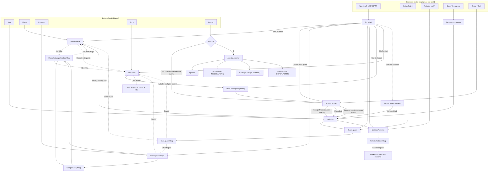

Caminos típicos:

| Perfil | Camino | Qué ve |
|---|---|---|
| Invitado | Portada → Mapa / Catálogo / Guías → marca avance (guardado en IndexedDB) → Foro (escaparate) → muro → `/entrar` | Todo en lectura; progreso local; foro recortado; `/aportar` bloqueado |
| Usuario (USER) | `/entrar` → Hub → Foro completo → Aportar (pestaña Aportes) | Puede escribir hilos y respuestas, votar y enviar aportes pendientes de aprobación (ver §13) |
| MODERATOR | Aportar → Moderación; Foro con fijar/borrar | Cola de aportes y moderación de hilos |
| ADMIN | Aportar → Catálogo y mapa | Alta, edición y borrado de entidades, marcadores y módulos, más auditoría |
| SUPER_ADMIN | Aportar → Control Total | Configuración global, módulos, monetización, roles, auditoría |

---

## 26. Adaptabilidad web vs móvil (iOS y Android)

### 26.1 Principios

- Un único cliente React/Vite para web y para la app nativa (Capacitor). No hay código específico de plataforma salvo `Capacitor.isNativePlatform()` (AdSlot no se muestra en nativo; `?native=1` en el inicio de sesión).
- El punto de corte principal es **768 px** (`md`): `matchMedia('(min-width: 768px)')` en Mapa y Catálogo; `Modal` pasa a hoja por debajo de 768 px. Guías usa `≥1280 px` para la barra lateral de anuncios.
- Alturas con `100dvh`; `viewport-fit=cover`; safe areas por `env(safe-area-inset-*)`.

### 26.2 Componentes que cambian de comportamiento

| Aspecto | Escritorio (≥768 px) | Móvil (<768 px) |
|---|---|---|
| Bottom Dock | Píldora flotante centrada, mismos 5 ítems | Barra flotante a ancho de pantalla con safe-area; mismos 5 ítems, 56 px de alto |
| Cabecera | Wordmark + Guías + Noticias + % + Entrar | Wordmark + % + Entrar (sin Guías/Noticias) |
| `BottomSheet` | Modo lateral de 380 px (`slide-in-right`); el Comparador usa ancho `min(92vw,760px)` | Hoja inferior deslizable (`slide-up`) |
| `Modal` | Diálogo centrado con foco atrapado | Se convierte en `BottomSheet` (capa `dialog`) |
| Ficha del mapa | `aside` flotante de 340 px | `BottomSheet` no modal, versión compacta |
| Detalle del catálogo | Columna central (visor con zoom) + panel lateral | Cuadrícula de 3 columnas + `BottomSheet` al tocar un elemento |
| Foro | Dos paneles (lista y detalle) | Lista o detalle alternados ("← Volver al tablón"); botón flotante "+" para nuevo hilo |
| Portada | Hero en fila, 3 columnas de tarjetas | Hero en columna, 2 columnas |
| Acceso `/entrar` | Panel izquierdo de 576 px + artwork con tip flotante | Banner de 290 px con wordmark, tarjeta de botones, skyline inferior |

### 26.3 Regla de scroll y footer

| Tipo de página | Rutas | Comportamiento |
|---|---|---|
| HUD (sin scroll de página) | `/mapa`, `/catalogo` (Inspector), `/foro` | `h-dvh overflow-hidden`; scroll interno por paneles; **sin RockstarFooter** (ni en escritorio ni en móvil) |
| Página con scroll | `/`, `/hub`, `/progreso`, `/guias*`, `/noticias*`, ficha de catálogo, `/aportar` | Scroll normal; RockstarFooter negro al final; reserva inferior `--dock-reserve` (92 px + safe-bottom; 112 px en `md+`) |
| Sin shell | `/entrar` | Sin dock ni footer; ocupa toda la pantalla |

### 26.4 Áreas táctiles, safe areas y movimiento

- Controles con `min-h-11` (44 px) en prácticamente toda la UI; botón de cierre de hojas 44×44; pines del mapa con área táctil de 22 px de radio constante. ✅
- `pt/pl/pr-safe` en `ViceShell`; dock con `calc(12px + var(--safe-*))`; `BottomSheet` con padding inferior seguro.
- Gestos del mapa: arrastre (>5 px), pellizco con 2 punteros, rueda, botones +/−/restablecer.
- Sin respuesta háptica (`vibrate`/haptics: no existe). Sin gestos de "tirar para refrescar".
- 🟡 `prefers-reduced-motion`: se anulan `.anim-slide-up/.anim-slide-in-right/.anim-pulse` y la transición de `.pbtn` (`vice-nui.css:180-189`); las clases Tailwind `animate-slide-up`/`animate-slide-in-right` de `BottomSheet` no tienen override verificado (❓).

### 26.5 Qué cambia pantalla por pantalla

| Pantalla | Diferencia escritorio → móvil |
|---|---|
| Portada | Hero fila→columna; imagen del hero recortada bajo el título en móvil |
| Acceso | Layout dividido→banner + tarjeta; mismo máximo de 4 botones |
| Hub | Dos columnas (Avance + Tip) → una columna apilada |
| Mapa | Buscador y capas fijos a la izquierda → capas tras botón "Capas del mapa"; zoom a la derecha en ambos |
| Catálogo | Visor central con zoom → solo cuadrícula + hoja |
| Ficha | Imagen y estadísticas en dos columnas → apiladas |
| Guías | Índice en 2 columnas → 1; detalle con barra lateral de anuncios solo ≥1280 px |
| Noticias | Tarjetas en rejilla → columna |
| Foro | Dos paneles → lista/detalle alternados |
| Aportar | Formulario y "Mis aportes" lado a lado → apilados (pestañas con desplazamiento horizontal ❓) |

### 26.6 Estado real de la app nativa

Ver §30. Resumen: existen los proyectos `android/` e `ios/` generados por Capacitor, pero con identidad heredada, sin deep link, sin plugins y con web embebida desactualizada en Android. **No hay PWA** (sin manifest ni service worker) y **no hay icono, favicon ni splash** en `public/`. En nativo, `AdSlot` no renderiza nunca.

> ⚠️ **Brecha:** el diseño exige que "escritorio y móvil (iOS/Android)" compartan el mismo dock y bottom sheets; eso se cumple en web responsive, pero el empaquetado nativo no está listo para tiendas (§30).

---

## 27. Wireframes estructurales (escritorio NUI vs móvil)

Los wireframes reproducen lo que **hoy** muestra la app (capturas de `shots/` y código). Notas: las capturas de Mapa y Hub se tomaron con 20 pines de ejemplo; **hoy el mapa no tiene marcadores** (0) y el Hub mostrará "0 de 0 marcadores". Convenciones: `[ ]` botón, `(•)` seleccionado, `▓` imagen, `░` fondo sunset, `░░ DOCK` = Bottom Dock.

### 27.1 Portada `/`

Escritorio:

```text
┌──────────────────────────────────────────────────────────────────────────────────────┐
│ LEONIDAPP                                         Guías  Noticias  [0%]  [Entrar]    │
├──────────────────────────────────────────────────────────────────────────────────────┤
│  ┌────────────────────────────────────────────┬─────────────────────────────────┐   │
│  │ GUÍA COMUNITARIA DE LEONIDA                │▓▓▓▓▓▓ artwork hero ▓▓▓▓▓▓▓▓▓▓▓▓│   │
│  │ Todo Leonida, en un solo mapa              │▓▓ (hero-gas-station.jpg, con    ▓│   │
│  │ Mapa, catálogo, guías y foro...            │▓▓  degradado de fusión)         ▓│   │
│  │ [Abrir el mapa] [Crear cuenta gratis]      │▓▓▓▓▓▓▓▓▓▓▓▓▓▓▓▓▓▓▓▓▓▓▓▓▓▓▓▓▓▓▓│   │
│  └────────────────────────────────────────────┴─────────────────────────────────┘   │
│  Explora Leonida                                                                     │
│  ┌──────────────┐ ┌──────────────┐ ┌──────────────┐   (hasta 6 tarjetas con        │
│  │▓ Mapa        │ │▓ Armas       │ │▓ Vehículos   │    imagen, título y conteo;     │
│  └──────────────┘ └──────────────┘ └──────────────┘    filtradas por módulo activo) │
│  Noticias oficiales (≤6)   | vacío/error: tarjeta + enlace a Rockstar Newswire       │
│  Guías (≤6, barra de avance) | Foro en vivo (5 hilos, badge EN VIVO)                 │
│  ┌─ Franja de registro (solo invitado) ─────────────────────────────────────────┐    │
│  └──────────────────────────────────────────────────────────────────────────────┘    │
│  Aviso de datos de ejemplo (si source = seed)                                        │
├──────────────────────────────────────────────────────────────────────────────────────┤
│ ███ RockstarFooter negro: Contacto | Colabora | Recursos | Suscríbete | ES EN | legal │
└──────────────────────────────────────────────────────────────────────────────────────┘
                     ░░░ [Hub][Mapa][Catálogo][Foro][Aportar] ░░░  (dock flotante)
```

Móvil:

```text
┌──────────────────────────┐
│ LEONIDAPP      [0%][Entrar]│
│ ┌──────────────────────┐ │
│ │ GUÍA COMUNITARIA...  │ │
│ │ Todo Leonida, en un  │ │
│ │ solo mapa            │ │
│ │ [Abrir el mapa]      │ │
│ │ [Crear cuenta gratis]│ │
│ │▓▓▓ artwork (recorte)▓│ │
│ └──────────────────────┘ │
│ Explora Leonida          │
│ ┌────────┐ ┌────────┐    │
│ │▓ Mapa  │ │▓ Armas │    │
│ └────────┘ └────────┘    │
│ Noticias · Guías · Foro  │
│ ...scroll... Footer      │
│ [Hub][Mapa][Cat][Foro][+]│
└──────────────────────────┘
```

Estados: noticias `loading` / vacío / error con `aria-live`; foro vacío "Aún no hay hilos…"; imagen del hero que falla → se oculta.

### 27.2 Acceso `/entrar`

Escritorio (sin dock ni footer):

```text
┌───────────────────────────┬──────────────────────────────────────────────────────────┐
│     LEONIDAPP (wordmark)  │  ┌─ TIP DEL DÍA ───────────────────────────────┐        │
│  [ Entrar ][ Explorar ]   │  │ Marca cada hallazgo al 100%... (3 tips ▬ ▬ ▬)│        │
│  Bienvenido a Leonida     │  └──────────────────────────────────────────────┘        │
│  [G Continuar con Google ]│   ▓▓▓▓▓▓▓▓▓▓▓▓▓▓▓▓▓▓▓▓▓▓▓▓▓▓▓▓▓▓▓▓▓▓▓▓▓▓▓▓▓▓▓▓▓▓▓▓       │
│  [ Continuar con Discord ]│   ▓▓▓▓ artwork con diagonales SVG ▓▓▓▓▓▓▓▓▓▓▓▓▓▓       │
│  [ Continuar con Apple   ]│   ▓▓▓▓▓▓▓▓▓▓▓▓▓▓▓▓▓▓▓▓▓▓▓▓▓▓▓▓▓▓▓▓▓▓▓▓▓▓▓▓▓▓▓▓▓▓       │
│  [ Correo / Magic Link   ]│                                                          │
│  v0.1.0 • EN LÍNEA        │                                                          │
└───────────────────────────┴──────────────────────────────────────────────────────────┘
```

Móvil: banner de 290 px con wordmark sobre el artwork; pestañas Entrar/Explorar; tarjeta glass con los 4 botones; skyline inferior y "v0.1.0 • EN LÍNEA".

Modo "Explorar": lista de ventajas + "Continuar como invitado" (→ `/hub`). Magic Link abre un `Modal` (hoja en móvil) con campo de correo.

Estados: sin `VITE_API_URL` → botones deshabilitados con "Sin conexión con el servidor…"; `maintenance_mode` → aviso; sin proveedores → "desactivado temporalmente". Máximo 4 botones (`.slice(0,4)`).

> ⚠️ **Brecha:** la validación del correo del Magic Link usa la regex rota `/^S+@S+.S+$/` (`LandingAuthPage.tsx:52`): un correo normal siempre muestra "Introduce un correo electrónico válido." El Footer sí valida bien.

### 27.3 Hub `/hub` (y `/progreso`)

Escritorio:

```text
┌───────────────────────────────────────────────────────────────────────────────┐
│ LEONIDAPP                                   Guías  Noticias  [0%]  [Entrar]   │
│  Mi avance                                                                    │
│  Hola, invitado. Así va tu 100% de Leonida.                                   │
│ ┌─ Avance total ─────────────────────────────┐  ┌─ Tip del día ─────────┐    │
│ │ (◯ 0%)  0 de N marcadores completados      │  │ ▓ banner sunset       │    │
│ │         0 de M elementos en total          │  │ Marca cada hallazgo...│    │
│ │ Marcadores del mapa ▬▬▬▬▬▬▬▬▬▬ 0/N         │  │ ▬ ▬ ▬ (paginador)     │    │
│ │ Armas / Vehículos / Coleccionables  barras │  └───────────────────────┘    │
│ │ "Tu progreso se guarda en este dispositivo.│                               │
│ │  Inicia sesión para sincronizarlo."        │                               │
│ └────────────────────────────────────────────┘                               │
│ ┌─ Rutas sugeridas ─────────────────────────┐ Aviso global (si hay)          │
│ │ [tarjeta ruta][tarjeta ruta] [Ir al siguiente punto]                       │
│ └────────────────────────────────────────────┘ Novedades oficiales (≤3)       │
│ Accesos rápidos (6 tarjetas; Aportar siempre)                                 │
│ Footer                                                                        │
└───────────────────────────────────────────────────────────────────────────────┘
```

Móvil: una columna: Mi avance → Avance total → Tip → Rutas → Novedades → accesos.

Estados: "Cargando tu progreso local…" hasta hidratar IndexedDB; con sesión aparece el estado de sincronización (Sincronizando / Error + "Reintentar sincronización" / Sincronizado con fecha / Pendiente). "Rutas sugeridas" proviene de `SEED_ROUTES` y puede quedar vacía si los ids de los marcadores no coinciden (❓).

> ⚠️ **Brecha:** con 0 marcadores en la base, el Hub mostrará 0 de 0 en marcadores y las rutas sugeridas no tendrán destino.

### 27.4 Mapa `/mapa` (HUD 100vh)

Escritorio:

```text
┌───────────────────────────────────────────────────────────────────────────────────┐
│ LEONIDAPP                                      Guías  Noticias  [0%]  [Entrar]    │
├────────────────────┬──────────────────────────────────────────────┬───────────────┤
│ [Buscar en el mapa]│                                              │   [+]         │
│ ┌ CAPAS DEL MAPA ┐ │      Lienzo SVG 1000×700: tierra, islas,     │   [−]         │
│ │☑ Coleccionables│ │      regiones etiquetadas, rutas punteadas   │   [↻]         │
│ │☑ Armas         │ │      y pines (HOY: 0 pines)                  │ [0/N complet.]│
│ │☑ Vehículos     │ │                                              │               │
│ │☑ Tiendas       │ │      ┌─ Ficha de marcador (aside 340px) ─┐   │               │
│ │☑ Eventos       │ │      │ al seleccionar un pin; acciones:   │   │               │
│ │☑ Misiones/guías│ │      │ completar, Ver ficha, Discutir     │   │               │
│ │☑ Puntos interés│ │      └────────────────────────────────────┘   │               │
│ └────────────────┘ │                                              │               │
├────────────────────┴───────────── skyline sunset ─────────────────┴───────────────┤
│                      ░░░ [Hub][Mapa][Catálogo][Foro][Aportar] ░░░                  │
└───────────────────────────────────────────────────────────────────────────────────┘
(sin footer)
```

Móvil:

```text
┌──────────────────────────┐
│ LEONIDAPP      [0%][Entrar]│
│ [Buscar en el mapa...]   │
│ [Capas del mapa] [0/N]   │
│   lienzo SVG a pantalla  │
│   (pan, pellizco)        │
│                   [+][−][↻]│
│ ┌ BottomSheet (ficha) ──┐│  ← al tocar un pin (no modal)
│ [Hub][Mapa][Cat][Foro][+]│
└──────────────────────────┘
```

Estados: sin pantalla de carga propia; si la API falla se muestra "No se pudo conectar… se muestran datos de ejemplo". **Vacío real hoy: lienzo sin pines y contador 0/0.** Capas con conteo por tipo.

### 27.5 Catálogo (Inspector) `/catalogo`

Escritorio:

```text
┌───────────────────────────────────────────────────────────────────────────────────┐
│ LEONIDAPP                                      Guías  Noticias  [0%]  [Entrar]    │
│ ARMERÍA                                      [Armas][Vehículos][Coleccionables]   │
│ [Todas][Pistolas][Subfusiles][Rifles de Asalto][Escopetas]...(filtro categoría)   │
├──────────────────┬──────────────────────────────┬─────────────────────────────────┤
│ ARMAS  19 en total│                              │ [PISTOLAS]                      │
│ ┌──┐┌──┐┌──┐     │      ┌──────────────┐        │ Pistola Compacta C9             │
│ │▓ ││▓ ││▓ │     │      │ silueta /    │        │ Arma corta de uso diario        │
│ └──┘└──┘└──┘     │      │ imagen grande│        │ ESTADÍSTICAS: Daño ▬▬ 38 ...    │
│ nombres...       │      └──────────────┘        │ Ubicación · Precio · Munición   │
│ (cuadrícula con  │  [−] ZOOM x1.0 [+] [↻]       │ [Marcar como obtenida]          │
│  scroll interno) │  "Silueta vectorial ilustr." │ [Ver en el mapa]                │
│                  │                              │ [Ver ficha][Comparar][Discutir] │
├──────────────────┴────────── skyline ───────────┴─────────────────────────────────┤
│                      ░░░ dock ░░░                          (sin footer)           │
└───────────────────────────────────────────────────────────────────────────────────┘
```

Móvil: título, pestañas de módulo con scroll horizontal, chips de categoría, cuadrícula de 3 columnas; al tocar un elemento se abre un `BottomSheet` con el detalle. Comparador: `BottomSheet` (también en escritorio) con 2-3 columnas, `select` para cambiar elementos, mejor cifra resaltada "· mejor".

Estados: "No hay elementos para mostrar." / "Sin elementos en esta categoría."; elementos sin imagen usan silueta SVG o banner sunset.

### 27.6 Ficha de entidad `/catalogo/:categoria/:itemSlug`

Escritorio:

```text
┌──────────────────────────────────────────────────────────────────────────────┐
│ cabecera                                                                      │
│  Catálogo › Armas › Duke 556                                                  │
│  RIFLES DE ASALTO                                                             │
│  Duke 556 · Fusil carabina                                                    │
│ ┌────────────────────────┐ ┌───────────────────────────────┐                  │
│ │ imagen / silueta       │ │ Daño ▬▬ 5.0 ... StatBars       │                  │
│ │                        │ │ Precio · Ubicación             │                  │
│ └────────────────────────┘ │ [Marcar como obtenida]         │                  │
│ Relacionado                └───────────────────────────────┘                  │
│  [Sin ubicación en el mapa]        [Abrir hilo sobre Duke 556]                │
│  Comparar con otras de Armas: [Comparar con A] [B] [C]                        │
│  AdSlot after-content (solo si hay anuncios activos)                          │
│ ███ Footer ███                                                                │
└──────────────────────────────────────────────────────────────────────────────┘
```

Móvil: bloques apilados (imagen, estadísticas, relacionados, comparar). Estados: "Cargando ficha…"; "No encontramos esta ficha." con enlace al catálogo (`noindex`). Las estadísticas muestran el valor exacto 0-10 cuando existe `metadata_json.stats_juego`.

### 27.7 Guías `/guias` y `/guias/:slug`

Índice (escritorio y móvil: 2 columnas → 1):

```text
┌──────────────────────────────────────────────────────────────┐
│ Guías y misiones                                              │
│ Sigue cada guía paso a paso y marca lo que ya hiciste...      │
│ ┌─[CATEGORÍA]──────────────┐ ┌─[CATEGORÍA]──────────────┐    │
│ │ Título de la guía         │ │ Título                    │    │
│ │ subtítulo                 │ │ subtítulo                 │    │
│ │ Tu avance ▬▬▬▬▬▬ 0/3      │ │ Tu avance ▬▬ 0/2          │    │
│ │ Empezar guía →            │ │ Empezar guía →            │    │
│ └───────────────────────────┘ └───────────────────────────┘    │
│ AdSlot after-content · Footer                                  │
└──────────────────────────────────────────────────────────────┘
```

Guía (detalle):

```text
┌──────────────────────────────────────────────┬─────────────────┐
│ Migas: Guías › Título                         │ AdSlot sidebar  │
│ Título · subtítulo                            │ (solo ≥1280 px) │
│ Progreso de la guía N/M pasos ▬▬▬▬            │                 │
│ 1 ☐ paso ...  2 ☐ paso ...                    │                 │
│ AdSlot in-article (tras el paso 2, si no ancho)│                 │
│ Contenido con spoiler [Mostrar spoiler]       │                 │
│ En esta guía: enlaces a catálogo y mapa       │                 │
│ Hilos del foro (≤5) [Discutir]                │                 │
│ AdSlot after-content · Footer                 │                 │
└──────────────────────────────────────────────┴─────────────────┘
```

Estados: "Aún no hay guías publicadas."; aviso si la API falla; "Cargando guía…"; "No encontramos esta guía." (`noindex`); "Guía completada.". Hoy hay 57 guías en la base (55 de grabación y 2 básicas).

> ⚠️ **Brecha:** las capturas de `shots/` muestran guías de ejemplo (p. ej. "Primer día en Leonida") de cuando aún existía la semilla; la lista actual proviene de la base (57).

### 27.8 Noticias `/noticias` y `/noticias/:slug`

```text
┌──────────────────────────────────────────────────────────────┐
│ Noticias oficiales                                            │
│ Lo último publicado por Rockstar Games y Take-Two...          │
│ [Todas][Rockstar Newswire][Rockstar YouTube][Take-Two IR]     │ (solo fuentes con noticias)
│ ┌─[Take-Two IR] 24 de junio de 2026 ─────────────┐            │
│ │ Título · resumen... Leer en la fuente oficial   │            │
│ └─────────────────────────────────────────────────┘            │
│ ┌ Más noticias en Rockstar Newswire ── [Abrir Rockstar Newswire]┐│
│ Nota de atribución (no afiliado) · AdSlot · Footer            │
└──────────────────────────────────────────────────────────────┘
```

Móvil: tarjetas en columna. Detalle: migas, fuente/fecha, título, imagen (`referrerPolicy="no-referrer"`, lazy), resumen, enlace a fuente original. Estados: cargando, "No pudimos cargar…", "Aún no hay noticias oficiales guardadas en LeonidApp." Hoy: 1 noticia (Take-Two IR).

### 27.9 Foro `/foro`

Invitado (escaparate con muro), escritorio:

```text
┌───────────────────────────────────────────────────────────────────────────────────┐
│ COMUNIDAD [Todos][General][Guías / Ayuda][Secretos][Crews]               [+ HILO] │
├─────────────────────────────────┬─────────────────────────────────────────────────┤
│ HILOS · 6              ● EN VIVO│                                                 │
│ [Buscar hilos...][Tend.][Recien.]│                (🔒)                             │
│ ┌ GENERAL ─────────────────────┐│          Entra a la conversación                │
│ │ Título ▲9 · 0 respuestas · u ││   Lee los hilos completos, responde, vota...    │
│ └──────────────────────────────┘│          [Crear cuenta gratis]                  │
│ ... (sin contenido del hilo)    │                                                 │
├─────────────────────────────────┴───────────── skyline ───────────────────────────┤
│                      ░░░ dock ░░░                       (sin footer)              │
└───────────────────────────────────────────────────────────────────────────────────┘
```

Móvil invitado: lista de hilos con voto ▲ a la izquierda, chips de categoría con scroll, botón flotante "+" que abre el muro.

Con sesión, escritorio:

```text
├─────────────────────────────────┬─────────────────────────────────────────────────┤
│ lista de hilos (fijados primero)│ Título del hilo · [categoría] [SPOILER]         │
│                                 │ contenido (spoiler difuminado [Mostrar spoiler])│
│                                 │ chips: ficha / marcador enlazados               │
│                                 │ ▲ voto · [Responder]                            │
│                                 │ árbol de respuestas (profundidad máx. 3, ▲)     │
│                                 │ [Moderación: Fijar | Borrar] (MODERATOR+)       │
└─────────────────────────────────┴─────────────────────────────────────────────────┘
```

"+ Hilo" abre un `BottomSheet` "Nuevo hilo" (categoría, título 4-140, contenido ≥4, casilla spoiler). Borrar pide confirmación en `Modal`. En móvil lista y detalle alternan ("← Volver al tablón").

Estados: vacío, error de red (publicar sin API solo vive en memoria de la sesión, con aviso), voto optimista con reversión. Hoy: 6 hilos y 9 posts de semilla ("hace 142 d" en la captura).

### 27.10 Aportar `/aportar`

Sin sesión (ambos formatos): tarjeta centrada "Necesitas una cuenta" con [Iniciar sesión] → `/entrar?next=/aportar`; mientras carga: "Verificando sesión…".

Con sesión, escritorio:

```text
┌───────────────────────────────────────────────────────────────────────────────────┐
│ Centro de aportes · Todo aporte pasa por moderación antes de publicarse           │
│ [Aportes] [Moderación*] [Catálogo y mapa**] [Control Total***]   (* según rol)    │
│ ┌─ Nuevo aporte ───────────────────────┐ ┌─ Mis aportes ──────────────────────┐   │
│ │ Tipo (marcador/entidad/corrección)   │ │ "Aún no has enviado aportes."      │   │
│ │ Módulo · Título · Descripción        │ │ (lista con badge de estado)        │   │
│ │ Región · X (0-1000) · Y (0-700)      │ │                                    │   │
│ │ Imagen (URL, opcional)               │ │                                    │   │
│ │ [Enviar aporte]                      │ │                                    │   │
│ └──────────────────────────────────────┘ └────────────────────────────────────┘   │
│ Footer                                                                            │
└───────────────────────────────────────────────────────────────────────────────────┘
```

Móvil: formulario y "Mis aportes" apilados. Estados: "queda Pendiente hasta que un moderador lo revise"; sin API todo deshabilitado con aviso. (Aprobación automática: ver §13.)

### 27.11 Panel de administración (pestañas de `/aportar`)

Moderación (MODERATOR+):

```text
┌─ Cola de moderación ──────────────────────────────────────────┐
│ [Pendiente][Aprobado][Rechazado]                               │
│ ┌ tarjeta: título, tipo, descripción, región/coords ─────────┐ │
│ │                          [Aprobar] [Rechazar] (si pendiente)│ │
│ └─────────────────────────────────────────────────────────────┘ │
│ vacío: "No hay aportes en este estado."                        │
└───────────────────────────────────────────────────────────────┘
```

Catálogo y mapa (ADMIN+):

```text
┌─ Catálogo y mapa ─ Alta, edición y borrado; cada cambio queda en auditoría ─┐
│ [Entidades (227)] [Marcadores (0)] [Módulos (7)]                  [Nuevo]   │
│ ┌ Título · Módulo · Categoría · /slug              [Editar] [Borrar] ┐      │
│ │ ... lista con scroll interno ...                                    │      │
│ └─────────────────────────────────────────────────────────────────────┘      │
│ Formularios en Modal (hoja en móvil): módulo / entidad / marcador            │
│ Borrar → Modal de confirmación. (ADMIN: además AuditPanel)                   │
└──────────────────────────────────────────────────────────────────────────────┘
```

Control Total (SUPER_ADMIN):

```text
┌─ Configuración global ─────────────────────────────────────────────┐
│ ☐ Modo mantenimiento · Anuncio global (≤500) · Proveedores (máx. 4)│
│ Feature flags [nombre][Añadir] · Redes sociales (máx. 12)          │
│ [Guardar configuración]   Fuentes oficiales vigentes (solo texto)  │
├──────────────────────────────┬─────────────────────────────────────┤
│ Módulos (switch activo)      │ Monetización (AdSlot): global,      │
│ mapa, armas, vehículos, ...  │ proveedor, publisher ID, slots      │
├──────────────────────────────┼─────────────────────────────────────┤
│ Gestión de roles (buscar,    │ Registro de auditoría (últimos 50)  │
│ select USER..SUPER_ADMIN)    │                                     │
└──────────────────────────────┴─────────────────────────────────────┘
```

> ⚠️ **Brecha:** en móvil el panel de administración no tiene captura (❓); es la misma estructura apilada. No existe pantalla en el cliente para gestionar fuentes de noticias ni para leer la bandeja de Contacto/Suscripción (la lista de fuentes es solo informativa).

---

## 28. Sistema de diseño Vice Sunset NUI

### 28.1 Tokens (`src/styles/vice-nui.css`, `tailwind.config.ts`)

| Token | Valor | Uso |
|---|---|---|
| `--vice-night` / `plum` / `rose` / `orange` | `#2e1a47` / `#7b2c6f` / `#e14b7b` / `#f69259` | Paradas del cielo |
| `--vice-magenta` / `coral` | `#e1307e` / `#f67e56` | Acento primario |
| `--vice-ink` / `--vice-text` | `#1a0a22` / `#fbf1f5` | Etiqueta sobre acento / texto |
| Tailwind extra | `gold #FFC857`, `cyan #5ED6E0`, `lilac #B79CFF` | Barras de estadísticas y foco. No están en `:root` (solo en la config de Tailwind) |
| `--vice-sunset` | `linear-gradient(180deg,#2e1a47 0%,#7b2c6f 38%,#e14b7b 72%,#f69259 100%)` | Fondo de página (`.bg-sunset`) |
| `--vice-accent` | `linear-gradient(90deg,#e1307e,#f67e56)` | PalmButton y activos |
| Superficie glass | `rgba(20,14,36,.78)` + `blur(14px)` + borde `rgba(246,146,89,.25)` + sombra `0 10px 40px rgba(26,10,34,.45)` | Paneles HUD, tarjetas |
| Diagonales | `rgba(225,75,123,.25)` / `rgba(246,146,89,.2)` | Decoración |
| Safe areas | `--safe-top/right/bottom/left = env(safe-area-inset-*, 0px)` | Layout |
| Reserva de dock | `--dock-reserve: calc(92px + safe-bottom)`; 112 px en `md+` | Padding inferior |
| Capas z | `--z-dock 40`, `--z-sheet-backdrop 50` (clase sin uso), `--z-sheet 55`, `--z-dialog 70` | Apilado |
| Footer | Fondo `#000000` | `RockstarFooter` |
| Fuentes | Display **Jost** (500/600/700), cuerpo **Poppins** (400/500/600) vía Google Fonts (`index.html:10-11`) | Sin red caen a `system-ui` |
| Animaciones | `slide-up`, `slide-in-right` (0.28 s), `vice-pulse` (1.6 s) | Hojas y pulso |
| Scrollbars | Oscuros globales con pulgar sunset | Todas |
| `theme-color` | `#2E1A47` | Barra del navegador |

> ⚠️ **Brecha:** las fuentes se cargan de Google Fonts en tiempo de ejecución (no empaquetadas): offline y en la app nativa sin red se usa `system-ui`, y hay una dependencia de tercero (privacidad/RGPD). Poppins 700 no se solicita pero se usa `font-bold` (síntesis del navegador, ❓).

### 28.2 Componentes

| Componente | Archivo | Props clave | Estados y accesibilidad |
|---|---|---|---|
| `ViceShell` | `components/layout/ViceShell.tsx` | `children, showHeader, headerEnd, headerCenter, dock, lockScroll=true, footer, decorations=true` | Fondo sunset con palmeras (7-9 % opacidad) y skyline `aria-hidden`; `<header>`/`<main>`; `lockScroll` → `h-dvh overflow-hidden`; con scroll + `footer` monta `RockstarFooter`. Exporta `ViceWordmark` (`role=img`, `aria-label="LEONIDAPP"`), `SunsetBanner`, `PalmSymbol` |
| `BottomDock` | `components/layout/BottomDock.tsx` | `items, activeId` | `<nav aria-label="Navegación principal">`, `fixed` con safe-area, 56 px por ítem, `aria-current="page"`, icono SVG + etiqueta |
| `RockstarFooter` | `components/layout/Footer.tsx` (783 l.) | — | `<footer aria-label="LeonidApp">` negro; 4 columnas (Contacto, Colabora, Recursos, Suscríbete); redes desde config pública (URLs http/https saneadas); selector ES/EN (`aria-pressed`, `lang`); legales y cookies en `Modal`; honeypot `website`; estados idle/loading/done/error |
| `PalmButton` | `components/ui/PalmButton.tsx` | `variant primary|glass, loading, disabled, fullWidth, icon, as 'button'|'a'` | `.pbtn` (min-height 44, radio 14, Jost 700 18 px), `aria-busy`, `aria-disabled`; como `<a>` deshabilitado quita `href` y `tabIndex`; foco `outline 2px #ffc857` |
| `TipCard` | `components/ui/TipCard.tsx` | `tips (máx 3), index, onIndexChange, imageSrc` | `<section aria-label="Tip del día">`, `aria-live=polite`, paginador con `aria-current` |
| `StatBar` | `components/ui/StatBar.tsx` | `label, value 0-100, valueLabel, accent magenta|gold|cyan|lilac` | `role=meter` con `aria-valuenow/-valuetext` |
| `BottomSheet` | `components/ui/BottomSheet.tsx` | `open, onClose, title, mode sheet|side, modal, closeLabel, layer sheet|dialog` | Portal a `<body>`; `role=dialog`, `aria-modal` si modal; foco al panel, Esc cierra, trampa de Tab si modal, devuelve foco; cierre 44 px |
| `Modal` | `components/ui/Modal.tsx` | `open, onClose, title, footer, closeLabel` | Escritorio: diálogo centrado (`z-dialog`); `<768 px` → `BottomSheet layer=dialog` |
| `AdSlot` | `components/ui/AdSlot.tsx` | `position, slotId, className` | Renderiza solo si: anuncios activados, proveedor distinto de `none`, no es plataforma nativa, la ruta no es `/mapa|hub|progreso|aportar|entrar`, y hay slot habilitado con ancho y alto. `<aside aria-label="Publicidad">` con `aspect-ratio` fijo (CLS 0). **No carga scripts de terceros ni lee el consentimiento** |
| `CatalogAdminPanel` | `components/ui/CatalogAdminPanel.tsx` (434 l.) | — | Selector Entidades/Marcadores/Módulos, formularios en `Modal`, `aria-pressed`, `aria-live`, `role=alert/status`; deshabilitado sin API. No figura en el árbol aprobado de `ui` (DesignSpec §6.1) |

### 28.3 Reglas de contraste, movimiento y táctil

| Regla | Estado |
|---|---|
| Etiqueta del acento en `#1A0A22` con peso 700 (el blanco no alcanza contraste sobre `#F67E56`) | ✅ |
| Áreas táctiles ≥44 px (`min-h-11` en ~95 usos) | ✅ |
| Foco visible (`outline-vice-gold`, `#FFC09A` en foro) | ✅ |
| `prefers-reduced-motion` | 🟡 cubre `.anim-*` y `.pbtn`; `BottomSheet` usa clases Tailwind sin override verificado (❓) |
| Skip link | ❓ no localizado |
| Contraste medido (WCAG AA) de textos sobre glass y sunset | ❓ no medido |
| `html lang` | ⚠️ fijo `es`; el selector ES/EN no lo cambia |

### 28.4 Assets de `public/assets/` (1 archivo)

| Archivo | Uso |
|---|---|
| `hero-gas-station.jpg` | Hero de Portada y `/entrar` |

Sprint 4: se eliminaron `vice-sunset-ref.jpg` y todos los `complexmusic_*`, `rockstargames_*` y `theofficialselfridges_*`. Las tarjetas de Portada/Dashboard (`CropImg`) usan degradados Vice Sunset en CSS y las fichas semilla sin imagen muestran el banner sunset. No hay iconos de app, favicon ni splash.

> ⚠️ **Pendiente de derechos:** `hero-gas-station.jpg` es artwork protagonista según CLAUDE.md §3; su procedencia y licencia siguen sin verificar (❓). `supabase/03_seed_data.sql` (legado) aún referencia las rutas eliminadas.

---

## 29. Catálogo de pantallas (una por una)

Convención: "Invitado" = sin sesión; "USER+" = autenticado; ver §11 para el RBAC.

### 29.1 HomePage `/` (`HomePage.tsx`, 421 l.)

| Campo | Detalle |
|---|---|
| Propósito | Portada pública y puerta de entrada SEO |
| Invitado | Ver todo; "Abrir el mapa", "Crear cuenta gratis"; los hilos del "Foro en vivo" abren el muro de registro |
| USER+ | Igual, sin franja de registro; los hilos enlazan a `/foro?hilo=ID` |
| Datos | `useWorldData`, `useForumData`, `useOfficialNews('all',50)`, `useModuleGate` |
| Estados | Noticias `loading`/vacío/error; foro vacío; imagen del hero que falla se oculta; aviso de datos de ejemplo |
| Offline | Mundo y foro caen a `SEED_WORLD`/`SEED_FORUM`; noticias vacías ("Sin API configurada") |
| Defectos | Sin AdSlot; imágenes de terceros (§28.4); la sección "Explora Leonida" depende de recortes de imágenes fijos |

### 29.2 LandingAuthPage `/entrar` (`LandingAuthPage.tsx`, 335 l.)

| Campo | Detalle |
|---|---|
| Propósito | Inicio de sesión OAuth2+PKCE (Google, Discord, Apple) o Magic Link; modo Explorar como invitado |
| Invitado | Único público objetivo; con sesión redirige a `next` |
| Datos | `usePublicConfig` (proveedores habilitados, mantenimiento), `SEED_TIPS` |
| Estados | Botones deshabilitados sin API; mantenimiento; sin proveedores; éxito del Magic Link "Si el correo es válido, recibirás el enlace…" |
| Offline | Botones deshabilitados; "Explorar" funciona |
| Defectos | ⚠️ **Regex del correo rota** (`/^S+@S+.S+$/`, línea 52): el Magic Link desde `/entrar` nunca valida. El pie "EN LÍNEA/SIN CONEXIÓN" solo refleja si hay `VITE_API_URL`, no la red real. No usa `usePageMeta` propio |

### 29.3 DashboardPage `/hub` y `/progreso` (`DashboardPage.tsx`, 297 l.)

| Campo | Detalle |
|---|---|
| Propósito | Resumen de avance, tip, rutas sugeridas, novedades y accesos rápidos |
| Invitado | Todo; el progreso se guarda en IndexedDB |
| USER+ | Además estado de sincronización y "Reintentar sincronización" |
| Datos | mundo, `useProgressStore`, `SEED_TIPS`, `SEED_ROUTES`, config (aviso), 3 noticias |
| Estados | "Cargando tu progreso local…"; sync Sincronizando/Error/Sincronizado/Pendiente |
| Offline | Funciona; sincroniza al volver `online` |
| Defectos | "Rutas sugeridas" proviene de semilla (ids posiblemente no coincidentes con la base, ❓); con 0 marcadores los totales de marcadores son 0 |

### 29.4 MapPage `/mapa` (`MapPage.tsx`, 678 l.)

| Campo | Detalle |
|---|---|
| Propósito | Mapa vectorial interactivo con capas y fichas |
| Invitado / USER+ | Igual: marcar completado funciona sin sesión (local) |
| Datos | mundo (marcadores, regiones, capas), progreso, foro |
| Estados | Aviso de datos de ejemplo; sin pantalla de carga |
| Offline | Con semilla mostraba 20 pines; con la base real **0** |
| Defectos | ⚠️ **Mapa sin pines hoy** (0 marcadores en la base; las 138 entidades de `mapa` no se proyectan como pines). Lienzo SVG genérico, no un mapa real del juego. `lockScroll` ⇒ sin footer. Capas y zoom no persisten en la URL. Los ids de `?marker=` deben existir en la base |

### 29.5 CatalogPage `/catalogo` (`CatalogPage.tsx`, 965 l.)

| Campo | Detalle |
|---|---|
| Propósito | Inspector de armas, vehículos y coleccionables; comparador |
| Invitado / USER+ | Igual; marcar "obtenido" local/sync |
| Datos | mundo, foro, progreso |
| Estados | "No hay elementos para mostrar."; siluetas SVG cuando no hay imagen |
| Offline | Semilla (23 entidades) o último mundo en memoria |
| Defectos | Sin footer (`lockScroll`); coleccionables = 0 en la base; solo 12 armas y 20 vehículos reales; sin buscador; entidades de `mapa` no navegables aquí |

### 29.6 Ficha de entidad `/catalogo/:categoria/:itemSlug`

| Campo | Detalle |
|---|---|
| Propósito | Ficha indexable con estadísticas, relacionados y comparador |
| Datos | `useEntityDetail` (caché y API), foro, guías que la mencionan |
| Estados | "Cargando ficha…"; "No encontramos esta ficha." (`noindex`) |
| Defectos | Tiene footer y scroll, a diferencia del Inspector (inconsistencia de shell); AdSlot `after-content` solo con monetización activa (hoy desactivada) |

### 29.7 GuidesPage `/guias` y `/guias/:slug` (`GuidesPage.tsx`, 332 l.)

| Campo | Detalle |
|---|---|
| Propósito | Índice y lectura de guías paso a paso con progreso |
| Invitado / USER+ | Marcar pasos funciona sin sesión (local); a la nube solo la marca de guía completa; hilos del foro solo con sesión |
| Datos | entidades del módulo `guias` (57), `guideSteps`, foro |
| Estados | Vacío, error de API, "Cargando guía…", "No encontramos esta guía." |
| Offline | Local; los pasos nunca se sincronizan individualmente |
| Defectos | Muchas guías importadas carecen de pasos (tarjetas sin barra de avance, véase captura de guías con sesión); AdSlot sidebar solo ≥1280 px |

### 29.8 NewsPage `/noticias` y `/noticias/:slug` (`NewsPage.tsx`, 218 l.)

| Campo | Detalle |
|---|---|
| Propósito | Noticias oficiales de Rockstar/Take-Two con enlace a la fuente |
| Datos | `/api/news` (1 noticia hoy) |
| Estados | Cargando / error / vacío; filtros solo de fuentes con datos |
| Offline | **Sin API → lista vacía** (no usa semilla, por diseño del pilar "100 % oficial") |
| Defectos | Contenido en inglés sin traducción; cobertura mínima hasta que el worker (§16) ingiera más |

### 29.9 ForumPage `/foro` (`ForumPage.tsx`, 845 l.)

| Campo | Detalle |
|---|---|
| Propósito | Foro de la comunidad por categorías (General, Guías / Ayuda, Secretos, Crews) |
| Invitado | Escaparate: lista sin contenido; cualquier control abre el muro de registro |
| USER+ | Leer, crear hilos, responder (árbol ≤3 niveles), votar |
| MODERATOR+ | Fijar/desfijar, borrar hilos y respuestas (con confirmación) |
| Datos | `/api/forum` (refetch cada 20 s), votos, 6 hilos y 9 posts de semilla |
| Estados | Vacío; red caída; voto optimista con reversión; sin API publica solo en memoria |
| Defectos | ⚠️ Sin footer por `lockScroll`; sin AdSlot; botón "+ Hilo" visible para invitado (abre muro); `DISCORD_URL` importado con uso ❓; hilos de semilla con fechas antiguas ("hace 142 d") |

### 29.10 AdminSubmitPage `/aportar` (`AdminSubmitPage.tsx`, 1137 l.)

Acceso: `RequireAccount`. Sin API todos los envíos quedan desactivados.

| Pestaña / panel | Visible para | Qué hace | Estados / defectos |
|---|---|---|---|
| Aportes | Cualquier autenticado | Formulario (marcador, entidad, corrección) y "Mis aportes" (`POST /api/submissions`, `GET /api/submissions/mine`) | "Aún no has enviado aportes."; validaciones de título 3-160 y descripción ≥10; reglas de aprobación automática en §13 |
| Moderación | MODERATOR+ | Cola Pendiente/Aprobado/Rechazado; Aprobar/Rechazar | "No hay aportes en este estado." |
| Catálogo y mapa | ADMIN+ | `CatalogAdminPanel` + auditoría: CRUD de entidades, marcadores y módulos | Marcadores (0): se puede crear pines desde aquí; no hay importación masiva en la UI (existe por script, §14) |
| Control Total | SUPER_ADMIN | Panel de configuración (mantenimiento, anuncio, proveedores ≤4, flags, redes ≤12), módulos, monetización (hasta 20 slots), roles, auditoría | La lista de fuentes de noticias es solo informativa; hoy 0 SUPER_ADMIN persistidos (el acceso demo es solo desarrollo local) |

### 29.11 Elementos transversales

| Elemento | Estado real |
|---|---|
| `RockstarFooter` | Contacto (`POST /api/contact`), Suscripción (`POST /api/subscribe`), honeypot, redes desde config. Sin API → error de red al enviar. **No visible en Mapa, Inspector ni Foro** (`lockScroll`) |
| Selector de idioma ES/EN | ⚠️ Guarda cookie `leonidapp_lang` pero **solo traduce el Footer**; no cambia `html lang` ni el resto de la app |
| Consentimiento de cookies | ⚠️ La cookie `leonidapp_consent` se crea solo al guardar en "Ajustes de cookies"; no hay banner en el primer arranque y **nada en el cliente la lee** (AdSlot no la consulta) |
| Pantalla "No encontrada" / módulo desactivado | `Unavailable` con botón "Volver al Hub"; sin meta propia |
| Fuentes | Google Fonts en ejecución |

---

## 30. App nativa (Capacitor)

### 30.1 Estado real

| Aspecto | Esperado (CLAUDE.md §0) | Real | Estado |
|---|---|---|---|
| `appId` | `com.leonidapp.companion` | `com.atlasvice.app` (`capacitor.config.ts`, `android/app/build.gradle:4,7`, `project.pbxproj:312,333`) | ⚠️ |
| `appName` | LeonidApp | `ATLAS VICE` (`CFBundleDisplayName` también) | ⚠️ |
| Esquema de deep link | `leonidapp://` | Ninguno: sin `intent-filter` en `AndroidManifest.xml`, sin `CFBundleURLSchemes` en `Info.plist` | ❌ |
| `capacitor.config.ts` | — | `webDir: 'dist'`, `backgroundColor '#160B14'`, `ios.contentInset 'never'`, `server.androidScheme 'https'`, sin plugins | 🟡 |
| Plugins | `@capacitor/app` para `appUrlOpen` | Ninguno (`capacitor.plugins.json = []`, `packageClassList: []`); `@capacitor/app` no está en dependencias | ❌ |
| Android | — | Existe (minSdk 24, targetSdk 36); solo permiso `INTERNET`; un único `intent-filter` MAIN/LAUNCHER | 🟡 |
| iOS | — | Existe (`App.xcodeproj`, `CapApp-SPM` con capacitor-swift-pm 8.6.2, sin Podfile); contenido de `ios/App/App/public` ❓ | 🟡 |
| Web embebida | Debe coincidir con `dist/` | Android contiene una build antigua (`index-P2r7SfED.js`, 17-nov) frente a `dist/` actual (`index-C88ugxOx.js`): requiere `pnpm cap:sync` | ⚠️ |
| Login nativo | Retorno por `leonidapp://auth/callback?code=` y canje | El servidor emite el deep link y `POST /api/auth/exchange`; el cliente tiene `completeNativeLogin(code)` (`useAuthStore.ts:217`) y añade `?native=1` (`:210`), pero **nada lo llama** ni escucha `appUrlOpen` | 🟡 (servidor) / ❌ (cliente) |
| Cookie de sesión en nativo | `SameSite=None` | El servidor usa siempre `SameSite=Lax` (`services/session.ts`): en WebView nativa con origen distinto a la API la sesión por cookie puede no enviarse (❓) | ⚠️ |
| Iconos y splash | Requeridos por tiendas | No existen en `public/` ni recursos generados (❓ en carpetas nativas) | ❌ |
| Anuncios | Desactivados en nativo | `AdSlot` no renderiza en nativo (`AdSlot.tsx:42`) | ✅ |
| Offline | Web empaquetada local | Arranca sin red (assets locales); sin API los datos caen a la semilla; noticias, sesión, aportes y administración requieren API | 🟡 |
| `VITE_API_URL` | Debe apuntar a una API pública con HTTPS | Hoy apunta a `localhost` (desarrollo) | ❌ |

> ⚠️ **Brecha:** el login con Google/Discord/Apple/Magic Link no puede completarse dentro de una app nativa tal como está: falta el esquema `leonidapp://`, el listener `appUrlOpen` y la llamada a `completeNativeLogin`.

### 30.2 Pasos para publicar en tiendas (propuesta, no ejecutado)

1. Cambiar identidad: `appId` a `com.leonidapp.companion` y `appName` a `LeonidApp` en `capacitor.config.ts`; regenerar o editar `applicationId`/`namespace`, `strings.xml` y `PRODUCT_BUNDLE_IDENTIFIER` (y `CFBundleDisplayName`).
2. Instalar `@capacitor/app`; registrar el esquema `leonidapp://` en `AndroidManifest.xml` (intent-filter VIEW/BROWSABLE) y en `Info.plist` (`CFBundleURLTypes`); escuchar `appUrlOpen` en el cliente y llamar a `completeNativeLogin(code)`; añadir también los Associated Domains / App Links si se usa dominio propio.
3. Resolver la cookie de sesión en nativo (SameSite/`Secure` con HTTPS y mismo sitio o intercambio de token; decisión de arquitectura pendiente, ver §12 y §19).
4. Desplegar la API con HTTPS y dominio (§23); definir `VITE_API_URL` de producción y volver a generar `dist/`; `pnpm build` y `pnpm cap:sync`.
5. Crear icono, splash y capturas de tienda (plantillas de `@capacitor/assets` o equivalente); definir nombre, descripción y categoría.
6. Sustituir imágenes de terceros por material propio o con licencia (§28.4) y revisar el aviso de marca: la política de las tiendas exige no suplantar a Rockstar/Take-Two.
7. Implementar consentimiento real (banner y lectura de `leonidapp_consent`) y política de privacidad pública; completar el cuestionario de privacidad de datos de App Store y Play Console.
8. Android: generar keystore y firma, `bundleRelease` (AAB), prueba interna en Play Console. iOS: cuenta de Apple Developer, certificados y perfiles, archivo en Xcode, TestFlight.
9. Probar en dispositivos reales: safe areas, teclado, gestos del mapa, retorno de login, comportamiento sin red.
10. Decidir si se añade PWA (manifest + service worker) como alternativa o complemento; hoy no existe.

Todo lo anterior es **propuesta**; ninguno de estos pasos está hecho hoy. No se ejecutó ninguna compilación nativa en esta auditoría (❓).

## 31. Conformidad con los documentos maestros (matriz resumida)

Fuente: auditoría de solo lectura del 2026-11-18 (la auditoría de conformidad), que contrasta los documentos de diseño contra el código. Se evaluaron **179 filas**. Estados: ✅ implementado · 🟡 parcial · ⚠️ divergente · ❌ no implementado · ❓ no verificado (requiere ejecución o inspección visual).

> ⚠️ **Brecha:** el inventario de conformidad se redactó cuando la base aún tenía 23 entidades y 20 marcadores de ejemplo. Esos datos se borraron el mismo día. Ninguna fila de esta sección depende de esas cifras, salvo donde se indica. El estado real de los datos está en §14 y en §32 (P0-4).

### 31.1 Conteos por documento

| Bloque | Documento / origen | ✅ | 🟡 | ⚠️ | ❌ | ❓ | Filas |
|---|---|---:|---:|---:|---:|---:|---:|
| A | Requisitos heredados RF / RNF / HU (`AtlasVice-v2.md`) | 7 | 9 | 2 | 0 | 0 | 18 |
| B | Datos, RBAC y auth (`LeonidApp-Arquitectura-Datos-MongoDB.md`) | 35 | 6 | 7 | 3 | 0 | 51 |
| C | Rutas, SEO y monetización (`LeonidApp-Rutas-SEO-Monetizacion.md`) | 45 | 8 | 5 | 4 | 2 | 64 |
| D | UI y diseño (`LeonidApp-UI-NUI-DesignSpec.md`) | 30 | 3 | 8 | 1 | 4 | 46 |
| | **Total** | **117** | **26** | **22** | **8** | **6** | **179** |

Notas de lectura:

- Los conteos son del recuento de filas de las tablas del inventario. Las filas con «✅ (visual NV)» cuentan como ✅.
- Los ❓ de los bloques C y D son sobre todo fidelidad visual, contraste AA y estados vacíos. Se verifican abriendo la app, no leyendo código.
- Lo ✅ se resume en §31.2. Lo 🟡, ⚠️ y ❌ está en §31.3 y §31.4.

### 31.2 Lo que está en ✅ (resumen por bloque)

| Bloque | Qué cubre lo ✅ |
|---|---|
| A. Requisitos heredados | Catálogo con comparador (RF-03), guías y aportes con promoción automática (RF-05), módulos activables (RF-06), acceso en 3 clics (RNF-01), modo invitado sin bloqueos (HU-01), pin y completado en el mapa (HU-03), inspector comparativo (HU-04). |
| B. Colecciones | Las 10 colecciones con campos e índices del documento: User, AppConfig, Module, Entity (con slug único por módulo), MapMarker, UserProgress, OfficialNews, Submission (con `promotedTo`, `userId` nulo), foro (Thread/Post/Vote) y AuditLog. Todas las diferencias (Δ) del documento están en el código. |
| B. RBAC | Rol leído de la base de datos en cada petición, 401/403, vista previa del foro para invitado, capacidades de USER, MODERATOR (fijar hilos, revisar aportes), ADMIN (CRUD, bandeja de contacto), SUPER_ADMIN (roles, configuración), protección del único SUPER_ADMIN y GUEST fuera de `ROLES`. |
| B. Auth | State y verifier S256 en cookie efímera firmada, callback que valida y borra la cookie, máximo 4 proveedores, cero tokens en `localStorage`, arranque de SUPER_ADMIN por `SUPER_ADMIN_EMAIL`. |
| B. Aprobación automática | Disparadores A (revisión manual) y B (autor MODERATOR o superior, `reviewedBy:'system'`), promoción a marcador, entidad o corrección, idempotencia, `rejected` nunca promueve, 422 si Zod falla y el aporte queda pendiente, auditoría e invalidación de caché SSR. |
| C. Rutas | Las 13 rutas limpias con History API, servidor que sirve `dist/` con fallback SPA y 404 real `noindex`, parámetros del mapa y del comparador, redirecciones 301 (`/aportes`, `?entity=`, `?item=`). |
| C. SSR-lite y sitemap | Título, canonical y Open Graph, Twitter card, robots por ruta, JSON-LD por tipo de página (WebSite, CreativeWork, HowTo/Article, NewsArticle, CollectionPage, BreadcrumbList), escape de HTML y JSON-LD, degradación si la base falla, `sitemap.xml` con índice para más de 50 000 URLs. |
| C. Enlazado, comparador y AdSlot | Ficha, mapa, foro y guías enlazados entre sí; comparador de 2 a 3 entidades del mismo módulo con `noindex`; AdSlot con espacio fijo, etiqueta «Publicidad», nulo con `ads_enabled=false`, nunca en mapa, hub ni entrar; panel de monetización para SUPER_ADMIN. |
| C. Noticias | Lista blanca de fuentes, respeto de `robots.txt` y deduplicación en el worker. |
| D. Diseño | Tokens Vice Sunset, vidrio, acento con tinta `#1A0A22`, wordmark con palmeras y skyline, scrollbars, `prefers-reduced-motion`, HUD sin scroll en Mapa e Inspector, mismo dock de 5 ítems, safe areas, cero librerías de UI, componentes aprobados, Modal accesible, RockstarFooter con Contact y Subscribe, selector de idioma, Rediseño v2 (cabecera, portada, `/entrar`, catálogo sin pestaña Guías, foro invitado con muro). |

### 31.3 Filas ⚠️ DIVERGENTE (22, completas)

| # | Bloque | Ítem | Evidencia | Qué difiere |
|---|---|---|---|---|
| 1 | A | RNF-03 fidelidad Vice NUI | `src/styles/vice-nui.css:5-18,69-71` | La paleta y el desenfoque `blur(14)` de CLAUDE.md §3 reemplazan `#160B14..#241021` y `blur(12)` del documento heredado. Es intencional. |
| 2 | A | HU-06 administrador | `server/src/routes/submissions.ts:14,34`; `routes/catalog.ts:101` | El legado decía que solo ADMIN revisa. Lo vigente permite revisar a MODERATOR o superior. |
| 3 | B2 | SUPER_ADMIN lee AuditLog | `server/src/routes/config.ts:76` | Usa `requireRole('ADMIN')`. El documento exige SUPER_ADMIN. |
| 4 | B2 | Nombres de acción de auditoría | `config.ts:47,72` | `config.update` y `user.role.update`. El documento dice `config.updated` y `user.role_changed`. |
| 5 | B3 | Inicio PKCE | `server/src/routes/auth.ts:69-86` | Parámetro `?native=1` (el documento dice `?platform=native`). No acepta `?next=`. |
| 6 | B3 | Cookie de sesión | `server/src/services/session.ts:5-6,69-78` | Cookie `lv_session` con JWT HS256 sin estado (el documento dice ID de sesión). TTL 7 días (documento 30). Sin rotación. `Secure` solo en producción. `SameSite=Lax` siempre (el modo nativo `None` no está hecho). |
| 7 | B3 | Logout invalida en servidor | `auth.ts:162-165` | Solo borra la cookie. Un JWT robado vale hasta 7 días. |
| 8 | B3 | Solicitud de Magic Link | `auth.ts:120-127` | Ruta `/api/auth/magic/request` (el documento dice `/api/auth/magic-link`). TTL de 15 min y límite de 5 por 10 min cumplen. Devuelve 503 sin SMTP. |
| 9 | B3 | Acceso demo SUPER_ADMIN | `server/src/scripts/demoAccess.ts:1-40` | No existe en el documento. Tiene guardas contra producción y base no local. |
| 10 | C2 | Marcadores `<!--ssr-head-->` | `index.html`; `ssrLite.ts:446-451` | La plantilla no tiene los marcadores. Funciona por una ruta alternativa. |
| 11 | C3 | `robots.txt` | `server/src/routes/seo.ts:347-354` | Es dinámico y sus directivas son correctas. No existe `public/robots.txt` (el documento §4 lo prevé). |
| 12 | C6 | Máximo 2 AdSlot por página | `GuidesPage.tsx:261,315,322` | `/guias/:slug` puede mostrar 3 (in-article, after-content y sidebar). |
| 13 | C6 | Consentimiento de Marketing en AdSlot | `src/components/ui/AdSlot.tsx:11` | No lee `leonidapp_consent`. Hoy es inocuo porque no carga scripts de terceros. |
| 14 | C7 | Fuentes de noticias realmente ingeridas | `server/src/workers/sources.ts:22-27`; `models/OfficialNews.ts:4` | Solo se ingiere Take-Two IR. Newswire y YouTube no se ingieren, pero el enum lista 3. |
| 15 | D1 | Nombres de token del documento | `tailwind.config.ts:8-25`; `vice-nui.css` | Usa `--vice-glass-bg`, `--vice-accent` y `--vice-ink`. Faltan `--hud-blur`, `--footer-bg` y `--vice-palms-opacity` (los valores sí coinciden). |
| 16 | D1 | Iconos «solo Lucide React» | `src/components/layout/BottomDock.tsx:20-60` | `lucide-react` no está instalado. Se usan SVG en línea. Coherente con Zero Bloat, contradice el documento. |
| 17 | D3 | Contact con `userId` de sesión | `server/src/services/submissions.ts:234` | Siempre guarda `userId: null`. |
| 18 | D4 | Sobra `CatalogAdminPanel.tsx` | `src/components/ui/` | No está en DesignSpec §6.1. |
| 19 | D4 | Sobran `demoAccess.ts`, `importCatalog.ts` y `catalogo_grabaciones.json` | `server/src/scripts/` (JSON en `server/data/`) | DesignSpec §6.2 solo lista `seed.ts` y `seedData.json`. CLAUDE.md sí permite la carpeta `scripts`. El JSON ya está versionado en `server/data/`. |
| 20 | D4 | ~~Sobra `PDF/` en la raíz~~ | `docs/legado/PDF/` | Resuelto: movido a `docs/legado/PDF/`. |
| 21 | D4 | Falta `public/robots.txt` | `public/` | Ver fila 11. |
| 22 | D4 | Identidad de Capacitor | `capacitor.config.ts:4-5`; `android/app/build.gradle:4,7`; `ios/.../project.pbxproj:312,333` | `appId com.atlasvice.app`, `appName ATLAS VICE`, fondo `#160B14`. CLAUDE.md §0 exige `com.leonidapp.companion` y `leonidapp://`. Ver §30. |

### 31.4 Filas ❌ NO IMPLEMENTADO (8, completas)

| # | Bloque | Ítem | Evidencia | Detalle |
|---|---|---|---|---|
| 1 | B2 | MODERATOR: ocultar hilos | `server/src/routes/forum.ts` (solo `DELETE` en l.115 y fijar) | No hay «ocultar». Solo borrar o fijar. |
| 2 | B2 | SUPER_ADMIN: gestión de fuentes de noticias | `server/src/workers/sources.ts:22-27` | No hay endpoint. Las fuentes están fijas en el código. |
| 3 | B3 | Redirección a `next` tras login | `server/src/routes/auth.ts:46` | Siempre redirige a `PUBLIC_SITE_URL/?auth=ok`. Los errores van a `/?auth_error=`. Se pierde el destino. |
| 4 | C1 | `/catalogo?q=` (destino de SearchAction) | `ssrLite.ts:169`; `CatalogPage.tsx` | El JSON-LD lo anuncia, pero el catálogo no lee `q`. |
| 5 | C1 | Registro de 301 por cambio de slug | `server/src/routes/catalog.ts:181` | No hay tabla de redirecciones. `PATCH Entity` permite cambiar el slug y rompe URLs indexadas. |
| 6 | C2 | `hreflang` es/en/x-default | `index.html:2`; `ssrLite.ts` | Sin resultados en el código. `<html lang="es">` fijo. |
| 7 | C6 | Carga diferida del script del proveedor (6.3.3) | `AdSlot.tsx` | No inyecta AdSense ni usa `publisher_id`. El AdSlot es solo un hueco etiquetado. |
| 8 | D3 | Consentimiento consumido por AdSlot | `AdSlot.tsx`; `Footer.tsx:157-166` | El modal de cookies guarda `leonidapp_consent`, pero nada lo lee. |

### 31.5 Filas 🟡 PARCIAL (26, lista breve)

Las filas parciales cubren lo esencial, pero les falta algún tramo. Su detalle por componente está en las secciones indicadas.

| Bloque | Ítems parciales |
|---|---|
| A | RF-01 (el `?next` se pierde con OAuth), RF-02 (lienzo SVG, no mapa real de alta resolución), RF-04 (sin racha ni notificaciones), RF-07 (enlace de Discord es un marcador), RNF-02 (sin service worker ni manifest), RNF-04 (sin háptica), HU-02, HU-05 (solo URL de imagen, sin subida), HU-07 (no existe «reportar»). |
| B | Cliente colapsa el rol a USER/ADMIN en `profile`; deep link nativo (el servidor lo emite, el cliente no lo escucha); Magic Link verify (anti-reuso en memoria); CSRF por Origin (se permite sin Origin); transacción Mongo (en instancia única degrada sin atomicidad); `moduleSlug` no se valida al crear un aporte. |
| C | `?categoria` del foro no se lee; `/entrar?next` solo en cliente; colisión de slug devuelve 500 en vez de 409; descripción sin mínimo de 120; caché SSR no se invalida en el CRUD de admin; `lastmod` incompleto; comparador en BottomSheet también en escritorio; posiciones de AdSlot (`/foro` sin slot; `slot.route` se ignora). |
| D | Claves `atlas-vice-*` en IndexedDB; modal de cookies (botón «Rechazar opcionales», el documento dice «Rechazar todo»); versión de cabecera `supabase/schema.sql` en tipos. |

### 31.6 Lectura de conjunto

- **Datos y servidor:** la columna vertebral está alineada con el documento (63 % ✅ en B; 69 % ✅ si se excluyen las 7 divergencias de auth y auditoría). Las brechas se concentran en sesión, Magic Link, auditoría y gestión de fuentes.
- **SEO:** la base técnica es sólida. Fallan `hreflang`, el destino de SearchAction y los 301 por cambio de slug.
- **Monetización:** el bloque está ✅ en administración y ❌ en lo que genera ingreso (carga del proveedor y consentimiento). Ver §18.
- **Identidad nativa:** es la divergencia con más peso comercial (fila 22 de §31.3). Ver §30.

## 32. Brechas priorizadas y hoja de ruta

Criterios. **P0:** bloquea lanzar al público o generar ingresos. **P1:** necesario para operar con calidad. **P2:** mejora o diferenciación. Esfuerzo relativo: **S** (horas a pocos días), **M** (una a pocas semanas), **L** (varias semanas o trabajo externo). Es una escala relativa entre brechas, no una estimación de tiempo.

### 32.1 Brechas P0 (bloquean lanzar o monetizar)

| ID | Brecha | Descripción y evidencia | Impacto | Esfuerzo | Depende de |
|---|---|---|---|---|---|
| P0-1 | **Monetización sin ingresos** | El AdSlot solo reserva el hueco. No inyecta el script del proveedor, no usa `publisher_id`, no lee el consentimiento. `ads_enabled=false`, proveedor `none`, sin slots configurados (`AdSlot.tsx`; Rutas §6.3.2-3; §31.4 filas 7 y 8). Además, `/guias/:slug` puede mostrar 3 anuncios (el máximo es 2) y `/foro` no tiene slot. | Ingresos publicitarios = 0. | M | P0-3 (contenido a monetizar), P1-4 (consentimiento de cookies), P0-5 (dominio y hosting), cuenta con un proveedor de anuncios. |
| P0-2 | **Identidad nativa heredada** | `appId com.atlasvice.app`, `appName ATLAS VICE` y fondo `#160B14` en Capacitor, Android e iOS. Sin esquema `leonidapp://`, sin `@capacitor/app` ni `appUrlOpen`, sin intent-filter ni `CFBundleURLSchemes` (`capacitor.config.ts:4-5`; §31.3 fila 22). | El login nativo no vuelve a la app. Las tiendas exigen el identificador definitivo. | S a M | Decidir el identificador definitivo. Cuentas de desarrollador de las tiendas. |
| P0-3 | **Contenido real insuficiente** | Estado verificado: 227 entidades (mapa 138, guías 57, vehículos 20, armas 12), coleccionables 0, **marcadores de mapa 0**, hilos de foro 6 (de ejemplo) con 9 posts, 5 usuarios, **1 noticia**, 7 módulos. Las 138 entidades del módulo mapa son lugares sin coordenadas ni pines. De las 57 guías, 55 vienen de grabaciones y 2 son semilla. | Sin pines no hay mapa interactivo. Sin datos reales no hay valor de uso ni SEO. | L | Fuente de datos legítima (§33.3). Proceso de captura de coordenadas. Ver §14. |
| P0-4 | **Derechos de las imágenes de `public/assets`** | Resuelto en parte (Sprint 4): solo queda `hero-gas-station.jpg`; capturas de terceros eliminadas. Falta verificar la licencia del hero. | Riesgo legal residual al monetizar. | S | Procedencia del hero o sustitución por material propio. |
| P0-5 | **Sesión y autenticación** | JWT sin estado de 7 días, sin revocación al cerrar sesión, sin rotación, `Secure` solo en producción, CSRF que acepta peticiones sin Origin. Magic Link con anti-reuso en memoria (se pierde al reiniciar o con varias instancias). OAuth pierde `?next`. Sin credenciales de proveedores ni SMTP, los 4 botones devuelven 503 (§31.3 filas 5 a 8; §31.4 fila 3). Hoy hay 0 SUPER_ADMIN persistido; el acceso demo se niega en producción. | Riesgo de seguridad y embudo de registro roto. | M | Despliegue (P1-1). Credenciales OAuth y SMTP. Decisión de sesiones con estado o JWT corto con rotación. Ver §12 y §19. |

### 32.2 Brechas P1 (necesarias para operar con calidad)

| ID | Brecha | Descripción y evidencia | Impacto | Esfuerzo | Depende de |
|---|---|---|---|---|---|
| P1-1 | **Sin pruebas, CI ni despliegue** | No hay tests, linter, `.github`, Dockerfile, `render.yaml` ni `vercel.json`. MongoDB y servidor corren en local (el inventario de infraestructura). Typecheck y build sí pasan. | Cada cambio se verifica a mano. No hay camino repetible a producción. | L | Elegir hosting y MongoDB gestionado (§23). |
| P1-2 | **Regex rota del correo en `/entrar`** | La validación del correo usa `/^S+@S+.S+$/` (faltan las barras invertidas: `S` y `.` se interpretan literalmente), por lo que rechaza correos válidos (`src/pages/LandingAuthPage.tsx:52`; verificado en el código). | Usuarios válidos no pueden pedir el enlace mágico. | S | Ninguna. |
| P1-3 | **Noticias oficiales casi vacías** | Solo Take-Two IR se ingiere. Newswire y YouTube no, aunque el enum los lista. 1 noticia en la base (`workers/sources.ts:22-27`). Pilar 3 del proyecto. | La sección Noticias y la portada se ven vacías. | M | Fuentes oficiales con feed legible y permitido por su `robots.txt`. |
| P1-4 | **Consentimiento de cookies** | El modal guarda `leonidapp_consent`, pero nada lo consume. El texto del botón difiere del documento (§31.4 fila 8; §31.5). | Requisito previo legal de cualquier publicidad o analítica. | S a M | Base del P0-1. |
| P1-5 | **Almacén de imágenes y subida** | No hay endpoint de subida: HU-05 solo admite URL. Las imágenes viven en `public/assets`. Cada entidad tiene una sola `imagen_url`. | No hay galería por ficha ni aportes con imagen. | M | Hosting de objetos. Moderación de imágenes. Resuelve parte de P0-4. |
| P1-6 | **Moderación incompleta** | No existe «ocultar hilo» ni «reportar mensajes» (HU-07). AuditLog legible por ADMIN (el documento dice SUPER_ADMIN). Nombres de acción distintos (§31.3 filas 3 y 4; §31.4 fila 1). | Sin herramientas de moderación, el foro no escala. | M | Modelo de reporte (requiere ampliar el documento de datos, porque CLAUDE.md prohíbe campos no aprobados). |
| P1-7 | **Control Total: fuentes de noticias** | No hay endpoint para gestionar fuentes. Están fijas en código (§31.4 fila 2). El pilar 5 las incluye. | Cambiar una fuente exige desplegar código. | M | P1-3. |
| P1-8 | **SEO: hreflang y SearchAction** | Sin `hreflang`; `<html lang>` y `og:locale` fijos pese al selector ES/EN. SearchAction apunta a `/catalogo?q=`, que el cliente no implementa. Sin registro de 301 por cambio de slug (§31.4 filas 4 a 6). | Señales SEO erróneas. Los cambios de slug rompen enlaces. | M | Para `hreflang` hace falta contenido traducido (hoy el selector no traduce el contenido: ❓ no verificado a fondo). |
| P1-9 | **Datos del foro de ejemplo** | 6 hilos y 9 posts de semilla. Sin posts reales y con 5 usuarios, el foro no tiene actividad propia. Enlace de Discord de marcador. | Imagen de producto vacío ante usuarios reales. | S (limpiar) / L (comunidad real) | P0-5 y P0-3. |
| P1-10 | **Higiene del repositorio** | `CatalogAdminPanel.tsx`, scripts demo e importación, `PDF/`, falta `public/robots.txt`, claves `atlas-vice-*` en IndexedDB, `slot.route` ignorado (§31.3 filas 18 a 21). | Cumplimiento del árbol aprobado. | S | Decidir si se amplía el árbol aprobado en DesignSpec §6 o se reubican los archivos. |

### 32.3 Brechas P2 (mejora y diferenciación)

| ID | Brecha | Descripción | Esfuerzo | Depende de |
|---|---|---|---|---|
| P2-1 | Offline real | Sin service worker ni manifest. El modo sin conexión es la caché de progreso en IndexedDB más el `seed` embebido (RNF-02). | M | P1-1 |
| P2-2 | Háptica y notificaciones | Sin respuesta háptica (RNF-04) ni mecanismo de regreso diario (RF-04). | M | P0-2 (app nativa funcional) |
| P2-3 | Mapa real de alta resolución | El mapa es un lienzo SVG vectorial (RF-02). Falta decidir el origen de la cartografía. | L | P0-3 y la fuente legítima del mapa |
| P2-4 | Buscador global | No hay buscador global en la cabecera; solo búsqueda en el mapa. SearchAction apunta al catálogo (❓ confirmar con §29). | M | P1-8 |
| P2-5 | Detalle de ficha | Las fichas tienen `stats_json` y `metadata_json`, pero no esquema por tipo ni galería (ver §33.2). | M a L | P1-5, P0-3 |
| P2-6 | Rendimiento | Bundle de 495 kB (146 kB gzip); consultas secuenciales en `PUT /api/progress`; sin `$near` en marcadores. Carga menor de 2 s sin verificar (❓). | M | P0-3 (necesita volumen real para medir) |
| P2-7 | Foro: parámetro `categoria` | El enlace `?categoria` no se lee (§31.5). | S | Ninguna |
| P2-8 | Módulos vacíos | Coleccionables 0 y radio inactivo con 0 entradas. | M a L | P0-3 |

### 32.4 Mapa de dependencias

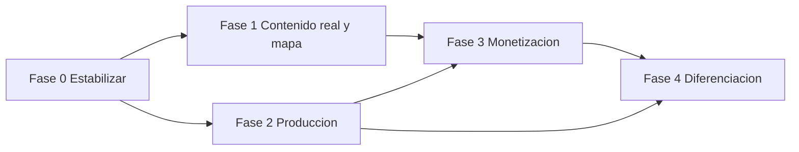

### 32.5 Hoja de ruta en fases

La hoja de ruta fija el **orden** y las **dependencias**. No contiene fechas ni costos, porque no hay datos en el repositorio para estimarlos. En §32.6 se indica qué hace falta para estimar.

| Fase | Objetivo | Incluye | Criterio de salida |
|---|---|---|---|
| **0. Estabilizar** | Dejar el producto consistente antes de sumar contenido. | P1-2 (regex del correo), P0-2 (identidad nativa), P1-10 (higiene y `public/robots.txt`), P2-7, cerrar los ⚠️ de bajo costo (fila 12 de §31.3: máximo 2 AdSlot; `slot.route`), primeros tests de las rutas críticas. | `pnpm typecheck` y `pnpm build` sin errores en cliente y servidor. Identidad `com.leonidapp.companion` en Android e iOS. |
| **1. Contenido real y mapa** | Que el producto tenga datos verificables y un mapa usable. | P0-3 (coordenadas y pines reales, coleccionables, más vehículos y armas), P0-4 (retirar o licenciar imágenes de terceros), P1-3 (noticias oficiales), P1-9 (limpiar foro de ejemplo), P1-5 (almacén de imágenes). | Mapa con marcadores reales. Ninguna imagen de origen dudoso en `public/assets`. Más de una fuente oficial en noticias. |
| **2. Producción** | Poner el sistema en línea de forma repetible y segura. | P1-1 (CI, hosting, MongoDB gestionado, backups, monitoreo, dominio y HTTPS), P0-5 (sesión, OAuth, SMTP, SUPER_ADMIN real), P1-6 (moderación), P1-7 (fuentes de noticias en Control Total). | URL pública con HTTPS. Login de los 4 proveedores operativo. Despliegue y restauración de copia ensayados. |
| **3. Monetización** | Que la publicidad pueda generar ingresos con consentimiento. | P1-4 (consentimiento), P0-1 (carga del proveedor, lectura del consentimiento, `publisher_id`, slots). | Anuncios solo tras consentimiento, máximo 2 por página, sin presencia en mapa, hub ni entrar. |
| **4. Diferenciación** | Funciones que distinguen al producto. | P1-8 (hreflang y búsqueda), P2-1 a P2-6 y P2-8. | A definir con el propietario según lo que revele la comparación de §33. |

### 32.6 Qué datos hacen falta para estimar plazos y costos

| Dato necesario | Para qué |
|---|---|
| Tamaño de contenido objetivo por sección (cuántos pines, vehículos, armas, guías) | Esfuerzo de la Fase 1. Se puede derivar de §33 una vez decidido el objetivo. |
| Procedencia legítima del contenido y quién lo captura (propietario, comunidad, material oficial) | Fase 1: horas de captura y verificación. |
| Origen y licencia de la cartografía del mapa | Fase 1 y P2-3. |
| Proveedor de hosting y de base de datos elegidos, tráfico esperado | Costo recurrente y esfuerzo de la Fase 2. |
| Proveedor de anuncios y requisitos de aprobación | Fase 3. |
| Disponibilidad y número de personas que trabajarán en el proyecto | Convertir esfuerzo relativo (S/M/L) en tiempo. |
| Decisión sobre idiomas (solo español, o contenido traducido) | `hreflang` y alcance del contenido. |
| Cuentas de tiendas (Apple y Google) y política de publicación | P0-2 y Fase 4. |

## 33. Matriz de comparación con un sitio de referencia (GTABase)

Esta matriz sirve para que el propietario compare función a función y dato a dato. Los conteos de GTABase son **conteos de URLs medidos el 2026-11-18** en el repositorio de medición `C:\Users\JuaneSnkrs\Documents\FireCrawl` (README y reportes), para el universo de páginas de entidad de GTA VI en inglés. **No se verificaron contra el sitio al redactar este documento.** El sitio de referencia está activo desde 2014.

### 33.1 (a) Matriz por sección de contenido

Un conteo de URLs no equivale a un conteo de fichas únicas (puede incluir variantes), y las taxonomías de ambos productos no coinciden. Por eso la cobertura solo se calcula donde la comparación es válida.

| Sección (GTABase) | URLs medidas | Equivalente en LeonidApp | Cantidad actual en LeonidApp | Cobertura | Brecha |
|---|---:|---|---:|---|---|
| Vehículos | 338 | Módulo `vehiculos` | 20 | ≈ 5,9 % (20 de 338), **referencial**: asume que cada URL es un vehículo distinto (❓) | Faltan unos 318 vehículos si la equivalencia es válida. |
| Armas | 60 | Módulo `armas` | 12 | ≈ 20 % (12 de 60), **referencial** (mismo supuesto) | Faltan unas 48. |
| Misiones | 118 | Guías de categoría «Misión Principal» (dentro del módulo `guias`) | 11 | **No comparable**: son guías mezcladas con otras categorías, no fichas de misión. Ver nota 1. | Sin ficha de misión estructurada. |
| Personajes | 46 | Guías de categoría «Personajes» | 14 | **No comparable**: ver nota 1. | Sin ficha de personaje. |
| Animales | 48 | Sin módulo | 0 | 0 % | Sección inexistente. |
| Extraños | 21 | Sin módulo | 0 | 0 % | Sección inexistente. |
| Misiones secundarias | 16 | «Actividades» dentro de guías (3), sin equivalencia garantizada | 3 | **No comparable**: ver nota 1. | Sin ficha de misión secundaria. |
| Propiedades | 6 | «Negocios» del módulo `mapa` (43), sin equivalencia garantizada | 43 | **No comparable**: ver nota 2. | Sin ficha de propiedad comprable. |
| Emisoras de radio | 16 | Módulo `radio` (inactivo) | 0 | 0 % | Módulo sin contenido. |
| Banda sonora | 2 | Sin módulo | 0 | 0 % | Sección inexistente. |
| Pandillas | 3 | Sin módulo | 0 | 0 % | Sección inexistente. |
| Coleccionables | No medido en el universo de entidades | Módulo `coleccionables` | 0 | No aplica | Módulo activo sin contenido. |
| Mapa y localizaciones | Sin entidades enumerables por URL | Módulo `mapa` (138 lugares) y 0 marcadores | 138 / 0 | **No comparable** | Ver nota 2. |

**Nota 1. Las guías no son fichas de entidad.** El módulo `guias` tiene 57 entradas (Sistemas 15, Personajes 14, Misión Principal 11, Teléfono y Apps 8, Actividades 3, Tiendas 2, Talleres 2 y otras), que mezclan sistemas del juego con personajes y misiones. Son artículos de guía, no fichas con atributos comparables.

**Nota 2. Las 138 entidades de `mapa` son lugares, no pines.** Se reparten así: Negocios 43, Ciudades y Barrios 25, Puntos de Interés 22, Islas y Cayos 18, Aguas 16, Condados 14. Tienen texto y categoría, pero **ninguna tiene coordenadas**. Hoy hay 0 marcadores (`mapmarkers`). No equivalen a una enumeración de localizaciones de GTABase.

**Contenido total de LeonidApp hoy:** 227 entidades en 4 módulos con datos (mapa 138, guías 57, vehículos 20, armas 12) más 3 módulos vacíos (coleccionables, foro como módulo, radio). Los 6 hilos de foro y 9 posts son de ejemplo. Hay 1 noticia.

#### Nivel de detalle por ficha

| Aspecto | LeonidApp (verificado en el modelo) | Ficha típica de referencia (a completar por el propietario al comparar) | Brecha |
|---|---|---|---|
| Campos fijos de la entidad | `titulo`, `subtitulo`, `categoria`, `imagen_url` (una sola imagen), `slug`, `created_at` (`server/src/models/Entity.ts:34-47`) | ❓ no medido | Sin galería de varias imágenes por ficha. |
| Estadísticas | `stats_json`, un objeto libre con valores de 0 a 100. El importador convierte las puntuaciones 0 a 10 del juego a esa escala y conserva el valor exacto en `metadata_json.stats_juego` | Para vehículos suelen figurar velocidad, aceleración, frenado, manejo y precio. Para armas: daño, cadencia, alcance, cargador, precio. ❓ **No verificado en GTABase**; es la expectativa del dominio. | Las estadísticas de LeonidApp son relativas (0 a 100), no cifras absolutas con unidades. No hay campos de precio. |
| Metadatos | `metadata_json`, objeto libre: `fuente`, `confianza` (alta, media, baja), `evidencia` | ❓ | Los metadatos no tienen esquema por tipo, por lo que no hay campos garantizados (precio, clase, ubicación de compra). |
| Procedencia y confianza | Cada ficha importada indica fuente `grabacion`, nivel de confianza y evidencia (sesión y marca de tiempo). En el catálogo importado: confianza alta 154, media 63, baja 8 (225 fichas) | ❓ | Es un rasgo propio: transparencia de la fuente. Pero las fichas dependen de grabaciones de stream, no de material oficial verificado (procedencia legítima: ver §33.3). |
| Enlaces entre secciones | Ficha a mapa (`?marker=`), a foro (hasta 5 hilos) y a guías que la mencionan | ❓ | Los enlaces a mapa no funcionan sin marcadores. |
| Comparador | 2 a 3 entidades del mismo módulo | ❓ | Solo útil con más vehículos y armas. |

> ⚠️ **Brecha:** las cifras de cobertura (5,9 % y 20 %) son **orientativas**. Solo valen si cada URL de GTABase equivale a un vehículo o arma distintos y si las 20 y 12 fichas de LeonidApp están dentro de ese universo. Ninguno de los dos supuestos está verificado.

### 33.2 (b) Matriz por función del producto

Estado de LeonidApp: ✅ implementado · 🟡 parcial · ❌ no implementado · ❓ no verificado. Las columnas **Referencia (completar)** y **Notas** están vacías a propósito para que las rellene el propietario al comparar a mano.

| Función | Estado en LeonidApp | Detalle verificado | Referencia (completar) | Notas |
|---|---|---|---|---|
| Mapa interactivo con pines | 🟡 | Capas, búsqueda, zoom con rueda y pellizco, completado. Lienzo SVG vectorial, no mapa de alta resolución. **0 marcadores hoy.** | | |
| Capas del mapa y filtros por región | 🟡 | Capas y `?region&marker`. El filtro de la API solo filtra por región. | | |
| Comparador | ✅ | 2 a 3 entidades del mismo módulo, `noindex`. Útil solo con datos suficientes. | | |
| Buscador global | ❌ | Solo búsqueda dentro del mapa. `/catalogo?q=` no está implementado. | | |
| Filtros del catálogo | ✅ | Rejilla con filtro por módulo y categoría y comparador. | | |
| Ficha con galería de imágenes | 🟡 | Ficha con una sola `imagen_url`. Sin galería. | | |
| Estadísticas con unidades y precios | ❌ | `stats_json` de 0 a 100, sin campos de precio. | | |
| Noticias | 🟡 | Solo fuentes oficiales (pilar 3). Solo Take-Two IR se ingiere. 1 noticia. | | |
| Foro | 🟡 | Categorías, hilos contextuales, respuestas, votos, spoiler y muro de registro. Sin «reportar» ni «ocultar». Datos de ejemplo. | | |
| Guías | ✅ | 57 guías con checklists, «En esta guía» y enlaces cruzados. | | |
| Progreso y seguimiento | 🟡 | Porcentaje global, completado por entidad y marcador, rutas sugeridas. Sin racha ni notificaciones. | | |
| Cuenta y sincronización | 🟡 | Modo invitado en IndexedDB y fusión con la nube (última escritura gana). OAuth y Magic Link requieren credenciales y SMTP. | | |
| Aportes de la comunidad | 🟡 | Aportes con aprobación automática según rol. Sin subida de imágenes (solo URL). | | |
| Panel de administración | ✅ | Herramientas para catálogo, mapa, foro y auditoría. Control Total solo para SUPER_ADMIN. Sin gestión de fuentes de noticias. | | |
| Moderación | 🟡 | Fijar y borrar hilos, revisar aportes. Sin ocultar ni reportar. | | |
| App móvil (iOS y Android) | 🟡 | Proyectos Capacitor existentes, pero con la identidad heredada y sin deep link funcional. | | |
| Modo sin conexión | 🟡 | Caché de progreso y datos semilla embebidos. Sin service worker. | | |
| Idiomas | 🟡 | Selector es/en con cookie. `<html lang>` fijo. Sin `hreflang`. ❓ Alcance real de la traducción. | | |
| SEO y datos estructurados | ✅ | SSR-lite, sitemap, JSON-LD, canonical y Open Graph. Faltan `hreflang` y SearchAction funcional. | | |
| Rendimiento | ❓ | Bundle de 495 kB (146 kB gzip). Tiempo de carga sin medir. | | |
| Monetización | ❌ | Hueco de anuncio sin script de proveedor. `ads_enabled=false`. | | |
| Trucos (cheats) | ❌ | No hay módulo. | | |
| Radio | ❌ | Módulo `radio` existe pero está inactivo y vacío. | | |
| Coleccionables | ❌ | Módulo activo con 0 entradas. | | |
| Accesibilidad | ❓ | Objetivos táctiles de 44 px, `prefers-reduced-motion`, Modal accesible. Contraste AA sin verificar. | | |
| Footer institucional y legales | ✅ | RockstarFooter con Contact, Subscribe, cookies y avisos. | | |
| Notificaciones y retención | ❌ | Sin notificaciones ni racha. | | |
| Historial de versiones / cambios del juego | ❓ | No consta en los inventarios. | | |

### 33.3 (c) Cómo hacer la comparación de forma limpia

#### Método de revisión manual lado a lado

1. Abra ambos sitios en dos ventanas, una al lado de la otra, con la misma sección (por ejemplo, Vehículos).
2. Rellene primero la columna «Referencia (completar)» de §33.2 solo con **observaciones de función** (qué permite hacer el sitio), no con contenido.
3. Para cada sección de §33.1, anote cuántas fichas ve y qué campos tiene cada ficha. Compare después con el nivel de detalle de LeonidApp.
4. Anote en «Notas» cualquier diferencia de estructura que sea una decisión de producto y no un defecto.
5. Ordene las brechas con los criterios P0, P1 y P2 de §32 y decida qué entra en el alcance. Con eso se pueden estimar plazos (§32.6).

#### Qué se puede comparar

| Sí se puede comparar | Ejemplos |
|---|---|
| Hechos y datos de juego | Nombres, clases, categorías, precios, estadísticas, cantidad de entidades por sección. |
| Estructura y funciones | Qué filtros hay, si existe galería, si hay comparador, cómo se organizan las secciones. |
| Rendimiento y SEO visibles | Tiempos de carga percibidos, presencia de datos estructurados. |

#### Qué NO se debe copiar

| No copiar | Motivo |
|---|---|
| Textos, descripciones y guías | Son obras protegidas del sitio de referencia. |
| Imágenes y capturas | Son obras protegidas. Ver P0-4. |
| Mapas y sus marcadores | Son obras protegidas y su compilación es trabajo del sitio. |
| La estructura exacta de las fichas y su maquetación | Evitar la apariencia de copia. |

**Fuentes legítimas** para completar LeonidApp: el propio juego (capturas y datos propios), material oficial del editor (por ejemplo, avisos de prensa publicados) y aportes de la comunidad con consentimiento. Registrar siempre la procedencia de cada dato, como ya hace el importador con `fuente`, `confianza` y `evidencia`.

> ⚠️ **Brecha:** el catálogo actual se obtuvo analizando grabaciones de stream por fotogramas (por la evidencia de cada ficha). El proceso de extracción no está en el repositorio (❓ no verificado). Conviene confirmar que las grabaciones se pueden usar como fuente.

#### Diferenciadores potenciales de LeonidApp

Son rasgos que existen o están diseñados en LeonidApp. **No se afirma nada sobre si GTABase los tiene o no**, porque no se midió.

| Rasgo | Estado | Observación |
|---|---|---|
| Noticias solo de fuentes oficiales | 🟡 | Definido como pilar. Hoy solo hay una fuente ingerida. |
| Procedencia y nivel de confianza por ficha | ✅ | `fuente`, `confianza` y `evidencia` en `metadata_json`. |
| Aportes de la comunidad con aprobación automática según rol | ✅ | Con auditoría de cada promoción. |
| Progreso con modo invitado y sincronización | ✅ | Sin bloqueos de login. |
| Foro contextual enlazado a fichas y pines | ✅ | Con datos de ejemplo hoy. |
| App con la misma interfaz en escritorio y móvil | 🟡 | Dock de 5 ítems. Identidad nativa pendiente. |
| Comparador NUI | ✅ | De 2 a 3 entidades. |
| SEO con SSR-lite y datos estructurados | ✅ | Sin servidor de renderizado completo. |

## 34. Glosario

| Término | Definición |
|---|---|
| **NUI** | Interfaz natural: estilo visual y de interacción propio del producto (Vice Sunset NUI), con vidrio translúcido, degradados y objetivos táctiles amplios. |
| **Vice Sunset** | Paleta de atardecer del producto: degradado morado, rosa y naranja que define el aspecto de la interfaz. |
| **HUD** | Panel flotante sobre la pantalla, como los de un videojuego; aquí son los paneles de vidrio sobre el mapa. |
| **Glassmorphism** | Efecto de vidrio esmerilado: fondo translúcido y desenfocado con borde cálido. |
| **Zero Bloat** | Regla del proyecto: no instalar librerías ni crear archivos que no estén aprobados. |
| **SSR-lite** | Técnica en la que el servidor inserta título, descripción y datos estructurados en la página antes de enviarla, sin renderizar toda la aplicación; ayuda a los buscadores. |
| **SEO** | Optimización para motores de búsqueda: hacer que las páginas aparezcan en Google. |
| **JSON-LD** | Bloque de datos dentro de la página que describe su contenido a los buscadores (artículo, ficha, migas de pan). |
| **Sitemap** | Archivo `sitemap.xml` que lista las URL del sitio para los buscadores. |
| **Canonical** | Etiqueta que indica cuál es la URL oficial de una página para evitar duplicados. |
| **hreflang** | Etiqueta que indica a los buscadores qué versión de una página corresponde a cada idioma. |
| **SearchAction** | Dato estructurado que anuncia un buscador interno del sitio a Google. |
| **Open Graph** | Etiquetas que controlan cómo se ve un enlace al compartirlo en redes. |
| **History API** | Mecanismo del navegador que permite URL limpias (`/mapa`) sin recargar la página ni usar un enrutador externo. |
| **SPA** | Aplicación de una sola página: el navegador carga una vez y cambia de pantalla sin recargar. |
| **301** | Redirección permanente: avisa de que una URL cambió de dirección para siempre. |
| **RBAC** | Control de acceso por roles: lo que puede hacer cada usuario depende de su rol (GUEST, USER, MODERATOR, ADMIN, SUPER_ADMIN). |
| **GUEST** | Visitante sin sesión; no se guarda en la base de datos. |
| **SUPER_ADMIN** | Rol máximo; gestiona roles, módulos, moderación y configuración desde el panel Control Total. |
| **OAuth2** | Estándar para iniciar sesión con una cuenta de otro servicio (Google, Discord, Apple). |
| **PKCE** | Refuerzo de OAuth que evita que un tercero use el código de acceso interceptado. |
| **Magic Link** | Enlace de un solo uso enviado por correo para entrar sin contraseña. |
| **JWT** | Testigo firmado que prueba la identidad de una sesión; aquí viaja dentro de una cookie. |
| **Cookie HttpOnly** | Cookie que el código de la página no puede leer, lo que protege el testigo de sesión. |
| **CSRF** | Ataque en el que otra web hace que su navegador envíe peticiones en su nombre; se mitiga comprobando el origen. |
| **Deep link** | Enlace que abre directamente la app móvil (`leonidapp://`). |
| **Rate limit** | Tope de peticiones por tiempo para evitar abusos. |
| **API REST** | Conjunto de direcciones del servidor con las que el cliente pide o envía datos. |
| **DTO** | Objeto con la forma exacta de los datos que se envían o reciben, sin campos internos. |
| **Zod** | Librería que valida que los datos tengan la forma esperada. |
| **Mongoose** | Librería que define y usa las colecciones de MongoDB desde Node. |
| **MongoDB** | Base de datos de documentos; es el único almacén de datos del proyecto. |
| **Colección** | Equivalente a una tabla en MongoDB. |
| **Mixed** | Tipo de campo de Mongoose que admite cualquier estructura; `stats_json` y `metadata_json` lo usan. |
| **Índice** | Estructura de la base de datos que acelera consultas o impone unicidad. |
| **Upsert** | Operación que actualiza un registro si existe o lo crea si no. |
| **LWW (última escritura gana)** | Regla de fusión: si hay dos versiones de un dato, se queda la más reciente. |
| **Idempotente** | Que repetir la operación produce el mismo resultado, sin duplicar datos. |
| **Seed (semilla)** | Datos de ejemplo cargados al inicio para que la app tenga contenido. |
| **Entity (entidad)** | Ficha de contenido del catálogo (vehículo, arma, lugar o guía). |
| **Módulo** | Sección activable del producto (mapa, armas, vehículos, guías, foro, coleccionables, radio). |
| **MapMarker (marcador)** | Pin con coordenadas sobre el mapa; hoy hay 0. |
| **Submission (aporte)** | Propuesta de un usuario (marcador, ficha o corrección) o mensaje de contacto o suscripción. |
| **Promote (promoción)** | Convertir un aporte aprobado en dato real del catálogo o del mapa. |
| **Aprobación automática** | Regla por la que un aporte de un MODERATOR o superior se publica sin revisión adicional, con registro de auditoría. |
| **AuditLog** | Registro de las acciones sensibles realizadas (quién y qué). |
| **Worker de noticias** | Proceso que consulta periódicamente las fuentes oficiales y guarda las noticias. |
| **Fuente oficial** | Sitio de Rockstar Games o Take-Two; el único origen permitido de noticias. |
| **Fastify** | Marco de servidor web de Node que aloja la API. |
| **Vite** | Herramienta que compila y sirve el cliente en desarrollo. |
| **Zustand** | Librería para guardar el estado de la interfaz (sesión, ruta, progreso). |
| **TanStack Query** | Librería para pedir datos al servidor y guardarlos en caché. |
| **IndexedDB** | Almacén del navegador donde se guarda el progreso sin conexión. |
| **Offline-first** | Diseño en el que la app funciona primero con datos locales y sincroniza después. |
| **Service worker** | Programa del navegador que permite funcionar sin conexión; aún no existe en el proyecto. |
| **Capacitor** | Herramienta que empaqueta la web como app para iOS y Android. |
| **BottomDock** | Barra inferior fija de 5 ítems: Hub, Mapa, Catálogo, Foro y Aportar. |
| **BottomSheet** | Panel que se desliza desde abajo en móvil. |
| **Modal** | Ventana emergente que bloquea el resto de la pantalla hasta cerrarse. |
| **ViceShell** | Estructura común de página: cabecera, contenido y dock. |
| **PalmButton** | Botón de acción principal con degradado y siluetas de palmeras. |
| **RockstarFooter** | Pie de página institucional negro con contacto, suscripción, idioma, cookies y legales. |
| **StatBar** | Barra que muestra una estadística de una ficha. |
| **TipCard** | Tarjeta de consejo rotativo en la portada. |
| **AdSlot** | Hueco reservado en una página para un anuncio; hoy no carga ningún anuncio. |
| **CLS** | Salto de diseño: cuánto se mueve el contenido mientras carga; un hueco de tamaño fijo lo evita. |
| **Consentimiento de cookies** | Elección del usuario sobre qué cookies no esenciales permite; se guarda en `leonidapp_consent`. |
| **Safe area** | Zona de pantalla libre de muescas y barras del sistema en móviles. |
| **Typecheck / build** | Comprobaciones automáticas de tipos y de compilación que deben pasar sin errores antes de avanzar de fase. |
| **CI** | Integración continua: ejecución automática de pruebas y compilación en cada cambio; hoy no existe. |
| **Gitflow** | Método de trabajo con ramas `feature/*`, `develop` y `main`, con integración por Pull Request. |
| **Conventional Commits** | Formato de mensajes de commit (`feat:`, `fix:`, `ui:`, `chore:`, `docs:`). |
| **Graphify** | Herramienta que genera un grafo de conocimiento del código para consultarlo. |
| **Divergente / Parcial** | Estados de esta auditoría: lo implementado difiere del documento / cumple solo una parte. |
